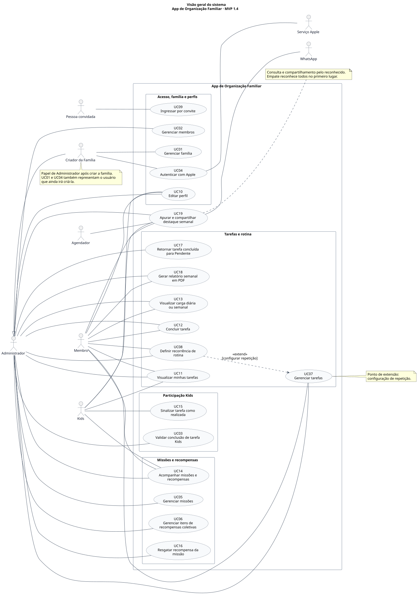
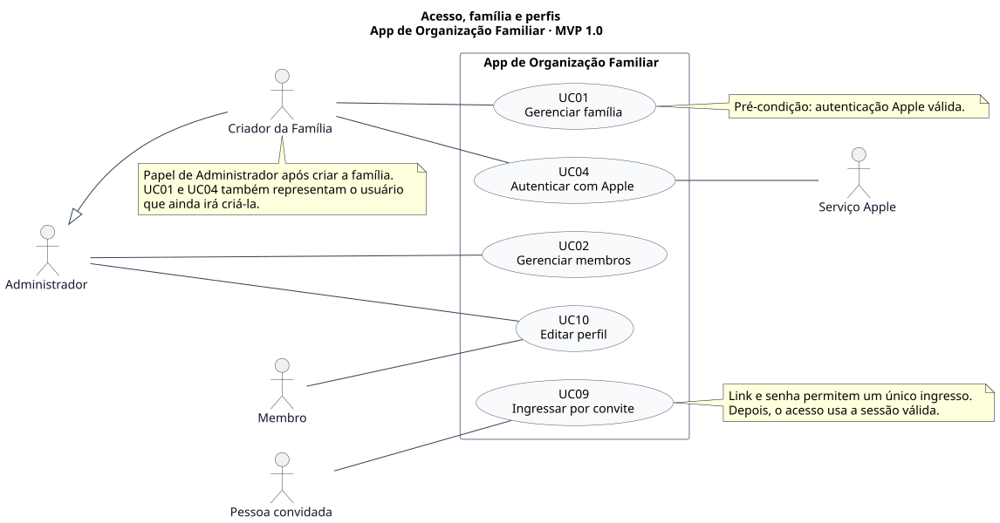
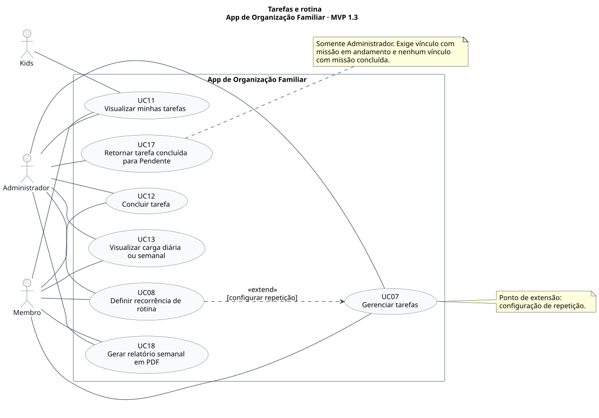
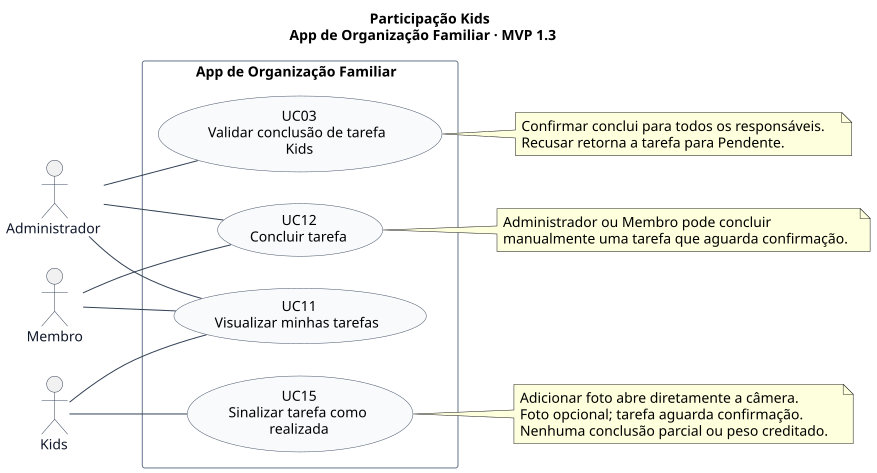
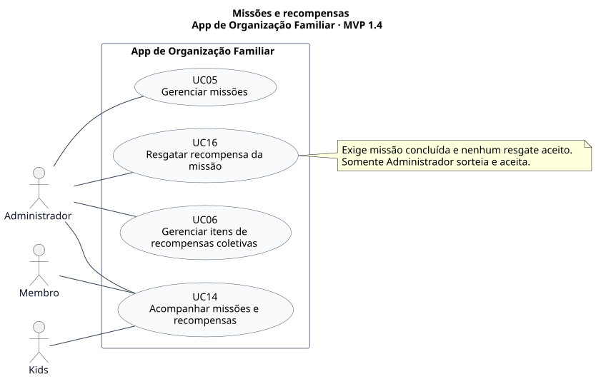

# Diagramas de caso de uso

**Projeto:** App de Organização Familiar — MVP  
**Versão de referência:** 1.0  
**Data:** 2026-10-01  
**Situação:** complemento visual da base documental

[Projeto](../README.md) · [Visão do produto](00-visao-do-produto.md) · [Índice documental](DOCUMENTACAO.md) · [Regras](01-regras-de-negocio.md) · [Requisitos](02-requisitos.md) · [Especificação dos casos de uso](03-casos-de-uso.md)

Os cinco diagramas representam os 17 casos de uso da versão 1.0. Os códigos, nomes e permissões seguem a especificação textual, que continua sendo a referência para pré-condições, fluxos, exceções e resultados. A visão geral reúne todo o escopo; os recortes permitem ler cada área em maior detalhe. Casos repetidos em mais de um desenho têm o mesmo significado.

## Como ler

- **Bonequinho:** ator humano ou sistema externo que participa do caso de uso.
- **Elipse:** caso de uso identificado pelo código UC e pelo nome vigente.
- **Retângulo do aplicativo:** limite do sistema. Os atores ficam fora dele; os agrupamentos internos organizam a leitura, sem definir arquitetura ou telas.
- **Linha contínua:** participação de um ator; não indica ordem de execução.
- **Seta com triângulo vazio:** generalização. O Criador da Família herda as participações do Administrador após a criação, com as restrições próprias descritas nas regras. Não constitui um quarto perfil. Em UC01 e UC04, o papel também abrange a pessoa que ainda irá criar a família.
- **Seta tracejada `«extend»`:** comportamento opcional que aponta para o caso base. UC08 estende UC07 no ponto “configuração de repetição”, quando o usuário decide configurá-la.
- **Nota:** condição relevante para interpretar o desenho; as regras completas continuam nos documentos vinculados.

Não há relação `«include»` nesta representação: autenticação válida é pré-condição de UC01, sem exigir nova autenticação em cada execução. Sinalizar, validar e concluir manualmente são objetivos separados, executados em momentos diferentes. O resgate também tem sua própria pré-condição, sem ser uma etapa obrigatória da consulta de missões. A ausência de setas entre esses casos não elimina suas dependências de estado.

Administrador e Membro têm associações explícitas; não foi criada uma herança entre esses perfis. “Adulto” permanece apenas o termo coletivo usado na especificação. O Criador está explícito nas visões geral e de acesso; nos demais recortes, suas participações são cobertas pelo papel Administrador.

## Índice

- [Visão geral do sistema](#01-visao-geral)
- [Acesso, família e perfis](#02-acesso-familia-perfis)
- [Tarefas e rotina](#03-tarefas-rotina)
- [Participação Kids](#04-participacao-kids)
- [Missões e recompensas](#05-missoes-recompensas)

<a id="01-visao-geral"></a>

## Visão geral do sistema

Mapa completo dos 17 casos de uso, agrupados por área. Por ser maior, abra o SVG para ampliar; os diagramas seguintes oferecem recortes para leitura cotidiana.



[Abrir SVG](diagramas/casos-de-uso/01-visao-geral.svg) · [Fonte PlantUML](diagramas/casos-de-uso/01-visao-geral.puml)

| Caso de uso | Especificação |
|---|---|
| [UC01](03-casos-de-uso.md#uc01) | Gerenciar família |
| [UC02](03-casos-de-uso.md#uc02) | Gerenciar membros |
| [UC03](03-casos-de-uso.md#uc03) | Validar conclusão de tarefa Kids |
| [UC04](03-casos-de-uso.md#uc04) | Autenticar com Apple |
| [UC05](03-casos-de-uso.md#uc05) | Gerenciar missões |
| [UC06](03-casos-de-uso.md#uc06) | Gerenciar itens de recompensas coletivas |
| [UC07](03-casos-de-uso.md#uc07) | Gerenciar tarefas |
| [UC08](03-casos-de-uso.md#uc08) | Definir recorrência de rotina |
| [UC09](03-casos-de-uso.md#uc09) | Ingressar por convite |
| [UC10](03-casos-de-uso.md#uc10) | Editar perfil |
| [UC11](03-casos-de-uso.md#uc11) | Visualizar minhas tarefas |
| [UC12](03-casos-de-uso.md#uc12) | Concluir tarefa |
| [UC13](03-casos-de-uso.md#uc13) | Visualizar carga semanal |
| [UC14](03-casos-de-uso.md#uc14) | Acompanhar missões e recompensas |
| [UC15](03-casos-de-uso.md#uc15) | Sinalizar tarefa como realizada |
| [UC16](03-casos-de-uso.md#uc16) | Resgatar recompensa da missão |
| [UC17](03-casos-de-uso.md#uc17) | Retornar tarefa concluída para Pendente |

<a id="02-acesso-familia-perfis"></a>

## Acesso, família e perfis

Distingue a entrada do Criador via Apple, o ingresso da pessoa convidada e a administração dos perfis. O serviço Apple participa somente da autenticação. Editar o próprio perfil (UC10) difere de gerenciar membros (UC02).



[Abrir SVG](diagramas/casos-de-uso/02-acesso-familia-perfis.svg) · [Fonte PlantUML](diagramas/casos-de-uso/02-acesso-familia-perfis.puml)

| Caso de uso | Especificação |
|---|---|
| [UC01](03-casos-de-uso.md#uc01) | Gerenciar família |
| [UC02](03-casos-de-uso.md#uc02) | Gerenciar membros |
| [UC04](03-casos-de-uso.md#uc04) | Autenticar com Apple |
| [UC09](03-casos-de-uso.md#uc09) | Ingressar por convite |
| [UC10](03-casos-de-uso.md#uc10) | Editar perfil |

<a id="03-tarefas-rotina"></a>

## Tarefas e rotina

Mostra as operações compartilhadas por Administrador e Membro e as consultas permitidas a Kids. O retorno de uma tarefa concluída para Pendente é exclusivo do Administrador, sujeito aos vínculos de missão.



[Abrir SVG](diagramas/casos-de-uso/03-tarefas-rotina.svg) · [Fonte PlantUML](diagramas/casos-de-uso/03-tarefas-rotina.puml)

| Caso de uso | Especificação |
|---|---|
| [UC07](03-casos-de-uso.md#uc07) | Gerenciar tarefas |
| [UC08](03-casos-de-uso.md#uc08) | Definir recorrência de rotina |
| [UC11](03-casos-de-uso.md#uc11) | Visualizar minhas tarefas |
| [UC12](03-casos-de-uso.md#uc12) | Concluir tarefa |
| [UC13](03-casos-de-uso.md#uc13) | Visualizar carga semanal |
| [UC17](03-casos-de-uso.md#uc17) | Retornar tarefa concluída para Pendente |

<a id="04-participacao-kids"></a>

## Participação Kids

Reúne consulta, sinalização Kids, avaliação pelo Administrador e conclusão manual por adulto. As linhas representam participação, sem transformar esses casos em uma sequência obrigatória.



[Abrir SVG](diagramas/casos-de-uso/04-participacao-kids.svg) · [Fonte PlantUML](diagramas/casos-de-uso/04-participacao-kids.puml)

| Caso de uso | Especificação |
|---|---|
| [UC11](03-casos-de-uso.md#uc11) | Visualizar minhas tarefas |
| [UC15](03-casos-de-uso.md#uc15) | Sinalizar tarefa como realizada |
| [UC03](03-casos-de-uso.md#uc03) | Validar conclusão de tarefa Kids |
| [UC12](03-casos-de-uso.md#uc12) | Concluir tarefa |

<a id="05-missoes-recompensas"></a>

## Missões e recompensas

Separa a administração de missões e itens da roleta, a consulta por todos os perfis e o resgate exclusivo do Administrador. Missões não expiram; uma recompensa só é vinculada após aceitação.



[Abrir SVG](diagramas/casos-de-uso/05-missoes-recompensas.svg) · [Fonte PlantUML](diagramas/casos-de-uso/05-missoes-recompensas.puml)

| Caso de uso | Especificação |
|---|---|
| [UC05](03-casos-de-uso.md#uc05) | Gerenciar missões |
| [UC06](03-casos-de-uso.md#uc06) | Gerenciar itens de recompensas coletivas |
| [UC14](03-casos-de-uso.md#uc14) | Acompanhar missões e recompensas |
| [UC16](03-casos-de-uso.md#uc16) | Resgatar recompensa da missão |

## Manutenção

Edite a fonte `.puml` correspondente e regenere os SVGs com PlantUML e Graphviz disponíveis localmente. As imagens desta revisão foram geradas com PlantUML 1.2025.2. A partir da raiz do repositório:

```sh
java -Djava.awt.headless=true -jar /caminho/plantuml.jar -charset UTF-8 -tsvg docs/diagramas/casos-de-uso/*.puml
```

Ao alterar um UC, confira sua presença na visão geral e em todos os recortes listados na especificação. Preserve códigos e nomes, confira as associações dos atores e atualize fonte e imagem juntas. Os SVGs versionados permitem ler as docs sem instalar um renderizador.

## Histórico

| Versão de referência | Data | Alteração |
|---|---|---|
| 1.0 | 2026-10-01 | Complemento visual: visão geral e quatro recortes dos 17 UCs, sem alteração de escopo ou comportamento. |
