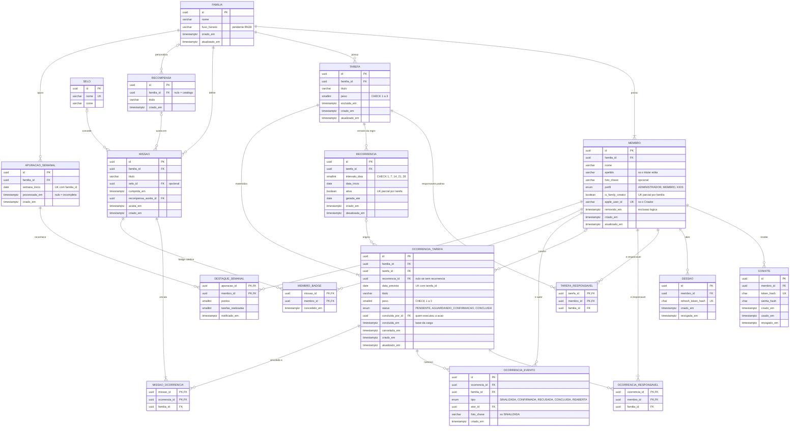

# Modelo de dados (DER)

**Projeto:** App de Organização Familiar — MVP  
**Base funcional:** 1.3  
**Data:** 2026-10-02  
**Situação:** primeira versão para revisão; contém pendências de esclarecimento

[Projeto](../README.md) · [Índice documental](DOCUMENTACAO.md) · [Regras](01-regras-de-negocio.md) · [Requisitos](02-requisitos.md) · [Casos de uso](03-casos-de-uso.md)

Diagrama entidade-relacionamento em Mermaid (renderizado nativamente pelo GitHub). O DER foi auditado contra RN01–RN65, RF01–RF66, RNF01–RNF27 e UC01–UC19.

## Convenções de modelagem

- **Tarefa individual** (RN16, RN35) = `OCORRENCIA_TAREFA`. `TAREFA` é o modelo que a documentação chama de rotina; tarefa única tem uma `TAREFA` e uma ocorrência.
- Carga, progresso e pontos **não são armazenados**: derivam de `concluida_em` e dos responsáveis da ocorrência (RN30, RN57, RNF10). A reabertura desfaz o crédito sem sincronização.
- Faixas e enums viram `CHECK`. Os `familia_id` desnormalizados exigem FK composta `(familia_id, id)` para isolar famílias (RNF06). Sem `ON DELETE CASCADE` em tarefa e ocorrência.

## Diagrama

## Restrições que o diagrama não expressa

| Restrição | Base |
|---|---|
| Um Criador por família (índice único parcial); `apple_user_id` preenchido se e somente se `is_family_creator`; Criador sempre ADMINISTRADOR | RN01, RN05, RN06, RN44 |
| Uma recorrência ativa por tarefa (índice único parcial) | RN17 |
| `status = CONCLUIDA` exige `concluida_por_id` e `concluida_em` | RN22, RNF11 |
| Missão com ao menos uma ocorrência vinculada (transação ou trigger diferido) | RN36, RN50 |
| Missão concluída: vínculos, tarefas vinculadas e dados imutáveis, exceto o registro do resgate | RN58, RNF25 |
| Resgate único: gravar `recompensa_aceita_id` somente `WHERE recompensa_aceita_id IS NULL` | RN53, RNF23 |
| `recompensa_aceita_id` aponta para item do catálogo ou da mesma família | RN42 |
| Badge único por missão e membro (PK de `MEMBRO_BADGE`) | RN64 |
| Um resultado por família e semana (`UK` de `APURACAO_SEMANAL`); resultado só visível com `processada_em` preenchido | RN65, RNF26 |
| Sessão e renovação validam `MEMBRO.removido_em` | RN10, RNF22 |

## Alterações em relação ao DER inicial

- **Incluídos:** `MISSAO_OCORRENCIA`, `MEMBRO_BADGE`, `APURACAO_SEMANAL`, `DESTAQUE_SEMANAL`, `OCORRENCIA_EVENTO`; `CONVITE.senha_hash`; `MEMBRO.apelido` e `MEMBRO.foto_chave`.
- **Corrigidos:** recorrência por `intervalo_dias` (RN14); `concluida_por_id` e `concluida_em` no lugar de `realizada_*` e `validada_*`; `recompensa_aceita_id` e `aceita_em` no lugar de `recompensa_sorteada_id` e `sorteada_em`; relação errada "realizada por" removida.
- **Removidos:** `RECORRENCIA_DIA_SEMANA`, `RECORRENCIA.frequencia` e `data_fim`, `MISSAO.data_inicio` e `data_fim` (missão sem prazo, RN36), `SESSAO.expira_em` (RN47), `CONVITE.expira_em` (documentação não prevê expiração), `FAMILIA_RECOMPENSA` (redundante com `RECOMPENSA.familia_id`).

## Pendências de esclarecimento

1. **Data da tarefa:** o RF07 não diz como se define a data de uma tarefa única nem o início da rotina; o DER assume `data_prevista` e `data_inicio`.
2. **Horizonte de geração:** o UC08 não define até quando as ocorrências são geradas (`gerada_ate`).
3. **Expiração de convite:** não prevista; `CONVITE.expira_em` foi removido. Confirmar.
4. **Reatribuição de tarefa concluída:** alteraria a carga histórica e não é proibida expressamente.
5. **Selos:** definir se são apenas do catálogo do app ou criados pelo Administrador.
6. **Notificação do destaque (UC19):** se for push externo, falta tabela de token de dispositivo.
7. **Fuso horário (RN28) e revisão pós-reabertura (RN65):** pendentes; afetam `FAMILIA.fuso_horario` e o snapshot de `DESTAQUE_SEMANAL`.
8. **Terminologia:** "tarefa" na documentação é a ocorrência do DER e a `TAREFA` do DER é a rotina; a visão e o screen map usam "ocorrência". Falta um glossário.
9. **Badge retroativo:** a RN64 deixa pendente a concessão a membros que entram depois da conclusão.
10. **Convite ativo:** definir se um novo convite invalida o anterior do mesmo membro.
