# Modelo de dados (DER)

**Projeto:** App de Organização Familiar — MVP  
**Versão do modelo:** 1.7 · **Base funcional:** 1.15\
**Data:** 2026-10-10\
**Situação:** modelo conceitual atualizado; sem migrações implementadas

[Projeto](../README.md) · [Índice](DOCUMENTACAO.md) · [Regras](01-regras-de-negocio.md) · [Requisitos](02-requisitos.md) · [Casos de uso](03-casos-de-uso.md) · [Classes](06-diagrama-de-classes.md#classe-familytask) · [Arquitetura mobile](architecture/mobile-architecture.md)

Backend único com PostgreSQL no Supabase. Fotos ficam no R2; o banco armazena sua URL estável privada. O mobile usa a API, sem receber segredos do banco/armazenamento. O diagrama é conceitual; o backend será Node.js/Clean Architecture, conforme a [arquitetura backend](architecture/backend-architecture.md). Os nomes portugueses preservam a terminologia documental; SQL, código e arquivos futuros usam inglês conforme o glossário ao final.

## Convenções de modelagem

- `OCORRENCIA_TAREFA` é a tarefa individual (`FamilyTask`). `TAREFA` é o template; configuração recorrente fica em `RECORRENCIA`. Tarefa única tem template e ocorrência, sem rotina.
- Datas previstas/início são datas civis livres, inclusive antes da criação da família; datas de evento/conclusão são instantes UTC. O carrossel limita consulta, não persistência de datas.
- Carga e progresso são projeções derivadas do estado/crédito vigente. Destaque final é snapshot imutável; badges e participações são concessões persistidas.
- Edições usam última gravação válida, sem precondição de versão do cliente. Transações e unicidade preservam invariantes. Não há tabela geral de idempotência; recuperação de ingresso é um protocolo específico e restrito.
- FKs compostas por família isolam relações. Sem exclusão em cascata que apague histórico ou conquistas. Omissões de índices físicos não dispensam as restrições abaixo.

## Diagrama

```mermaid
erDiagram
    FAMILIA ||--|{ MEMBRO : possui
    FAMILIA ||--o{ ALTERACAO_FUSO : configura
    FAMILIA ||--o{ CICLO_SEMANAL : delimita
    MEMBRO ||--o{ CONVITE : recebe
    MEMBRO ||--o{ SESSAO : acessa
    IDENTIDADE_CRIADOR ||--o| MEMBRO : autentica
    IDENTIDADE_CRIADOR ||--o{ GRANT_CRIACAO : autoriza
    SESSAO ||--o{ TOKEN_ACESSO : emite
    SESSAO ||--o{ DISPOSITIVO_PUSH : registra
    FAMILIA ||--o{ TAREFA : possui
    TAREFA ||--o{ TAREFA_RESPONSAVEL : atribui
    MEMBRO ||--o{ TAREFA_RESPONSAVEL : participa
    TAREFA ||--o{ RECORRENCIA : configura
    TAREFA ||--o{ OCORRENCIA_TAREFA : materializa
    RECORRENCIA |o--o{ OCORRENCIA_TAREFA : origina
    OCORRENCIA_TAREFA ||--o{ OCORRENCIA_RESPONSAVEL : atribui
    MEMBRO ||--o{ OCORRENCIA_RESPONSAVEL : executa
    OCORRENCIA_TAREFA ||--o{ CONCLUSAO : registra
    CONCLUSAO ||--o{ CREDITO_CONCLUSAO : credita
    MEMBRO ||--o{ CREDITO_CONCLUSAO : recebe
    OCORRENCIA_TAREFA ||--o{ OCORRENCIA_EVENTO : audita
    FAMILIA ||--o{ MIDIA : armazena_referencia
    FAMILIA ||--o{ MISSAO : define
    MISSAO ||--|{ MISSAO_OCORRENCIA : vincula
    OCORRENCIA_TAREFA ||--o{ MISSAO_OCORRENCIA : integra
    MISSAO ||--o{ PARTICIPACAO_MISSAO : reconhece
    MEMBRO ||--o{ PARTICIPACAO_MISSAO : conquista
    MEMBRO ||--o{ MEMBRO_BADGE : recebe
    BADGE ||--o{ MEMBRO_BADGE : define_marco
    MEMBRO_BADGE ||--|{ BADGE_PARTICIPACAO : fundamenta
    PARTICIPACAO_MISSAO ||--o{ BADGE_PARTICIPACAO : contribui
    RECOMPENSA |o--o{ MISSAO : aceita_em
    FAMILIA |o--o{ RECOMPENSA : personaliza
    CICLO_SEMANAL ||--o| APURACAO_SEMANAL : apura
    APURACAO_SEMANAL ||--o{ DESTAQUE_SEMANAL : reconhece
    MEMBRO ||--o{ DESTAQUE_SEMANAL : recebe
    DESTAQUE_SEMANAL ||--o| NOTIFICACAO : enfileira

    FAMILIA {
        uuid id PK
        varchar nome
        varchar fuso_horario "default America/Sao_Paulo"
        timestamptz criado_em
        timestamptz atualizado_em
    }
    ALTERACAO_FUSO {
        uuid id PK
        uuid familia_id FK
        uuid administrador_id FK
        varchar fuso_anterior
        varchar novo_fuso
        enum aplicacao "IMMEDIATE, NEXT_CYCLE"
        timestamptz solicitada_em
        timestamptz efetiva_em
        timestamptz aplicada_em "nulo se programada"
        timestamptz substituida_em "historico preservado"
    }
    CICLO_SEMANAL {
        uuid id PK
        uuid familia_id FK
        timestamptz inicio "UK com familia_id"
        timestamptz fim
        varchar fuso_horario
        boolean em_transicao
        date semana_referencia
    }
    MEMBRO {
        uuid id PK
        uuid familia_id FK
        varchar nome
        varchar apelido "edicao pelo titular"
        uuid foto_id FK "MIDIA opcional"
        enum perfil "ADMINISTRATOR, MEMBER, KIDS"
        boolean is_family_creator
        uuid identidade_criador_id FK, UK "somente Criador"
        timestamptz removido_em
        timestamptz criado_em
    }
    IDENTIDADE_CRIADOR {
        uuid id PK
        char apple_subject_hash UK
        bytea apple_subject_protegido
        timestamptz criada_em
    }
    GRANT_CRIACAO {
        uuid id PK
        uuid identidade_criador_id FK
        char token_hash UK
        char prova_instalacao_hash
        timestamptz expira_em
        timestamptz usado_em
    }
    CONVITE {
        uuid id PK
        uuid membro_id FK
        char token_hash UK
        char senha_hash
        timestamptz criado_em
        timestamptz usado_em
        timestamptz revogado_em
    }
    SESSAO {
        uuid id PK
        uuid membro_id FK "UK parcial se ativa"
        uuid instalacao_id
        bytea comprovante_instalacao "verificador ou chave publica"
        char refresh_token_hash UK
        timestamptz criada_em
        timestamptz revogada_em
    }
    TOKEN_ACESSO {
        uuid id PK
        uuid sessao_id FK
        char token_hash UK
        timestamptz criado_em
        timestamptz expira_em "15 minutos"
    }
    DISPOSITIVO_PUSH {
        uuid id PK
        uuid sessao_id FK
        varchar token_protegido
        enum ambiente "DEVELOPMENT, PRODUCTION"
        timestamptz atualizado_em
        timestamptz invalidado_em
    }
    TAREFA {
        uuid id PK
        uuid familia_id FK
        varchar titulo
        smallint peso "1 a 3"
        varchar observacao "opcional; max 250 caracteres"
        timestamptz excluida_em
    }
    TAREFA_RESPONSAVEL {
        uuid tarefa_id PK, FK
        uuid membro_id PK, FK
        uuid familia_id FK
    }
    RECORRENCIA {
        uuid id PK
        uuid tarefa_id FK
        smallint intervalo_dias "1, 7, 14, 21, 28"
        date data_inicio
        boolean ativa
        date gerada_ate
        timestamptz desativada_em
    }
    OCORRENCIA_TAREFA {
        uuid id PK
        uuid familia_id FK
        uuid tarefa_id FK
        uuid recorrencia_id FK "opcional"
        varchar chave_origem "UK com tarefa_id; imutavel"
        date data_origem "slot original imutavel"
        date data_prevista "editavel; sem limite de cadastro"
        varchar titulo "1 a 60 caracteres visiveis"
        smallint peso
        varchar observacao "opcional; max 250 caracteres"
        enum status "PENDING, AWAITING_CONFIRMATION, COMPLETED"
        timestamptz cancelada_em
    }
    OCORRENCIA_RESPONSAVEL {
        uuid ocorrencia_id PK, FK
        uuid membro_id PK, FK
        uuid familia_id FK
    }
    CONCLUSAO {
        uuid id PK
        uuid ocorrencia_id FK
        uuid familia_id FK
        uuid autor_id FK
        enum origem "MANUAL, KIDS_CONFIRMATION"
        uuid confirmada_por_id FK "opcional"
        timestamptz concluida_em
        timestamptz desfeita_em
        uuid desfeita_por_id FK "opcional"
    }
    CREDITO_CONCLUSAO {
        uuid conclusao_id PK, FK
        uuid membro_id PK, FK
        uuid familia_id FK
        smallint peso_vigente
    }
    OCORRENCIA_EVENTO {
        uuid id PK
        uuid ocorrencia_id FK
        uuid familia_id FK
        uuid ator_id FK
        enum tipo "SIGNALED, CONFIRMED, REJECTED, COMPLETED, REOPENED, EDITED"
        uuid sinalizacao_id "correlacao da decisao"
        uuid foto_id FK "MIDIA opcional"
        jsonb dados_anteriores "inclui credito anterior"
        jsonb dados_novos "inclui credito corrigido"
        timestamptz criado_em
    }
    MIDIA {
        uuid id PK
        uuid familia_id FK
        uuid titular_id FK
        varchar url_objeto "URL estavel privada R2; sem segredo"
        enum finalidade "PROFILE_PHOTO, TASK_SIGNAL"
        enum estado "UPLOADING, READY, DELETING, DELETED, FAILED"
        bigint tamanho_bytes
        varchar tipo_conteudo
        timestamptz criado_em
        timestamptz vinculado_em
    }
    MISSAO {
        uuid id PK
        uuid familia_id FK
        varchar titulo
        varchar observacao "opcional, até 250 caracteres"
        timestamptz cumprida_em
        uuid recompensa_aceita_id FK
        varchar recompensa_titulo "snapshot do aceite"
        uuid aceita_por_id FK
        timestamptz aceita_em
    }
    MISSAO_OCORRENCIA {
        uuid missao_id PK, FK
        uuid ocorrencia_id PK, FK
        uuid familia_id FK
    }
    PARTICIPACAO_MISSAO {
        uuid missao_id PK, FK
        uuid membro_id PK, FK
        uuid familia_id FK
        timestamptz registrada_em
    }
    BADGE {
        varchar codigo PK "bronze, silver, gold, diamond"
        int minimo_missoes UK "5, 10, 25, 50"
        varchar icone
    }
    MEMBRO_BADGE {
        uuid id PK
        uuid membro_id FK "UK com badge_codigo"
        varchar badge_codigo FK
        timestamptz concedido_em
    }
    BADGE_PARTICIPACAO {
        uuid membro_badge_id PK, FK
        uuid missao_id PK, FK
        uuid membro_id FK "participacao do mesmo titular"
    }
    RECOMPENSA {
        uuid id PK
        uuid familia_id FK "nulo para catalogo"
        uuid criado_por_id FK "nulo para catalogo"
        varchar titulo
        varchar titulo_normalizado "customizado; trim/case-insensitive"
        varchar descricao "opcional; até 255 caracteres"
        timestamptz criado_em
    }
    APURACAO_SEMANAL {
        uuid id PK
        uuid ciclo_id FK, UK
        timestamptz iniciada_em
        timestamptz processada_em
    }
    DESTAQUE_SEMANAL {
        uuid apuracao_id PK, FK
        uuid membro_id PK, FK
        int pontos
        int tarefas_realizadas
    }
    NOTIFICACAO {
        uuid id PK
        uuid apuracao_id FK "UK com membro_id"
        uuid membro_id FK
        enum estado "PENDING, ACCEPTED_BY_PROVIDER, FAILED"
        int tentativas
        timestamptz proxima_tentativa_em
        timestamptz aceita_pelo_provedor_em
        timestamptz aberta_em "evento separado; opcional"
    }
```

## Restrições que o diagrama não expressa

| Restrição | Base |
|---|---|
| Um Criador por família, sempre Administrador; membro pertence a uma família. Troca de acesso não transfere nem remove perfil anterior | RN01, RN05, RN09, RF68 |
| Uma sessão ativa por perfil, comprovada pela instalação; checar revogação em toda operação. Refresh sem vencimento temporal | RN47, RNF22 |
| Emitir/reenviar convite invalida anteriores e revoga sessão antes de disponibilizar nova credencial; sem prazo temporal de convite | RN46, RF41/54 |
| Uma recorrência ativa por template; origem imutável identifica ocorrência mesmo quando data prevista muda | RN14, RN16/17 |
| No máximo uma conclusão vigente por ocorrência; estado concluído exige conclusão vigente. Zero responsáveis/zero créditos é permitido após edição autorizada | RN17, RN22, RNF11 |
| Correção de concluída atualiza crédito vigente e audita valores antigos na mesma transação; mantém instante de conclusão | RN17, RN30 |
| Reabertura invalida conclusão/créditos uma vez; se reabrir missão concluída, remove recompensa, participações e badges derivados no mesmo commit; exclusão posterior não subtrai novamente | RN57/59 |
| Missão mantém ao menos uma ocorrência, sem selo configurável. Edição/exclusão preservam dados/vínculos, exceto reabertura confirmada de tarefa vinculada | RN36, RN50, RN58 |
| Participação única por membro/missão: exige ao menos um crédito válido em tarefa vinculada no encerramento; é removida quando a missão é reaberta | RN64 |
| Badge por membro/marco é recalculado após reabertura de missão para refletir participações vigentes | RN64 |
| Resgate único e item de catálogo ou da mesma família; reabertura de missão remove o aceite | RN43, RN53, RNF23 |
| Item personalizado: título obrigatório sem controle, até 60 caracteres não-espaço após `trim`; descrição opcional até 255 caracteres contando espaços; `titulo_normalizado` único por família para itens personalizados | RN42, RF34, UC06 |
| Ciclos contíguos, não sobrepostos; transição de fuso não reapura intervalos encerrados. Uma mudança programada vigente por família | RN28, RN65 |
| Uma apuração por ciclo; resultado final imutável. Fila de notificação gravada com resultado, sem confundir aceitação APNs com leitura | RN65, RNF26 |
| Família do recurso, titularidade e estado ativo conferidos no backend; URL de mídia não é permissão de leitura | RNF06/07/24/27 |

A recuperação de ingresso perdido é uma troca de credenciais específica, vinculada à tentativa e prova da instalação original por dez minutos. Seu estado protegido não é histórico de negócio nem tabela geral de idempotência. Não devolver tokens com base apenas em ID público ou permitir reconsumo do convite. Não persistir senha legível permanente para essa recuperação.

Consultas/PDF usam snapshot consistente. Última gravação vence somente entre alterações autorizadas; restrições transacionais não são removidas. A política não depende de campo de versão esperado do cliente.

## Glossário para a implementação em inglês

| Modelo documental | Nome técnico |
|---|---|
| FAMILIA / MEMBRO | `Family` / `Member` |
| TAREFA / RECORRENCIA / OCORRENCIA_TAREFA | `TaskTemplate` / `Routine` / `FamilyTask` |
| CONCLUSAO / CREDITO_CONCLUSAO / OCORRENCIA_EVENTO | `Completion` / `CompletionCredit` / `TaskEvent` |
| ALTERACAO_FUSO / CICLO_SEMANAL | `TimeZoneChange` / `WeeklyCycle` |
| MISSAO / PARTICIPACAO_MISSAO | `Mission` / `MissionParticipation` |
| BADGE / MEMBRO_BADGE / BADGE_PARTICIPACAO | `Badge` / `BadgeAward` / `BadgeContribution` |
| MIDIA / DISPOSITIVO_PUSH / NOTIFICACAO | `MediaAsset` / `PushDevice` / `NotificationDelivery` |
| APURACAO_SEMANAL / DESTAQUE_SEMANAL | `WeeklyHighlight` / `WeeklyRecognition` |

## Decisões incorporadas

As pendências anteriores foram resolvidas: datas livres, horizonte de geração, ausência de expiração temporal de convite, reemissão com revogação, edição de concluída com auditoria, fuso configurável, destaque preservado, participação por crédito, badges cumulativos e sessão única. Não há `SELO` ou `selo_id` na missão; `notificado_em` foi substituído por estados explícitos de notificação. Data prevista editável não é chave de geração. O projeto não implementará rotina própria de backup. Retenção de fotos vinculadas, volumes de teste, distribuição e hospedagem permanecem fora desta etapa. Node.js/Clean Architecture está definido; TypeScript/Fastify são propostas técnicas da arquitetura backend.

## Detalhamento operacional do backend 1.0

A [arquitetura backend](architecture/backend-architecture.md) complementa este modelo com estruturas técnicas; não são novas funcionalidades nem uma API pública de tabelas. Nomes físicos futuros serão em inglês. O schema privado `app` e as credenciais de runtime são acessíveis somente ao backend.

| Estrutura técnica | Dados e invariantes |
|---|---|
| `creator_identities` / `family_creation_grants` | Identidade Apple verificada antes de existir família; grant restrito, temporário, com hash e vínculo à instalação. No máximo um membro Criador por identidade; grant não é convite/sessão de membro |
| `session_access_tokens` | Um hash por access token/validade; vários tokens de 15 minutos podem coexistir sob a mesma sessão. Revogar sessão invalida todos, sem criar múltiplos aparelhos |
| `invite_join_recoveries` | Tentativa e verificadores originais, sessão criada, envelope autenticado criptografado, expiração em dez minutos. Chave fora do banco; nenhuma senha de convite armazenada em claro |
| `background_jobs` | Tipo, chave natural, referências de recurso, estado, próxima tentativa, contador, lease/dono/versão do claim e erro sanitizado; sem payload com credenciais |
| `routine_materialization_state` | Versão vigente, cursor/horizonte e estado de preparação. Origem/tombstones preservados; revalidar versão antes de avançar |
| `media_assets` | Reserva anterior ao upload, URL privada gerada pelo backend, estado/finalidade, tamanho/tipo e vínculo. Nunca armazenar imagem binária no banco |
| `notification_deliveries` | Intenção única ligada à apuração/membro; claim recuperável por job, tentativas, aceitação APNs e abertura distinta |

`appleUserID` do modelo de classes é projeção protegida da identidade do Criador; sua persistência é `creator_identities`, não um campo editável do perfil. Credenciais operacionais possuem limpeza por validade própria; convite e refresh continuam sem expiração temporal. Upload já vinculado não vira órfão automaticamente quando uma foto é substituída.

A versão 1.1 representava somente um access token na sessão. A versão 1.2 separa tokens para admitir requisições/renovações concorrentes do mesmo aparelho, sem alterar RN47. A sessão continua sendo a unidade de revogação e unicidade.

## Histórico

| Versão | Base | Data | Alteração |
|---|---|---|---|
| 1.7 | 1.15 | 2026-10-10 | `RECOMPENSA` ganha autor, descrição opcional e título normalizado; restrição registra limite e unicidade do item personalizado. Para SPEC-015. |
| 1.6 | 1.12 | 2026-10-07 | `MISSAO` ganha `observacao` opcional (até 250 caracteres). Para SPEC-014. |
| 1.5 | 1.11 | 2026-10-07 | Reabertura de missão concluída remove recompensa, participações e badges derivados na mesma transação. |
| 1.4 | 1.8 | 2026-10-06 | `TAREFA` passa a armazenar `observacao` opcional (até 250 caracteres), herdada pelas ocorrências geradas por rotina. Para SPEC-008. |
| 1.3 | 1.7 | 2026-10-06 | `OCORRENCIA_TAREFA` ganha `observacao` opcional (até 250 caracteres). Para SPEC-007. |
| 1.2 | 1.5 | 2026-10-05 | Integração backend: identidade/bootstrap do Criador, tokens subordinados à sessão, origem civil e estados de mídia; armazenamento operacional de jobs/recuperação. |
| 1.1 | 1.5 | 2026-10-05 | Modelo alinhado às decisões consolidadas: Supabase/R2, ciclos/fuso, sessão única, créditos/auditoria, participações/marcos e fila de notificações. |
| 1.0 | 1.3 | 2026-10-02 | Primeiro DER, anterior à consolidação das decisões de arquitetura. |
