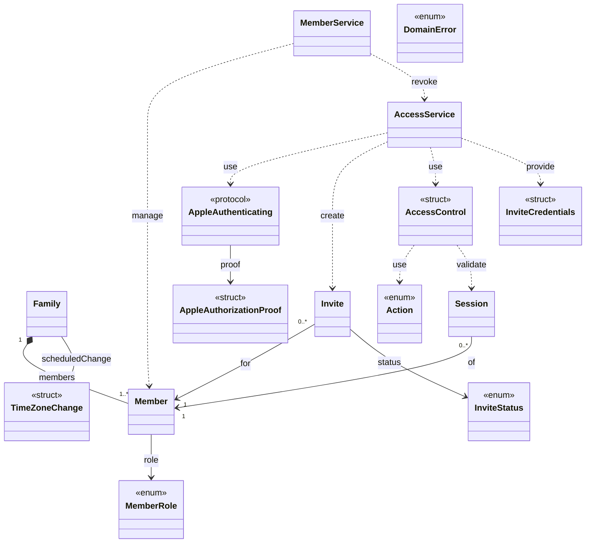
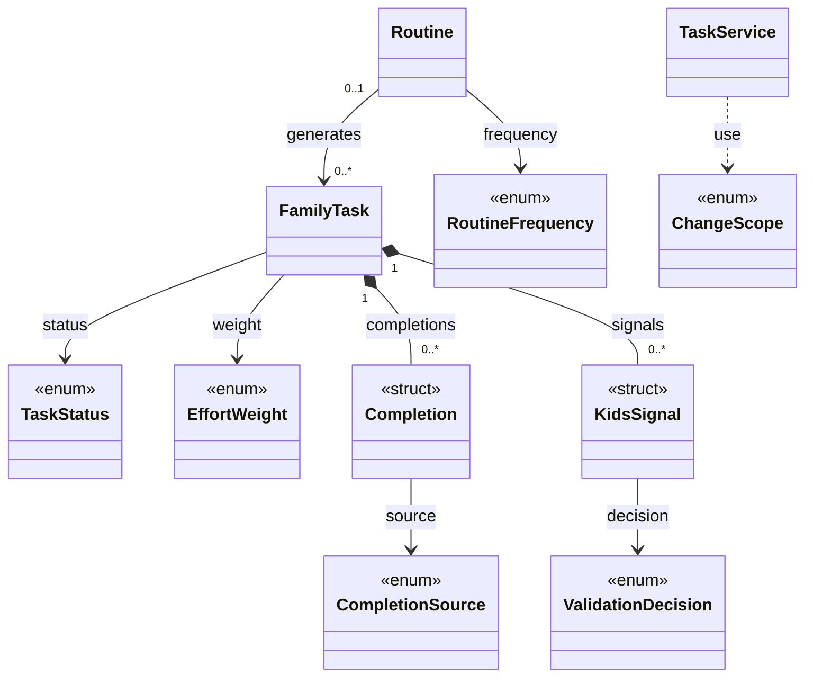
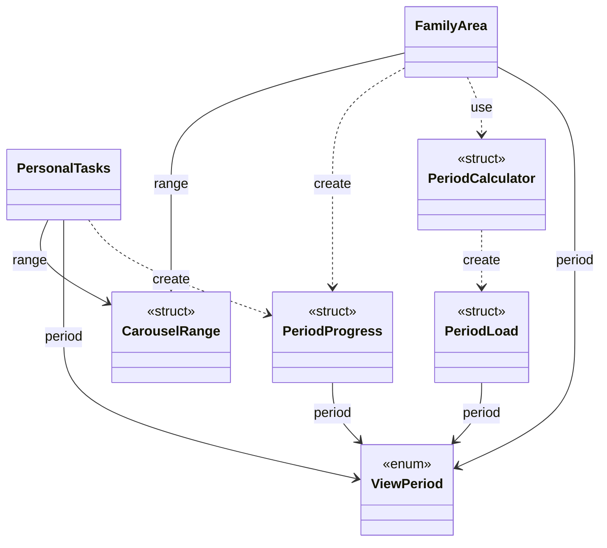
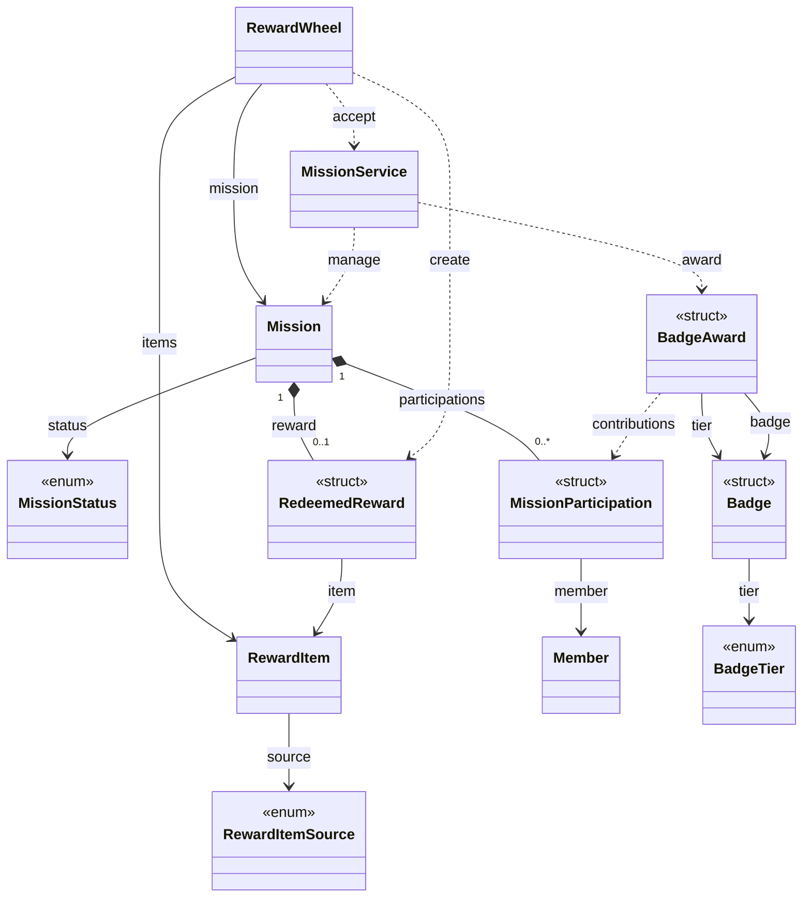
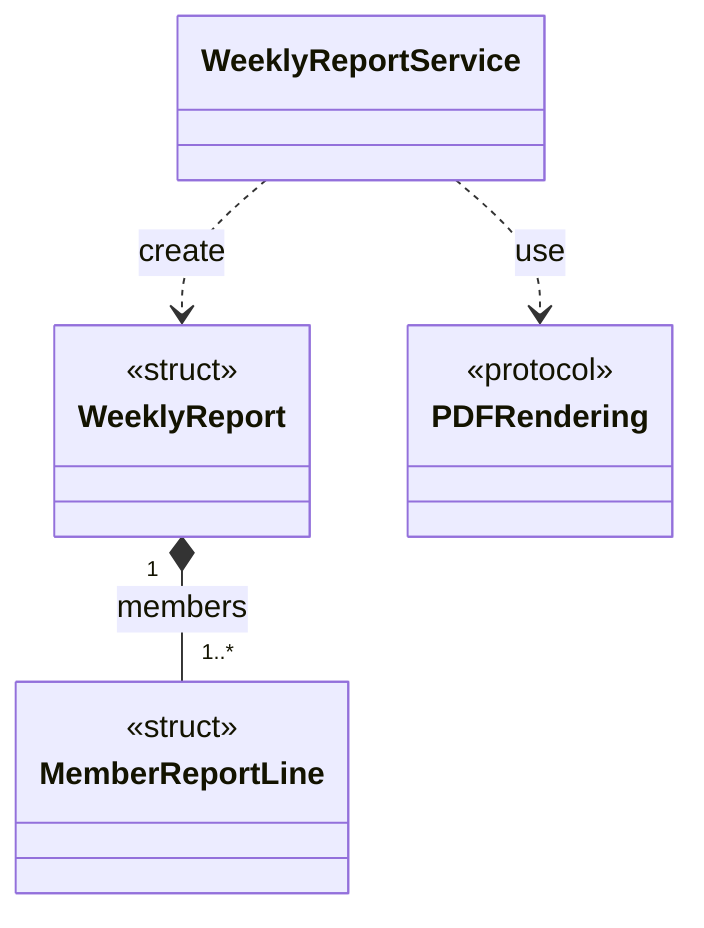
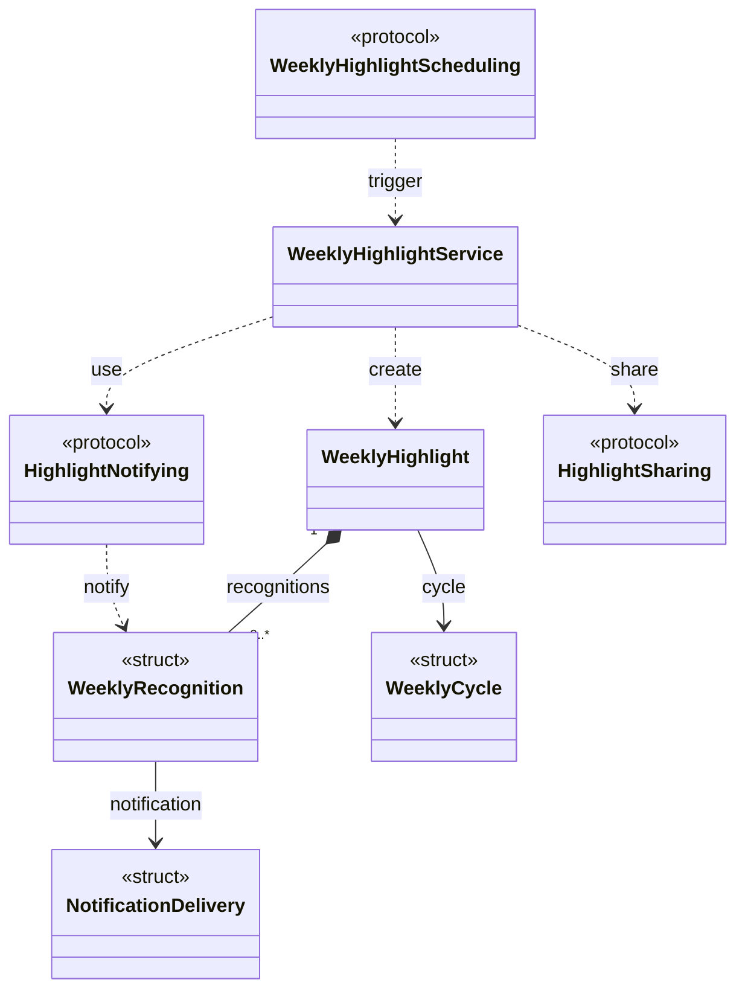

# Diagrama de classes — versão 1.1

**Projeto:** App de Organização Familiar — MVP  
**Versão:** 1.1\
**Base funcional:** 1.5\
**Data:** 2026-10-05  
**Situação:** referência de modelagem da base funcional

[Projeto](../README.md) · [Visão do produto](00-visao-do-produto.md) · [Índice e versões](DOCUMENTACAO.md) · [Regras](01-regras-de-negocio.md) · [Requisitos](02-requisitos.md) · [Casos de uso](03-casos-de-uso.md) · [Diagramas de caso de uso](04-diagramas-de-caso-de-uso.md) · [Screen map](design/screen-map.md) · [Modelo de dados](05-modelo-de-dados.md)

## Como ler

A tradução deste modelo do sistema para o aplicativo está na [arquitetura mobile](architecture/mobile-architecture.md#7-tradução-do-modelo-de-classes-para-o-mobile). Ela distingue valores e casos de uso do cliente das operações autoritativas do backend. Os [ajustes de modelagem aplicados](architecture/mobile-decisions.md#4-ajustes-de-modelagem-aplicados) consolidam as decisões desta revisão.

- Os diagramas Mermaid mostram os tipos e relacionamentos de cada domínio. O catálogo detalha atributos e operações; os identificadores em inglês são preservados para uso em Swift.
- `class`, `struct`, `enum` e `protocol` indicam o tipo do modelo. Nos diagramas, classes usam a declaração padrão, sem estereótipo; os demais tipos são identificados por estereótipos. `+` significa público e `-`, privado. Os blocos são pseudocódigo com notação UML e tipos Swift, não código compilável.
- `*--` representa composição; `o--`, agregação; `-->`, associação; `..>`, dependência. Multiplicidades nas pontas indicam quantas instâncias podem participar; dependências não têm multiplicidade.
- Atributos públicos representam leitura do estado; alterações passam pelas operações autorizadas, sem escrita direta que contorne as regras. As assinaturas representam contratos, não uma escolha de banco ou framework.
- Composição expressa pertencimento no modelo, sem autorizar exclusão em cascata de histórico. Enums são tipos de valor, sem cardinalidade de entidades persistidas.
- Cada âncora `classe-<nome>` identifica um tipo; `rastreio-ucNN` identifica sua linha de rastreabilidade. Mudanças de nome exigem revisar os vínculos.
- A separação dos domínios segue [RNF14](02-requisitos.md#rnf14). `PersonalTasks` e `FamilyArea` são coordenadores de apresentação; serviços orquestram operações e protocolos delimitam integrações.

## Índice

- [Rastreabilidade por caso de uso](#rastreabilidade-por-caso-de-uso)
- [Restrições não funcionais](#restricoes-nao-funcionais)
- [Família, perfis e acesso](#dominio-acesso)
- [Tarefas e rotinas](#dominio-tarefas)
- [Área Família, progresso e carga](#dominio-indicadores)
- [Missões e recompensas](#dominio-missoes)
- [Relatório semanal em PDF](#dominio-relatorio)
- [Destaque semanal](#dominio-destaque)
- [Relacionamentos](#relacionamentos)
- [Regras centrais do modelo](#regras-centrais-do-modelo)
- [Correspondência com o DER](#correspondencia-com-o-der)
- [Definições consolidadas na base funcional](#definicoes-pendentes-na-base-funcional)
- [Histórico](#historico)

## Rastreabilidade por caso de uso

Os RF e RN são os vínculos declarados em cada UC na base funcional. A lista de tipos indica participação no fluxo como um todo; não atribui todos os requisitos a cada classe isoladamente. `AccessControl`, `Action`, `DomainError` e a validação de sessão apoiam transversalmente as operações protegidas. Os aspectos de interface permanecem no [screen map](design/screen-map.md) e nos [user flows](design/user-flows.md).

| Caso de uso | Tipos responsáveis ou de apoio | Requisitos funcionais | Regras de negócio |
|---|---|---|---|
| <a id="rastreio-uc01"></a>[UC01](03-casos-de-uso.md#uc01) — Gerenciar família | [Family](#classe-family), [Member](#classe-member), [AccessService](#classe-accessservice), [AppleAuthenticating](#classe-appleauthenticating) , [TimeZoneChange](#classe-timezonechange) | [RF01](02-requisitos.md#rf01), [RF38](02-requisitos.md#rf38), [RF39](02-requisitos.md#rf39), [RF67](02-requisitos.md#rf67) | [RN01](01-regras-de-negocio.md#rn01), [RN09](01-regras-de-negocio.md#rn09), [RN28](01-regras-de-negocio.md#rn28), [RN44](01-regras-de-negocio.md#rn44), [RN65](01-regras-de-negocio.md#rn65) |
| <a id="rastreio-uc02"></a>[UC02](03-casos-de-uso.md#uc02) — Gerenciar membros | [Family](#classe-family), [Member](#classe-member), [MemberRole](#classe-memberrole), [Invite](#classe-invite), [InviteStatus](#classe-invitestatus), [Session](#classe-session), [AccessService](#classe-accessservice), [AccessControl](#classe-accesscontrol), [MemberService](#classe-memberservice), [InviteCredentials](#classe-invitecredentials) | [RF02](02-requisitos.md#rf02), [RF03](02-requisitos.md#rf03), [RF04](02-requisitos.md#rf04), [RF05](02-requisitos.md#rf05), [RF06](02-requisitos.md#rf06), [RF40](02-requisitos.md#rf40), [RF41](02-requisitos.md#rf41), [RF54](02-requisitos.md#rf54) | [RN01](01-regras-de-negocio.md#rn01), [RN02](01-regras-de-negocio.md#rn02), [RN03](01-regras-de-negocio.md#rn03), [RN04](01-regras-de-negocio.md#rn04), [RN05](01-regras-de-negocio.md#rn05), [RN06](01-regras-de-negocio.md#rn06), [RN07](01-regras-de-negocio.md#rn07), [RN08](01-regras-de-negocio.md#rn08), [RN10](01-regras-de-negocio.md#rn10), [RN45](01-regras-de-negocio.md#rn45), [RN46](01-regras-de-negocio.md#rn46), [RN47](01-regras-de-negocio.md#rn47) |
| <a id="rastreio-uc03"></a>[UC03](03-casos-de-uso.md#uc03) — Validar conclusão de tarefa Kids | [FamilyTask](#classe-familytask), [KidsSignal](#classe-kidssignal), [ValidationDecision](#classe-validationdecision), [Completion](#classe-completion), [TaskService](#classe-taskservice), [MissionService](#classe-missionservice) | [RF25](02-requisitos.md#rf25), [RF26](02-requisitos.md#rf26), [RF55](02-requisitos.md#rf55), [RF56](02-requisitos.md#rf56) | [RN22](01-regras-de-negocio.md#rn22), [RN23](01-regras-de-negocio.md#rn23), [RN24](01-regras-de-negocio.md#rn24), [RN25](01-regras-de-negocio.md#rn25), [RN26](01-regras-de-negocio.md#rn26), [RN30](01-regras-de-negocio.md#rn30), [RN35](01-regras-de-negocio.md#rn35), [RN54](01-regras-de-negocio.md#rn54), [RN55](01-regras-de-negocio.md#rn55), [RN56](01-regras-de-negocio.md#rn56) |
| <a id="rastreio-uc04"></a>[UC04](03-casos-de-uso.md#uc04) — Autenticar com Apple | [AppleAuthenticating](#classe-appleauthenticating), [AccessService](#classe-accessservice), [Family](#classe-family), [Member](#classe-member) , [AppleAuthorizationProof](#classe-appleauthorizationproof) | [RF37](02-requisitos.md#rf37), [RF39](02-requisitos.md#rf39) | [RN44](01-regras-de-negocio.md#rn44) |
| <a id="rastreio-uc05"></a>[UC05](03-casos-de-uso.md#uc05) — Gerenciar missões | [Mission](#classe-mission), [MissionStatus](#classe-missionstatus), [FamilyTask](#classe-familytask), [Badge](#classe-badge), [BadgeAward](#classe-badgeaward), [MissionService](#classe-missionservice) , [MissionParticipation](#classe-missionparticipation) | [RF28](02-requisitos.md#rf28), [RF29](02-requisitos.md#rf29), [RF31](02-requisitos.md#rf31), [RF32](02-requisitos.md#rf32), [RF50](02-requisitos.md#rf50), [RF58](02-requisitos.md#rf58) | [RN16](01-regras-de-negocio.md#rn16), [RN35](01-regras-de-negocio.md#rn35), [RN36](01-regras-de-negocio.md#rn36), [RN37](01-regras-de-negocio.md#rn37), [RN38](01-regras-de-negocio.md#rn38), [RN39](01-regras-de-negocio.md#rn39), [RN40](01-regras-de-negocio.md#rn40), [RN50](01-regras-de-negocio.md#rn50), [RN51](01-regras-de-negocio.md#rn51), [RN53](01-regras-de-negocio.md#rn53), [RN58](01-regras-de-negocio.md#rn58), [RN59](01-regras-de-negocio.md#rn59), [RN64](01-regras-de-negocio.md#rn64) |
| <a id="rastreio-uc06"></a>[UC06](03-casos-de-uso.md#uc06) — Gerenciar itens de recompensas coletivas | [RewardItem](#classe-rewarditem), [RewardItemSource](#classe-rewarditemsource) | [RF33](02-requisitos.md#rf33), [RF34](02-requisitos.md#rf34) | [RN41](01-regras-de-negocio.md#rn41), [RN42](01-regras-de-negocio.md#rn42) |
| <a id="rastreio-uc07"></a>[UC07](03-casos-de-uso.md#uc07) — Gerenciar tarefas | [FamilyTask](#classe-familytask), [EffortWeight](#classe-effortweight), [TaskStatus](#classe-taskstatus), [TaskService](#classe-taskservice), [ChangeScope](#classe-changescope), [Routine](#classe-routine) | [RF07](02-requisitos.md#rf07), [RF08](02-requisitos.md#rf08), [RF09](02-requisitos.md#rf09), [RF10](02-requisitos.md#rf10), [RF15](02-requisitos.md#rf15), [RF16](02-requisitos.md#rf16), [RF27](02-requisitos.md#rf27), [RF58](02-requisitos.md#rf58), [RF59](02-requisitos.md#rf59) | [RN11](01-regras-de-negocio.md#rn11), [RN12](01-regras-de-negocio.md#rn12), [RN13](01-regras-de-negocio.md#rn13), [RN17](01-regras-de-negocio.md#rn17), [RN18](01-regras-de-negocio.md#rn18), [RN19](01-regras-de-negocio.md#rn19), [RN20](01-regras-de-negocio.md#rn20), [RN30](01-regras-de-negocio.md#rn30), [RN38](01-regras-de-negocio.md#rn38), [RN50](01-regras-de-negocio.md#rn50), [RN53](01-regras-de-negocio.md#rn53), [RN57](01-regras-de-negocio.md#rn57), [RN58](01-regras-de-negocio.md#rn58), [RN59](01-regras-de-negocio.md#rn59) |
| <a id="rastreio-uc08"></a>[UC08](03-casos-de-uso.md#uc08) — Definir recorrência de rotina | [Routine](#classe-routine), [RoutineFrequency](#classe-routinefrequency), [FamilyTask](#classe-familytask), [TaskService](#classe-taskservice), [ChangeScope](#classe-changescope) | [RF13](02-requisitos.md#rf13), [RF14](02-requisitos.md#rf14) | [RN11](01-regras-de-negocio.md#rn11), [RN14](01-regras-de-negocio.md#rn14), [RN16](01-regras-de-negocio.md#rn16), [RN17](01-regras-de-negocio.md#rn17) |
| <a id="rastreio-uc09"></a>[UC09](03-casos-de-uso.md#uc09) — Ingressar por convite | [Invite](#classe-invite), [InviteStatus](#classe-invitestatus), [Session](#classe-session), [AccessService](#classe-accessservice), [InviteCredentials](#classe-invitecredentials) | [RF42](02-requisitos.md#rf42), [RF43](02-requisitos.md#rf43), [RF44](02-requisitos.md#rf44), [RF45](02-requisitos.md#rf45), [RF46](02-requisitos.md#rf46), [RF54](02-requisitos.md#rf54), [RF68](02-requisitos.md#rf68) | [RN09](01-regras-de-negocio.md#rn09), [RN10](01-regras-de-negocio.md#rn10), [RN45](01-regras-de-negocio.md#rn45), [RN46](01-regras-de-negocio.md#rn46), [RN47](01-regras-de-negocio.md#rn47) |
| <a id="rastreio-uc10"></a>[UC10](03-casos-de-uso.md#uc10) — Editar perfil | [Member](#classe-member), [BadgeAward](#classe-badgeaward), [Badge](#classe-badge), [MemberService](#classe-memberservice), [MissionService](#classe-missionservice) , [BadgeTier](#classe-badgetier) | [RF48](02-requisitos.md#rf48), [RF62](02-requisitos.md#rf62), [RF65](02-requisitos.md#rf65) | [RN33](01-regras-de-negocio.md#rn33), [RN63](01-regras-de-negocio.md#rn63), [RN64](01-regras-de-negocio.md#rn64) |
| <a id="rastreio-uc11"></a>[UC11](03-casos-de-uso.md#uc11) — Visualizar minhas tarefas | [FamilyArea](#classe-familyarea), [FamilyTask](#classe-familytask), [CarouselRange](#classe-carouselrange), [ViewPeriod](#classe-viewperiod), [PeriodProgress](#classe-periodprogress), [Member](#classe-member), [PersonalTasks](#classe-personaltasks), [WeeklyRecognition](#classe-weeklyrecognition), [PeriodCalculator](#classe-periodcalculator) | [RF11](02-requisitos.md#rf11), [RF17](02-requisitos.md#rf17), [RF22](02-requisitos.md#rf22), [RF49](02-requisitos.md#rf49), [RF60](02-requisitos.md#rf60), [RF65](02-requisitos.md#rf65), [RF66](02-requisitos.md#rf66) | [RN16](01-regras-de-negocio.md#rn16), [RN22](01-regras-de-negocio.md#rn22), [RN26](01-regras-de-negocio.md#rn26), [RN27](01-regras-de-negocio.md#rn27), [RN28](01-regras-de-negocio.md#rn28), [RN33](01-regras-de-negocio.md#rn33), [RN49](01-regras-de-negocio.md#rn49), [RN55](01-regras-de-negocio.md#rn55), [RN60](01-regras-de-negocio.md#rn60), [RN61](01-regras-de-negocio.md#rn61), [RN63](01-regras-de-negocio.md#rn63) |
| <a id="rastreio-uc12"></a>[UC12](03-casos-de-uso.md#uc12) — Concluir tarefa | [FamilyTask](#classe-familytask), [Completion](#classe-completion), [CompletionSource](#classe-completionsource), [TaskService](#classe-taskservice), [MissionService](#classe-missionservice) | [RF12](02-requisitos.md#rf12), [RF47](02-requisitos.md#rf47), [RF56](02-requisitos.md#rf56) | [RN21](01-regras-de-negocio.md#rn21), [RN22](01-regras-de-negocio.md#rn22), [RN30](01-regras-de-negocio.md#rn30), [RN35](01-regras-de-negocio.md#rn35), [RN48](01-regras-de-negocio.md#rn48), [RN55](01-regras-de-negocio.md#rn55), [RN56](01-regras-de-negocio.md#rn56) |
| <a id="rastreio-uc13"></a>[UC13](03-casos-de-uso.md#uc13) — Visualizar carga diária ou semanal | [FamilyArea](#classe-familyarea), [PeriodCalculator](#classe-periodcalculator), [PeriodLoad](#classe-periodload), [Completion](#classe-completion), [ViewPeriod](#classe-viewperiod) | [RF18](02-requisitos.md#rf18), [RF19](02-requisitos.md#rf19), [RF20](02-requisitos.md#rf20), [RF21](02-requisitos.md#rf21), [RF56](02-requisitos.md#rf56), [RF57](02-requisitos.md#rf57), [RF66](02-requisitos.md#rf66) | [RN26](01-regras-de-negocio.md#rn26), [RN28](01-regras-de-negocio.md#rn28), [RN30](01-regras-de-negocio.md#rn30), [RN31](01-regras-de-negocio.md#rn31), [RN33](01-regras-de-negocio.md#rn33), [RN34](01-regras-de-negocio.md#rn34), [RN35](01-regras-de-negocio.md#rn35), [RN55](01-regras-de-negocio.md#rn55), [RN56](01-regras-de-negocio.md#rn56), [RN57](01-regras-de-negocio.md#rn57), [RN58](01-regras-de-negocio.md#rn58), [RN60](01-regras-de-negocio.md#rn60), [RN61](01-regras-de-negocio.md#rn61) |
| <a id="rastreio-uc14"></a>[UC14](03-casos-de-uso.md#uc14) — Acompanhar missões e recompensas | [Mission](#classe-mission), [MissionStatus](#classe-missionstatus), [BadgeAward](#classe-badgeaward), [Badge](#classe-badge), [RedeemedReward](#classe-redeemedreward), [MissionService](#classe-missionservice) | [RF30](02-requisitos.md#rf30), [RF31](02-requisitos.md#rf31), [RF36](02-requisitos.md#rf36), [RF58](02-requisitos.md#rf58), [RF62](02-requisitos.md#rf62), [RF65](02-requisitos.md#rf65) | [RN26](01-regras-de-negocio.md#rn26), [RN33](01-regras-de-negocio.md#rn33), [RN35](01-regras-de-negocio.md#rn35), [RN36](01-regras-de-negocio.md#rn36), [RN38](01-regras-de-negocio.md#rn38), [RN39](01-regras-de-negocio.md#rn39), [RN43](01-regras-de-negocio.md#rn43), [RN51](01-regras-de-negocio.md#rn51), [RN52](01-regras-de-negocio.md#rn52), [RN53](01-regras-de-negocio.md#rn53), [RN55](01-regras-de-negocio.md#rn55), [RN58](01-regras-de-negocio.md#rn58), [RN63](01-regras-de-negocio.md#rn63), [RN64](01-regras-de-negocio.md#rn64) |
| <a id="rastreio-uc15"></a>[UC15](03-casos-de-uso.md#uc15) — Sinalizar tarefa como realizada | [FamilyTask](#classe-familytask), [KidsSignal](#classe-kidssignal), [TaskStatus](#classe-taskstatus), [TaskService](#classe-taskservice), [PersonalTasks](#classe-personaltasks) | [RF23](02-requisitos.md#rf23), [RF24](02-requisitos.md#rf24), [RF55](02-requisitos.md#rf55), [RF56](02-requisitos.md#rf56) | [RN21](01-regras-de-negocio.md#rn21), [RN22](01-regras-de-negocio.md#rn22), [RN23](01-regras-de-negocio.md#rn23), [RN24](01-regras-de-negocio.md#rn24), [RN30](01-regras-de-negocio.md#rn30), [RN35](01-regras-de-negocio.md#rn35), [RN54](01-regras-de-negocio.md#rn54), [RN55](01-regras-de-negocio.md#rn55), [RN56](01-regras-de-negocio.md#rn56) |
| <a id="rastreio-uc16"></a>[UC16](03-casos-de-uso.md#uc16) — Resgatar recompensa da missão | [RewardWheel](#classe-rewardwheel), [RewardItem](#classe-rewarditem), [RedeemedReward](#classe-redeemedreward), [Mission](#classe-mission), [MissionService](#classe-missionservice) | [RF35](02-requisitos.md#rf35), [RF51](02-requisitos.md#rf51), [RF52](02-requisitos.md#rf52), [RF53](02-requisitos.md#rf53) | [RN36](01-regras-de-negocio.md#rn36), [RN38](01-regras-de-negocio.md#rn38), [RN42](01-regras-de-negocio.md#rn42), [RN43](01-regras-de-negocio.md#rn43), [RN52](01-regras-de-negocio.md#rn52), [RN53](01-regras-de-negocio.md#rn53) |
| <a id="rastreio-uc17"></a>[UC17](03-casos-de-uso.md#uc17) — Retornar tarefa concluída para Pendente | [FamilyTask](#classe-familytask), [Completion](#classe-completion), [TaskService](#classe-taskservice), [Mission](#classe-mission), [MissionService](#classe-missionservice) | [RF57](02-requisitos.md#rf57), [RF58](02-requisitos.md#rf58), [RF59](02-requisitos.md#rf59) | [RN38](01-regras-de-negocio.md#rn38), [RN50](01-regras-de-negocio.md#rn50), [RN53](01-regras-de-negocio.md#rn53), [RN55](01-regras-de-negocio.md#rn55), [RN57](01-regras-de-negocio.md#rn57), [RN58](01-regras-de-negocio.md#rn58), [RN59](01-regras-de-negocio.md#rn59) |
| <a id="rastreio-uc18"></a>[UC18](03-casos-de-uso.md#uc18) — Gerar relatório semanal em PDF | [WeeklyReport](#classe-weeklyreport), [WeeklyReportService](#classe-weeklyreportservice), [MemberReportLine](#classe-memberreportline), [PDFRendering](#classe-pdfrendering), [FamilyArea](#classe-familyarea), [PeriodCalculator](#classe-periodcalculator), [PeriodLoad](#classe-periodload), [PeriodProgress](#classe-periodprogress) | [RF61](02-requisitos.md#rf61) | [RN62](01-regras-de-negocio.md#rn62) |
| <a id="rastreio-uc19"></a>[UC19](03-casos-de-uso.md#uc19) — Apurar e compartilhar destaque semanal | [WeeklyHighlight](#classe-weeklyhighlight), [WeeklyHighlightService](#classe-weeklyhighlightservice), [HighlightNotifying](#classe-highlightnotifying), [PeriodLoad](#classe-periodload), [WeeklyRecognition](#classe-weeklyrecognition), [WeeklyHighlightScheduling](#classe-weeklyhighlightscheduling), [HighlightSharing](#classe-highlightsharing), [PeriodCalculator](#classe-periodcalculator) , [WeeklyCycle](#classe-weeklycycle) , [NotificationDelivery](#classe-notificationdelivery) | [RF63](02-requisitos.md#rf63), [RF64](02-requisitos.md#rf64) | [RN28](01-regras-de-negocio.md#rn28), [RN30](01-regras-de-negocio.md#rn30), [RN65](01-regras-de-negocio.md#rn65) |

<a id="restricoes-nao-funcionais"></a>
## Restrições não funcionais

Os contratos de serviço incluem autorização e persistência consistente no backend. A lista completa de RNF aplicáveis permanece em cada UC.

| Responsabilidade | Tipos envolvidos | Referências e obrigação |
|---|---|---|
| Isolamento e autorização | `AccessControl`, `Session`, serviços | [RNF06](02-requisitos.md#rnf06), [RNF07](02-requisitos.md#rnf07) e [RNF22](02-requisitos.md#rnf22): validar família, perfil ativo e permissão no backend em cada operação protegida. |
| Apple e convites | `AppleAuthenticating`, `AccessService`, `Invite` | [RNF15](02-requisitos.md#rnf15), [RNF16](02-requisitos.md#rnf16), [RNF17](02-requisitos.md#rnf17), [RNF18](02-requisitos.md#rnf18), [RNF19](02-requisitos.md#rnf19), [RNF20](02-requisitos.md#rnf20) e [RNF21](02-requisitos.md#rnf21): integração oficial, proteção de credenciais, validação de vínculo, contenção de tentativas e consumo único atômico. |
| Conclusão, reabertura e crédito | `FamilyTask`, `Completion`, `TaskService`, `PeriodCalculator`, `Mission` | [RNF09](02-requisitos.md#rnf09), [RNF10](02-requisitos.md#rnf10), [RNF11](02-requisitos.md#rnf11) e [RNF25](02-requisitos.md#rnf25): preservar histórico e processar decisões concorrentes sem duplicar crédito ou modificar conquistas. |
| Resgate | `RewardWheel`, `Mission`, `RedeemedReward` | [RNF23](02-requisitos.md#rnf23): persistir recompensa e encerramento do resgate em uma operação consistente. |
| Fotos e perfil | `Member`, `KidsSignal` | [RNF24](02-requisitos.md#rnf24) e [RNF27](02-requisitos.md#rnf27): controlar acesso às fotos e edição de apelido por titularidade. |
| PDF e apuração | `WeeklyReportService`, `PDFRendering`, `WeeklyHighlightService`, `HighlightNotifying` | [RNF26](02-requisitos.md#rnf26) e [RNF27](02-requisitos.md#rnf27): leitura consistente, processamento recuperável, notificações sem duplicidade e compartilhamento explícito. |
| Apresentação e infraestrutura | Coordenadores, serviços e adaptadores futuros | [RNF01](02-requisitos.md#rnf01), [RNF02](02-requisitos.md#rnf02), [RNF03](02-requisitos.md#rnf03), [RNF04](02-requisitos.md#rnf04), [RNF05](02-requisitos.md#rnf05), [RNF08](02-requisitos.md#rnf08), [RNF12](02-requisitos.md#rnf12) e [RNF13](02-requisitos.md#rnf13): usabilidade, acessibilidade, desempenho, erros de persistência e responsividade dependem da implementação e de validação além deste modelo. |

<a id="dominio-acesso"></a>
## Família, perfis e acesso



O recorte mostra as relações internas deste domínio; as relações entre domínios estão na [tabela de relacionamentos](#relacionamentos).


<a id="classe-family"></a>
### Family «class»

**Rastreabilidade:** [UC01](#rastreio-uc01), [UC02](#rastreio-uc02), [UC04](#rastreio-uc04).

```swift
+ id: UUID
+ name: String
+ createdAt: Date
+ members: [Member]
+ administrators: [Member] { get }
+ creator: Member { get }
+ timeZoneID: String
+ scheduledTimeZoneChange: TimeZoneChange?
+ carouselRange(today: Date, calendar: Calendar) -> CarouselRange
```

**Restrições:** Um Criador protegido por família. Fuso padrão `America/Sao_Paulo`, selecionável na criação e editável somente por Administradores, imediatamente ou no próximo ciclo após informativo. Configuração e ciclos seguem RN28/RF67; troca de acesso por convite não remove o perfil anterior (RN09/RF68).

<a id="classe-member"></a>
### Member «class»

**Rastreabilidade:** [UC01](#rastreio-uc01), [UC02](#rastreio-uc02), [UC04](#rastreio-uc04), [UC10](#rastreio-uc10), [UC11](#rastreio-uc11).

```swift
+ id: UUID
+ familyID: UUID
+ name: String
+ nickname: String?
+ photoURL: URL?
+ role: MemberRole
+ isFamilyCreator: Bool
- appleUserID: String?  // creator only
+ removedAt: Date?
+ isActive: Bool { get }  // removedAt == nil
+ isAdministrator: Bool { get }
+ isAdult: Bool { get }
+ isKids: Bool { get }
+ editAdministrativeName(_ name: String, by admin: Member) throws
+ editOwnProfile(nickname: String?, photoURL: URL?, by holder: Member) throws
+ promote(by admin: Member) throws
+ demote(by admin: Member) throws
+ leaveAdministration(by holder: Member) throws
+ setKidsMode(_ enabled: Bool, by admin: Member) throws
```

**Restrições:** Nome de identificação e apelido são campos separados. Gestão administrativa não altera foto/apelido pessoais; edição pessoal não muda família, papel ou modo Kids. Apelido é visível à família, mas sua configuração é exclusiva do titular. Promoção exige adulto; Criador não pode ser rebaixado, removido ou deixar a administração; Administrador não pode ser Kids ([RN02](01-regras-de-negocio.md#rn02), [RN03](01-regras-de-negocio.md#rn03), [RN04](01-regras-de-negocio.md#rn04), [RN05](01-regras-de-negocio.md#rn05), [RN06](01-regras-de-negocio.md#rn06), [RN07](01-regras-de-negocio.md#rn07), [RN08](01-regras-de-negocio.md#rn08), [RN44](01-regras-de-negocio.md#rn44), [RN63](01-regras-de-negocio.md#rn63)).

<a id="classe-memberrole"></a>
### MemberRole: String, Codable «enum»

**Rastreabilidade:** [UC02](#rastreio-uc02).

```swift
case administrator
case member
case kids
```

<a id="classe-invite"></a>
### Invite «class»

**Rastreabilidade:** [UC02](#rastreio-uc02), [UC09](#rastreio-uc09).

```swift
+ id: UUID
+ familyID: UUID
+ memberID: UUID
- tokenVerifier: Data
- passwordVerifier: Data
+ createdBy: UUID
+ createdAt: Date
+ consumedAt: Date?
+ revokedAt: Date?
+ status: InviteStatus { get }
+ validate(token: String, password: String, member: Member) throws
```

**Restrições:** Sem expiração temporal; um ingresso. Gerar/reenviar sempre substitui link/senha, invalida anteriores e revoga sessão anterior do perfil na mesma operação. Hashes não permitem recuperar senha; credenciais são transitórias. RN46/RN47 e RNF17–22.

<a id="classe-invitestatus"></a>
### InviteStatus: String, Codable «enum»

**Rastreabilidade:** [UC02](#rastreio-uc02), [UC09](#rastreio-uc09).

```swift
case available
case consumed
case invalidated
```

<a id="classe-session"></a>
### Session «class»

**Rastreabilidade:** [UC02](#rastreio-uc02), [UC09](#rastreio-uc09).

```swift
+ id: UUID
+ memberID: UUID
+ familyID: UUID
+ installationID: UUID
- installationVerifier: Data
- refreshTokenVerifier: Data
+ accessTokenExpiresAt: Date
+ createdAt: Date
+ revokedAt: Date?
+ validate(member: Member, installationProof: Data) throws
+ refresh(refreshToken: String, installationProof: Data) async throws -> Session
+ revoke()
```

**Restrições:** Uma sessão ativa por perfil/instalação. Refresh estável, sem vencimento temporal; access token de 15 minutos. Operações verificam sessão vigente para revogação imediata no servidor. Remoção, emissão/reenvio de convite e novo acesso Apple revogam sessão anterior. ID de instalação sozinho não comprova identidade. RN47/RNF22.

<a id="classe-appleauthenticating"></a>
### AppleAuthenticating «protocol»

**Rastreabilidade:** [UC01](#rastreio-uc01), [UC04](#rastreio-uc04).

```swift
+ authenticate() async throws -> AppleAuthorizationProof
```

**Restrições:** Retorna prova com authorizationCode, identityToken e contexto nonce/state da tentativa. Backend valida a prova antes de identificar Criador/família; Apple ID isolado não autentica. RN44/RNF15.

<a id="classe-accessservice"></a>
### AccessService «class»

**Rastreabilidade:** [UC01](#rastreio-uc01), [UC02](#rastreio-uc02), [UC04](#rastreio-uc04), [UC09](#rastreio-uc09).

```swift
- apple: AppleAuthenticating
+ signInWithApple() async throws -> Family?
+ createFamily(name: String, timeZoneID: String) async throws -> Family
+ changeFamilyTimeZone(_ familyID: UUID, to timeZoneID: String,
      application: TimeZoneChangeApplication, by admin: Member) async throws
+ generateInvite(for memberID: UUID, by admin: Member) async throws
      -> InviteCredentials
+ resendInvite(_ inviteID: UUID, by admin: Member) async throws
      -> InviteCredentials
+ join(token: String, password: String, installationProof: Data) async throws -> Session
+ refreshSession(_ sessionID: UUID, refreshToken: String) async throws -> Session
+ revokeAccess(of memberID: UUID, by admin: Member) async throws
```

**Restrições:** Apple exclusivo do Criador. Gerar/reenviar convite revoga convites e sessão anteriores e retorna novas credenciais transitórias. Ingresso consome convite e cria sessão única atomicamente; recuperação de resposta perdida por dez minutos exige prova da mesma instalação/tentativa. Troca confirmada só substitui acesso local após sucesso, sem remover perfil anterior. Não há recuperação geral de comandos por operationID. UC01/02/04/09, RN46/47, RF68.

<a id="classe-invitecredentials"></a>
### InviteCredentials «struct»

**Rastreabilidade:** [UC02](#rastreio-uc02), [UC09](#rastreio-uc09).

```swift
+ inviteID: UUID
+ link: URL
+ password: String
```

**Restrições:** Novo link/senha a cada emissão, inclusive reenvio. Dados transitórios para compartilhamento conjunto explícito, sem logs/persistência legível; convite anterior e sessão foram revogados na emissão. RN46/RNF17.

<a id="classe-memberservice"></a>
### MemberService «class»

**Rastreabilidade:** [UC02](#rastreio-uc02), [UC10](#rastreio-uc10).

```swift
- access: AccessService
+ addMember(name: String, role: MemberRole, by admin: Member) async throws -> Member
+ editMember(_ memberID: UUID, name: String, by admin: Member) async throws
+ removeMember(_ memberID: UUID, by admin: Member) async throws
+ editOwnProfile(nickname: String?, photoURL: URL?, by holder: Member) async throws
```

**Restrições:** Gestão valida família, papel e proteção do Criador. Remoção retira apenas o membro das tarefas futuras não concluídas/não protegidas, mantém demais responsáveis e não altera pendências antigas ou concluídas. Revoga acesso e preserva histórico. Foto de perfil por câmera/galeria para todos; backend salva arquivo R2 e URL privada no Supabase. RN10/RN63.

<a id="classe-accesscontrol"></a>
### AccessControl «struct»

**Rastreabilidade:** [Todos os casos de uso](#rastreabilidade-por-caso-de-uso).

```swift
+ static require(_ action: Action, session: Session, actor: Member,
      resourceFamilyID: UUID, ownerID: UUID?) throws
+ static can(_ action: Action, session: Session, actor: Member,
      resourceFamilyID: UUID, ownerID: UUID?) -> Bool
```

**Restrições:** O backend valida sessão, perfil ativo, família do recurso, papel e titularidade quando aplicável. `ownerID` identifica o titular do perfil ou reconhecimento; sinalização Kids também valida responsabilidade na tarefa. Ocultar ação na interface não substitui autorização ([RNF06](02-requisitos.md#rnf06), [RNF07](02-requisitos.md#rnf07), [RNF22](02-requisitos.md#rnf22), [RNF27](02-requisitos.md#rnf27)).

<a id="classe-action"></a>
### Action «enum»

**Rastreabilidade:** [Todos os casos de uso](#rastreabilidade-por-caso-de-uso).

```swift
case manageMembers, generateInvite, resendInvite
case manageTasks, completeTask, signalTask, validateSignal, reopenTask
case manageMissions, manageRewardItems, redeemReward
case viewOwnTasks, viewOwnProgress, viewMissions
case viewLoad, accessFamilyArea, generateWeeklyReport
case viewOwnWeeklyHighlight, shareOwnWeeklyHighlight
case editOwnProfile, configureFamilyTimeZone, switchAccessByInvite
```

<a id="classe-domainerror"></a>
### DomainError: Error «enum»

**Rastreabilidade:** [Todos os casos de uso](#rastreabilidade-por-caso-de-uso).

```swift
case permissionDenied
case creatorProtected
case administratorInKidsMode
case titleRequired, invalidWeight
case completedTaskNotDeletable
case completedMissionProtected
case missionWithoutTasks
case invalidInvite, inviteConsumed
case sessionRevoked
case redemptionUnavailable
case invalidCurrentState
case dateOutOfRange
case notProfileHolder, inviteNotResendable
```

<a id="dominio-tarefas"></a>
## Tarefas e rotinas



O recorte mostra as relações internas deste domínio; as relações entre domínios estão na [tabela de relacionamentos](#relacionamentos).


<a id="classe-familytask"></a>
### FamilyTask «class»

**Rastreabilidade:** [UC03](#rastreio-uc03), [UC05](#rastreio-uc05), [UC07](#rastreio-uc07), [UC08](#rastreio-uc08), [UC11](#rastreio-uc11), [UC12](#rastreio-uc12), [UC15](#rastreio-uc15), [UC17](#rastreio-uc17).

```swift
+ id: UUID
+ familyID: UUID
+ routineID: UUID?
+ title: String
+ weight: EffortWeight
+ date: LocalDate
+ originKey: String
+ assigneeIDs: Set<UUID>
+ status: TaskStatus
+ completions: [Completion]
+ signals: [KidsSignal]
+ isUnassigned: Bool { get }
+ currentCompletion: Completion? { get }
+ pendingSignal: KidsSignal? { get }
+ edit(title: String, weight: EffortWeight, date: LocalDate, by actor: Member,
      missions: [Mission]) throws
+ assign(_ ids: Set<UUID>, by actor: Member, missions: [Mission]) throws
+ complete(by actor: Member, takeOver: Bool) throws -> Completion
+ signal(by kid: Member, photo: URL?) throws -> KidsSignal
+ confirmSignal(by admin: Member) throws -> Completion
+ rejectSignal(by admin: Member) throws
+ reopen(by admin: Member, missions: [Mission]) throws
+ canDelete(missions: [Mission]) -> Bool
```

**Restrições:** Estado único e peso 1–3. DatePicker de cadastro/edição sem limites de produto, inclusive antes da criação da família. Adultos concluem; Kids responsáveis sinalizam pendente. Decisões disputam estado atual sem duplicação. Concluída sem missão concluída pode ser editada: crédito/progresso se adaptam e auditoria é preservada; data prevista não muda instante de conclusão. Sem responsáveis, continua concluída sem crédito individual. Última edição válida no servidor prevalece. Reabertura só Admin com missão em andamento e nenhuma concluída, desfazendo crédito uma vez. RN11/17/23/24/55/57/58.

<a id="classe-taskstatus"></a>
### TaskStatus: String, Codable «enum»

**Rastreabilidade:** [UC07](#rastreio-uc07), [UC15](#rastreio-uc15).

```swift
case pending
case awaitingConfirmation
case completed
```

<a id="classe-effortweight"></a>
### EffortWeight: Int, Codable «enum»

**Rastreabilidade:** [UC07](#rastreio-uc07).

```swift
case low = 1
case medium = 2
case high = 3
// ---
+ label: String { get }
```

<a id="classe-completionsource"></a>
### CompletionSource: String, Codable «enum»

**Rastreabilidade:** [UC03](#rastreio-uc03), [UC12](#rastreio-uc12), [UC13](#rastreio-uc13), [UC17](#rastreio-uc17).

```swift
case manual
case kidsConfirmation
```

**Restrições:** Distingue ação manual e confirmação Kids; não confunde autor da ação com beneficiários do crédito. UC03/12.

<a id="classe-kidssignal"></a>
### KidsSignal «struct»

**Rastreabilidade:** [UC03](#rastreio-uc03), [UC15](#rastreio-uc15).

```swift
+ id: UUID
+ signaledBy: UUID
+ signaledAt: Date
+ photoURL: URL?
+ decision: ValidationDecision?
+ decidedBy: UUID?
+ decidedAt: Date?
```

<a id="classe-validationdecision"></a>
### ValidationDecision: String, Codable «enum»

**Rastreabilidade:** [UC03](#rastreio-uc03).

```swift
case confirmed
case rejected
case closedByManualCompletion
```

<a id="classe-completion"></a>
### Completion «struct»

**Rastreabilidade:** [UC03](#rastreio-uc03), [UC12](#rastreio-uc12), [UC13](#rastreio-uc13), [UC17](#rastreio-uc17).

```swift
+ id: UUID
+ taskID: UUID
+ performedBy: UUID
+ creditedAssignees: Set<UUID>
+ creditedWeight: EffortWeight
+ completedAt: Date
+ scheduledDate: LocalDate
+ source: CompletionSource
+ confirmedBy: UUID?
+ undoneAt: Date?
+ undoneBy: UUID?
+ isValid: Bool { get }
```

**Restrições:** Projeção do crédito vigente. Edição autorizada pode corrigir peso/responsáveis/data prevista, registrando antes/depois em TaskEvent. completedAt e autor da conclusão original permanecem. Reabrir registra quem/quando e invalida crédito, sem apagar auditoria. Destaque final não muda; novos PDFs refletem correção. RN17/RN30/RN57/RN61/RN65.

<a id="classe-routine"></a>
### Routine «class»

**Rastreabilidade:** [UC07](#rastreio-uc07), [UC08](#rastreio-uc08).

```swift
+ id: UUID
+ familyID: UUID
+ title: String
+ weight: EffortWeight
+ assigneeIDs: Set<UUID>
+ frequency: RoutineFrequency
+ startDate: LocalDate
+ isActive: Bool
+ upcomingDates(until: LocalDate, calendar: Calendar) -> [LocalDate]
+ generateTasks(until: LocalDate, calendar: Calendar) throws -> [FamilyTask]
+ update(title: String, weight: EffortWeight, assignees: Set<UUID>,
      frequency: RoutineFrequency, from: LocalDate, by actor: Member,
      missions: [Mission]) throws
+ end(from: LocalDate, by actor: Member, missions: [Mission]) throws
```

**Restrições:** Início escolhido em DatePicker sem limites de produto; diário ou 1/2/3/4 semanas. Backend gera até fim do mês seguinte, repõe diariamente/completa consulta. Início além do horizonte fica programado; passado é materializado em lotes sem truncamento silencioso. Chave de origem imutável impede duplicação mesmo após editar data da ocorrência. Alteração futura preserva passado e concluídas/protegidas. RN14/16/17/18/48/51.

<a id="classe-routinefrequency"></a>
### RoutineFrequency: Int, Codable «enum»

**Rastreabilidade:** [UC08](#rastreio-uc08).

```swift
case daily = 1
case every7Days = 7
case every14Days = 14
case every21Days = 21
case every28Days = 28
// No monthly frequency
```

<a id="classe-changescope"></a>
### ChangeScope «enum»

**Rastreabilidade:** [UC07](#rastreio-uc07), [UC08](#rastreio-uc08).

```swift
case thisOnly
case thisAndFuture
```

<a id="classe-taskservice"></a>
### TaskService «class»

**Rastreabilidade:** [UC03](#rastreio-uc03), [UC07](#rastreio-uc07), [UC08](#rastreio-uc08), [UC12](#rastreio-uc12), [UC15](#rastreio-uc15), [UC17](#rastreio-uc17).

```swift
+ create(title: String, weight: EffortWeight, assignees: Set<UUID>,
      date: LocalDate, frequency: RoutineFrequency?, by actor: Member) async throws
      -> [FamilyTask]
+ edit(_ taskID: UUID, title: String, weight: EffortWeight,
      date: LocalDate, assignees: Set<UUID>, scope: ChangeScope, by actor: Member) async throws
+ delete(_ taskID: UUID, scope: ChangeScope, by actor: Member) async throws
+ complete(_ taskID: UUID, takeOver: Bool, by actor: Member) async throws
+ signal(_ taskID: UUID, photo: URL?, by kid: Member) async throws
+ confirmSignal(_ taskID: UUID, by admin: Member) async throws
+ rejectSignal(_ taskID: UUID, by admin: Member) async throws
+ reopen(_ taskID: UUID, by admin: Member) async throws
+ kidsConfirmationQueue(by admin: Member) async throws -> [FamilyTask]
```

**Restrições:** Carrega estado atual e executa transações no servidor. Última edição válida prevalece, sem precondição de versão antiga. Conclusão/crédito/missões/participações/badges são consistentes; reabertura retira crédito uma vez e preserva conquista; exclusão não deixa missão vazia. Resposta perdida leva a consulta do estado, sem replay geral automático. RN17/48/50/55–59, RNF09–12/25.

<a id="dominio-indicadores"></a>
## Área Família, progresso e carga



O recorte mostra as relações internas deste domínio; as relações entre domínios estão na [tabela de relacionamentos](#relacionamentos).


<a id="classe-personaltasks"></a>
### PersonalTasks «class»

**Rastreabilidade:** [UC11](#rastreio-uc11), [UC15](#rastreio-uc15).

```swift
+ user: Member
+ selectedDate: Date
+ period: ViewPeriod
+ range: CarouselRange
+ init(user: Member, today: Date, calendar: Calendar) throws
+ select(date: Date, period: ViewPeriod) throws
+ tasks() async throws -> [FamilyTask]
+ progress() async throws -> PeriodProgress
+ ownHighlight(week: DateInterval) async throws -> WeeklyRecognition?
```

**Restrições:** Todos os perfis consultam suas tarefas e progresso, com início no dia atual, Dia/Semana e limites do carrossel. Kids têm duas abas, Minhas tarefas e Missões e conquistas; perfil pelo avatar/cabeçalho. Sinalização com foto abre diretamente a câmera, permite revisar/refazer/descartar e continuar sem foto em caso de cancelamento ou indisponibilidade. Reconhecimento próprio não libera carga familiar ([RN27](01-regras-de-negocio.md#rn27), [RN33](01-regras-de-negocio.md#rn33), [RN54](01-regras-de-negocio.md#rn54), [RN61](01-regras-de-negocio.md#rn61), [RN63](01-regras-de-negocio.md#rn63), [RN65](01-regras-de-negocio.md#rn65); [RF55](02-requisitos.md#rf55), [RF65](02-requisitos.md#rf65)).

<a id="classe-familyarea"></a>
### FamilyArea «class»

**Rastreabilidade:** [UC11](#rastreio-uc11), [UC13](#rastreio-uc13), [UC18](#rastreio-uc18).

```swift
+ user: Member
+ selectedDate: Date
+ period: ViewPeriod
+ selectedMemberID: UUID?
+ range: CarouselRange
+ init(user: Member, today: Date, calendar: Calendar) throws
+ select(date: Date, period: ViewPeriod) throws
+ select(memberID: UUID?) throws
+ interval: DateInterval { get }
+ availableTaskInterval: DateInterval { get }
+ members() async throws -> [Member]
+ progress() async throws -> PeriodProgress
+ tasks() async throws -> [FamilyTask]
+ load() async throws -> PeriodLoad
+ weeklyReportPDF() async throws -> URL
+ canManageMembers: Bool { get }
+ canValidateKids: Bool { get }
```

**Restrições:** Entrada restrita a Administradores e Membros, com carga/progresso, lista e PDF diretamente na tela. `nil` seleciona a família inteira, incluindo tarefas sem responsável. Detalhe herda período, filtra membro e restaura contexto ao voltar; dias disponíveis são indicados nas semanas de borda. Adicionar membro, edição administrativa, convites e validação Kids exigem Administrador. PDF usa a semana da data selecionada mesmo na consulta Dia ([RN49](01-regras-de-negocio.md#rn49), [RN60](01-regras-de-negocio.md#rn60), [RN61](01-regras-de-negocio.md#rn61), [RN62](01-regras-de-negocio.md#rn62)).

<a id="classe-carouselrange"></a>
### CarouselRange «struct»

**Rastreabilidade:** [UC11](#rastreio-uc11).

```swift
+ start: Date  // Family creation date
+ end: Date    // Last day of the current month
// ---
+ init(familyCreatedAt: Date, today: Date, calendar: Calendar)
+ contains(_ date: Date) -> Bool
```

<a id="classe-viewperiod"></a>
### ViewPeriod: String, Codable «enum»

**Rastreabilidade:** [UC11](#rastreio-uc11), [UC13](#rastreio-uc13).

```swift
case day
case week
```

<a id="classe-periodprogress"></a>
### PeriodProgress «struct»

**Rastreabilidade:** [UC11](#rastreio-uc11), [UC18](#rastreio-uc18).

```swift
+ interval: DateInterval
+ period: ViewPeriod
+ memberID: UUID?  // nil = family
+ completed: Int
+ total: Int
// ---
+ percentage: Double? { get }  // nil = no tasks
+ static personal(of m: Member, tasks: [FamilyTask],
      in interval: DateInterval) -> Self
+ static family(tasks: [FamilyTask], in interval: DateInterval) -> Self
  // Tasks counted by scheduled date (FamilyTask.date)
```

<a id="classe-periodload"></a>
### PeriodLoad «struct»

**Rastreabilidade:** [UC13](#rastreio-uc13), [UC18](#rastreio-uc18), [UC19](#rastreio-uc19).

```swift
+ interval: DateInterval
+ period: ViewPeriod
+ loadByMember: [UUID: Int]
+ completedCountByMember: [UUID: Int]
+ distinctCompletedTaskIDs: Set<UUID>
+ total: Int { get }
+ distinctCompletedCount: Int { get }
+ share(of id: UUID) -> Double?
+ completedCount(of id: UUID) -> Int
```

**Restrições:** Conta apenas conclusões válidas pela data de conclusão. Cada tarefa compartilhada conta uma vez por responsável e uma vez no total familiar distinto. Carga total soma créditos individuais; participação é percentual e fica sem valor quando a carga total é zero ([RN30](01-regras-de-negocio.md#rn30), [RN31](01-regras-de-negocio.md#rn31), [RN61](01-regras-de-negocio.md#rn61), [RN62](01-regras-de-negocio.md#rn62)).

<a id="classe-periodcalculator"></a>
### PeriodCalculator «struct»

**Rastreabilidade:** [UC11](#rastreio-uc11), [UC13](#rastreio-uc13), [UC18](#rastreio-uc18), [UC19](#rastreio-uc19).

```swift
+ calendar: Calendar
+ cycle: WeeklyCycle?
+ interval(_ period: ViewPeriod, containing date: Date) -> DateInterval
+ availableTaskInterval(_ interval: DateInterval, range: CarouselRange) -> DateInterval?
+ load(_ period: ViewPeriod, containing date: Date,
      completions: [Completion]) -> PeriodLoad
```

**Restrições:** Fuso IANA da família, padrão America/Sao_Paulo; Admin altera imediatamente ou no próximo ciclo. Usa limites explícitos de WeeklyCycle para transições contíguas, sem sobreposição/lacunas. Progresso usa data prevista e carga a conclusão/crédito vigente. Não usar limites do carrossel para validar cadastro. RN28/49/61/65.

<a id="dominio-missoes"></a>
## Missões e recompensas



O recorte mostra as relações internas deste domínio; as relações entre domínios estão na [tabela de relacionamentos](#relacionamentos).


<a id="classe-mission"></a>
### Mission «class»

**Rastreabilidade:** [UC05](#rastreio-uc05), [UC14](#rastreio-uc14), [UC16](#rastreio-uc16), [UC17](#rastreio-uc17).

```swift
+ id: UUID
+ familyID: UUID
+ title: String
+ createdBy: UUID
+ taskIDs: Set<UUID>
+ status: MissionStatus
+ completedAt: Date?
+ reward: RedeemedReward?
+ participations: [MissionParticipation]
+ isRedemptionAvailable: Bool { get }
+ progress(tasks: [FamilyTask]) -> Double
+ edit(title: String, by admin: Member) throws
+ link(_ task: FamilyTask, by admin: Member) throws
+ unlink(_ taskID: UUID, replacement: FamilyTask?, by admin: Member) throws
+ recordReward(_ reward: RedeemedReward, by admin: Member) throws
```

**Restrições:** Ao menos uma tarefa individual, sem prazo nem selo configurável. Encerramento registra participação dos responsáveis creditados em tarefas vinculadas e avalia marcos de badges. Conquista protege dados/vínculos/tarefas; apenas resgate único pode acrescentar recompensa. RN36/38/50/58/64.

<a id="classe-missionservice"></a>
### MissionService «class»

**Rastreabilidade:** [UC03](#rastreio-uc03), [UC05](#rastreio-uc05), [UC10](#rastreio-uc10), [UC12](#rastreio-uc12), [UC14](#rastreio-uc14), [UC16](#rastreio-uc16), [UC17](#rastreio-uc17).

```swift
+ create(title: String, taskIDs: Set<UUID>, by admin: Member) async throws -> Mission
+ edit(_ missionID: UUID, title: String, taskIDs: Set<UUID>, by admin: Member) async throws
+ updateAfterTaskChange(_ taskID: UUID) async throws
+ acceptReward(_ item: RewardItem, for missionID: UUID, by admin: Member) async throws -> RedeemedReward
+ list(by actor: Member) async throws -> [Mission]
+ badges(of memberID: UUID, by actor: Member) async throws -> [BadgeAward]
+ badgeContributions(_ awardID: UUID, by holder: Member) async throws -> [MissionParticipation]
```

**Restrições:** Criação/edição também pode encerrar missão se todas as tarefas já estiverem concluídas. Registrar uma participação por responsável creditado em ao menos uma tarefa e conceder marcos atingidos uma vez, na mesma operação consistente. Sem retroatividade a novos membros; sem relação com clique de confirmação/resgate. Sorteio é local; aceite remoto valida item e resgate único. RN38/53/64, RNF23/25.

<a id="classe-missionstatus"></a>
### MissionStatus: String, Codable «enum»

**Rastreabilidade:** [UC05](#rastreio-uc05), [UC14](#rastreio-uc14).

```swift
case inProgress
case completed
```

<a id="classe-badge"></a>
### Badge «struct»

**Rastreabilidade:** [UC05](#rastreio-uc05), [UC10](#rastreio-uc10), [UC14](#rastreio-uc14).

```swift
+ code: BadgeTier
+ requiredMissionCount: Int
+ icon: String
```

**Restrições:** Catálogo fixo e cumulativo: bronze 5, silver 10, gold 25, diamond 50. Sem selo opcional/administrável por missão. RN64.

<a id="classe-badgeaward"></a>
### BadgeAward «struct»

**Rastreabilidade:** [UC05](#rastreio-uc05), [UC10](#rastreio-uc10), [UC14](#rastreio-uc14).

```swift
+ id: UUID
+ memberID: UUID
+ tier: BadgeTier
+ awardedAt: Date
+ contributingMissionIDs: Set<UUID>
```

**Restrições:** Único por membro/marco. Participações que fundamentam o marco são preservadas; uma missão conta uma vez por pessoa. Manter badges anteriores, sem retroatividade ao ingresso. Detalhe mostra missões contribuintes, não uma missão única. RN64/UC10.

<a id="classe-rewardwheel"></a>
### RewardWheel «class»

**Rastreabilidade:** [UC16](#rastreio-uc16).

```swift
+ mission: Mission
+ items: [RewardItem]
+ currentResult: RewardItem?
+ init(mission: Mission, items: [RewardItem], by admin: Member) throws
+ spin(by admin: Member) throws -> RewardItem
+ rejectResult(by admin: Member) throws
+ accept(by admin: Member) async throws -> RedeemedReward
+ close()
```

**Restrições:** Sorteio e animação locais com catálogo remoto; resultados recusados não são persistidos. Só Admin em missão concluída sem resgate. Aceite chama servidor, que valida permissão/item e unicidade, sem comprovar aleatoriedade local. Consulta após falha de aceite mostra registro atual antes de nova tentativa. RN43/52/53.

<a id="classe-redeemedreward"></a>
### RedeemedReward «struct»

**Rastreabilidade:** [UC14](#rastreio-uc14), [UC16](#rastreio-uc16).

```swift
+ itemID: UUID
+ title: String
+ acceptedBy: UUID
+ acceptedAt: Date
```

<a id="classe-rewarditem"></a>
### RewardItem «class»

**Rastreabilidade:** [UC06](#rastreio-uc06), [UC16](#rastreio-uc16).

```swift
+ id: UUID
+ familyID: UUID?  // nil = predefined
+ title: String
+ details: String?
+ source: RewardItemSource
+ createdBy: UUID?
// ---
+ static predefined: [RewardItem]
+ static custom(title: String, by admin: Member) throws -> Self
```

<a id="classe-rewarditemsource"></a>
### RewardItemSource: String, Codable «enum»

**Rastreabilidade:** [UC06](#rastreio-uc06).

```swift
case predefined
case custom
```

<a id="dominio-relatorio"></a>
## Relatório semanal em PDF



O recorte mostra as relações internas deste domínio; as relações entre domínios estão na [tabela de relacionamentos](#relacionamentos).


<a id="classe-weeklyreport"></a>
### WeeklyReport «struct»

**Rastreabilidade:** [UC18](#rastreio-uc18).

```swift
+ id: UUID
+ familyID: UUID
+ familyName: String
+ week: DateInterval
+ timeZoneID: String
+ isTransitionPeriod: Bool
+ generatedAt: Date
+ generatedBy: UUID
+ isPartial: Bool
+ dataAvailableFrom: Date
+ dataAvailableThrough: Date
+ load: PeriodLoad
+ familyProgress: PeriodProgress
+ members: [MemberReportLine]
+ distinctCompletedCount: Int
+ metricExplanation: String
```

**Restrições:** Semana atual é parcial até a geração; semana de criação considera tarefas retroativas existentes. Progresso considera tarefas previstas na semana e estado atual, inclusive tarefas futuras dentro dessa semana. Carga e realizadas consideram conclusões válidas até a geração. Total familiar realizado conta tarefas distintas; contagens individuais de tarefa compartilhada não devem ser somadas como total familiar. Sem dados, zeros e “Sem tarefas”. Não inclui fotos de validação, credenciais ou configuração privada ([RN62](01-regras-de-negocio.md#rn62)).

<a id="classe-weeklyreportservice"></a>
### WeeklyReportService «class»

**Rastreabilidade:** [UC18](#rastreio-uc18).

```swift
- calculator: PeriodCalculator
- renderer: PDFRendering
+ build(weekOf date: Date, familyID: UUID, by actor: Member) async throws -> WeeklyReport
+ exportPDF(_ report: WeeklyReport, by actor: Member) async throws -> URL
```

**Restrições:** Backend autoriza e fornece snapshot único de tarefas/créditos vigentes e membros; PDFRendering executa no aplicativo, sem consultas durante renderização. Semana atual/passada e transição usam limites/fuso explícitos. Arquivo identifica parcialidade e não muda após exportar; nova geração usa correções vigentes. Falha não disponibiliza arquivo parcial. RN62/RNF26/27.

<a id="classe-memberreportline"></a>
### MemberReportLine «struct»

**Rastreabilidade:** [UC18](#rastreio-uc18).

```swift
+ memberID: UUID
+ displayName: String
+ load: Int
+ loadShare: Double?
+ progress: PeriodProgress
+ completedCount: Int
```

<a id="classe-pdfrendering"></a>
### PDFRendering «protocol»

**Rastreabilidade:** [UC18](#rastreio-uc18).

```swift
+ render(_ report: WeeklyReport) async throws -> Data
```

**Restrições:** Renderiza identificação de família/período/geração, indicação de parcialidade, gráficos de carga por membro e progresso total e tabela de peso creditado/quantidade realizada por membro. Inclui explicação de métricas/crédito compartilhado e ausência de dados; texto complementa cores. Sem conteúdo privado fora da projeção `WeeklyReport` ([RN62](01-regras-de-negocio.md#rn62), [RNF05](02-requisitos.md#rnf05), [RNF26](02-requisitos.md#rnf26), [RNF27](02-requisitos.md#rnf27)).

<a id="dominio-destaque"></a>
## Destaque semanal



O recorte mostra as relações internas deste domínio; as relações entre domínios estão na [tabela de relacionamentos](#relacionamentos).


<a id="classe-weeklyhighlight"></a>
### WeeklyHighlight «class»

**Rastreabilidade:** [UC19](#rastreio-uc19).

```swift
+ id: UUID
+ familyID: UUID
+ week: DateInterval
+ cycleID: UUID
+ timeZoneID: String
+ startedAt: Date
+ processedAt: Date?
+ recognitions: [WeeklyRecognition]
+ isProcessed: Bool { get }  // processedAt != nil
+ hasWinner: Bool { get }
+ isTie: Bool { get }
```

**Restrições:** Uma apuração por ciclo da família. processedAt nulo é processamento incompleto; finalizado com lista vazia é ausência de vencedor. Todos os primeiros empatados com pontos positivos são reconhecidos. Resultado final é preservado após edição/reabertura ou troca de fuso. RN28/RN65.

<a id="classe-weeklyrecognition"></a>
### WeeklyRecognition «struct»

**Rastreabilidade:** [UC11](#rastreio-uc11), [UC19](#rastreio-uc19).

```swift
+ highlightID: UUID
+ memberID: UUID
+ week: DateInterval
+ points: Int
+ completedCount: Int
+ notificationState: NotificationState
+ acceptedByProviderAt: Date?
+ notificationKey: String { get }
```

**Restrições:** Snapshot final por apuração/membro, com pontos e contagem. Consulta só do titular com sessão ativa, inclusive Kids. Intenção de notificar é única; aceitação APNs não comprova entrega ou leitura. Correções posteriores não alteram resultado nem geram nova notificação. RN65/RNF26/27.

<a id="classe-weeklyhighlightservice"></a>
### WeeklyHighlightService «class»

**Rastreabilidade:** [UC19](#rastreio-uc19).

```swift
- calculator: PeriodCalculator
- notifier: HighlightNotifying
- sharing: HighlightSharing
+ computePreviousWeek(familyID: UUID, referenceDate: Date) async throws -> WeeklyHighlight
+ notifyPending(_ highlightID: UUID) async throws
+ ownRecognition(week: DateInterval, by actor: Member) async throws -> WeeklyRecognition?
+ prepareShare(_ recognition: WeeklyRecognition, by holder: Member) throws -> String
+ share(editedMessage: String, recognition: WeeklyRecognition,
      by holder: Member) async throws
```

**Restrições:** Servidor apura ciclo encerrado às 00:00 de segunda-feira local, recupera atrasos e publica somente resultado completo. Todos os perfis ativos inclusive Kids são elegíveis; sem pontos positivos não há vencedor. Finalizado não reapura. Resultado e intenção única de notificação são persistidos juntos; envio usa worker. Preparação/abertura WhatsApp é adaptador do cliente. RN28/30/65.

<a id="classe-highlightnotifying"></a>
### HighlightNotifying «protocol»

**Rastreabilidade:** [UC19](#rastreio-uc19).

```swift
+ enqueue(_ recognition: WeeklyRecognition) async throws -> NotificationDelivery
```

**Restrições:** Intenção persistente única por apuração/membro. Worker envia via APNs e recupera falhas; distinguir pending, acceptedByProvider e failed. Aceitação não comprova entrega/leitura. Abertura é evento separado. Sem permissão externa, consulta interna permanece. Não prometer entrega externa exatamente uma vez. RNF26/UC19.

<a id="classe-weeklyhighlightscheduling"></a>
### WeeklyHighlightScheduling «protocol»

**Rastreabilidade:** [UC19](#rastreio-uc19).

```swift
+ schedulePreviousWeekComputation(familyID: UUID, calendar: Calendar) async throws
+ retryIncompleteComputation(familyID: UUID, week: DateInterval) async throws
```

**Restrições:** Aciona no servidor às 00:00 de segunda-feira no fuso configurado (primeiro instante válido da data), sem app aberto. Usa ciclos com início/fim/fuso e transições imediatas/programadas, evitando apuração duplicada ou lacunas. Recupera incompletos, preserva finalizados. RN28/RN65.

<a id="classe-highlightsharing"></a>
### HighlightSharing «protocol»

**Rastreabilidade:** [UC19](#rastreio-uc19).

```swift
+ isWhatsAppAvailable: Bool { get }
+ openWhatsApp(editableMessage: String) async throws
+ copyMessage(_ message: String) throws
```

**Restrições:** Acionado somente pela pessoa reconhecida. Ela escolhe destinatário, revisa e confirma no WhatsApp; abrir aplicativo externo não registra envio. Se indisponível, oferece copiar; cancelamento ou falha mantém reconhecimento. Texto convida: “Mande para sua família e sugira algo para vocês fazerem juntos.” ([RN65](01-regras-de-negocio.md#rn65), [UC19](03-casos-de-uso.md#uc19)).

<a id="classe-missionparticipation"></a>
### MissionParticipation «struct»

**Rastreabilidade:** [UC05](#rastreio-uc05).

```swift
+ missionID: UUID
+ memberID: UUID
+ recordedAt: Date
```

Única por missão/membro: pelo menos um crédito válido em tarefa vinculada no encerramento. Preservada com a conquista; sem retroatividade (RN64).

<a id="classe-badgetier"></a>
### BadgeTier «enum»

**Rastreabilidade:** [UC10](#rastreio-uc10).

```swift
case bronze, silver, gold, diamond
```

Marcos 5, 10, 25 e 50, cumulativos. Rótulos traduzidos ficam em Presentation.

<a id="classe-weeklycycle"></a>
### WeeklyCycle «struct»

**Rastreabilidade:** [UC19](#rastreio-uc19).

```swift
+ id: UUID
+ familyID: UUID
+ start: Date
+ end: Date
+ timeZoneID: String
+ isTransition: Bool
```

Início inclusivo/fim exclusivo; intervalos contíguos. Transição de fuso não reapura ciclos encerrados (RN28/RN65).

<a id="classe-timezonechange"></a>
### TimeZoneChange «struct»

**Rastreabilidade:** [UC01](#rastreio-uc01).

```swift
+ id: UUID
+ familyID: UUID
+ timeZoneID: String
+ application: TimeZoneChangeApplication
+ effectiveAt: Date
+ appliedAt: Date?
```

`TimeZoneChangeApplication` oferece `immediate` e `nextCycle`; somente Admin confirma (RF67).

<a id="classe-appleauthorizationproof"></a>
### AppleAuthorizationProof «struct»

**Rastreabilidade:** [UC04](#rastreio-uc04).

```swift
+ authorizationCode: Data
+ identityToken: Data
+ nonce: String
+ state: String
```

Prova transitória da tentativa, validada pelo backend, sem logs (RNF15).

<a id="classe-notificationdelivery"></a>
### NotificationDelivery «struct»

**Rastreabilidade:** [UC19](#rastreio-uc19).

```swift
+ id: UUID
+ recognitionID: UUID
+ memberID: UUID
+ state: NotificationState
+ acceptedByProviderAt: Date?
+ openedAt: Date?
```

`NotificationState`: `pending`, `acceptedByProvider`, `failed`. Evento de abertura não representa leitura garantida (RNF26).

## Relacionamentos

| Origem | Relação | Destino | Rótulo | Multiplicidade (origem → destino) |
|---|---|---|---|---|
| Family | composição ◆ | Member | members | 1 → 1..* |
| Member | associação → | MemberRole | role | – → 1 |
| Invite | associação → | Member | for | 0..* → 1 |
| Invite | associação → | InviteStatus | status | – → 1 |
| Session | associação → | Member | of | 0..* → 1 |
| AccessService | dependência ⇢ | AppleAuthenticating | «use» | – → – |
| AccessService | dependência ⇢ | Invite | «create» | – → – |
| AccessService | dependência ⇢ | AccessControl | «use» | – → – |
| AccessControl | dependência ⇢ | Action | «use» | – → – |
| Family | composição ◆ | FamilyTask | tasks | 1 → 0..* |
| FamilyTask | associação → | Member | assignees | 0..* → 0..* |
| FamilyTask | associação → | TaskStatus | status | – → 1 |
| FamilyTask | composição ◆ | Completion | completions | 1 → 0..* |
| FamilyTask | composição ◆ | KidsSignal | signals | 1 → 0..* |
| Completion | associação → | CompletionSource | source | – → 1 |
| KidsSignal | associação → | ValidationDecision | decision | – → 0..1 |
| Routine | associação → | FamilyTask | generates | 0..1 → 0..* |
| Routine | associação → | RoutineFrequency | frequency | – → 1 |
| TaskService | dependência ⇢ | ChangeScope | «use» | – → – |
| FamilyArea | associação → | CarouselRange | range | – → 1 |
| FamilyArea | dependência ⇢ | PeriodProgress | «create» | – → – |
| FamilyArea | dependência ⇢ | PeriodCalculator | «use» | – → – |
| PeriodCalculator | dependência ⇢ | PeriodLoad | «create» | – → – |
| Mission | associação → | FamilyTask | links | 0..* → 1..* |
| Mission | associação → | MissionStatus | status | – → 1 |
| Mission | composição ◆ | RedeemedReward | reward | 1 → 0..1 |
| RewardWheel | associação → | Mission | mission | – → 1 |
| RewardWheel | associação → | RewardItem | items | – → 1..* |
| RewardWheel | dependência ⇢ | RedeemedReward | «create» | – → – |
| RedeemedReward | associação → | RewardItem | item | – → 1 |
| RewardItem | associação → | RewardItemSource | source | – → 1 |
| FamilyArea | associação → | ViewPeriod | period | – → 1 |
| Mission | composição ◆ | MissionParticipation | participations | 1 → 0..* |
| BadgeAward | associação → | Badge | badge | – → 1 |
| WeeklyReport | composição ◆ | MemberReportLine | members | 1 → 1..* |
| WeeklyReportService | dependência ⇢ | WeeklyReport | «create» | – → – |
| WeeklyReportService | dependência ⇢ | PDFRendering | «use» | – → – |
| WeeklyReportService | dependência ⇢ | PeriodCalculator | «use» | – → – |
| FamilyArea | dependência ⇢ | WeeklyReportService | «use» | – → – |
| WeeklyHighlightService | dependência ⇢ | WeeklyHighlight | «create» | – → – |
| WeeklyHighlightService | dependência ⇢ | HighlightNotifying | «use» | – → – |
| MemberService | dependência ⇢ | Member | manage | – → – |
| MemberService | dependência ⇢ | AccessService | revoke | – → – |
| MemberService | dependência ⇢ | TaskService | releaseFutureTasks | – → – |
| AccessService | dependência ⇢ | InviteCredentials | provide | – → – |
| AccessControl | dependência ⇢ | Session | validate | – → – |
| TaskService | dependência ⇢ | MissionService | update | – → – |
| FamilyTask | associação → | EffortWeight | weight | – → 1 |
| PersonalTasks | associação → | CarouselRange | range | – → 1 |
| PersonalTasks | associação → | ViewPeriod | period | – → 1 |
| PersonalTasks | dependência ⇢ | PeriodProgress | create | – → – |
| PersonalTasks | dependência ⇢ | WeeklyHighlightService | ownRecognition | – → – |
| PeriodLoad | associação → | ViewPeriod | period | – → 1 |
| PeriodProgress | associação → | ViewPeriod | period | – → 1 |
| MissionService | dependência ⇢ | Mission | manage | – → – |
| MissionService | dependência ⇢ | BadgeAward | award | – → – |
| RewardWheel | dependência ⇢ | MissionService | accept | – → – |
| BadgeAward | associação → | Member | holder | 0..* → 1 |
| BadgeAward | dependência ⇢ | MissionParticipation | contributions | – → – |
| WeeklyReport | associação → | PeriodLoad | load | – → 1 |
| WeeklyReport | associação → | PeriodProgress | progress | – → 1 |
| WeeklyHighlight | composição ◆ | WeeklyRecognition | recognitions | 1 → 0..* |
| WeeklyRecognition | associação → | Member | holder | 0..* → 1 |
| WeeklyHighlightScheduling | dependência ⇢ | WeeklyHighlightService | trigger | – → – |
| WeeklyHighlightService | dependência ⇢ | PeriodCalculator | calculate | – → – |
| WeeklyHighlightService | dependência ⇢ | HighlightSharing | share | – → – |
| HighlightNotifying | dependência ⇢ | WeeklyRecognition | notify | – → – |
| Family | associação → | TimeZoneChange | scheduledChange | 1 → 0..1 |
| AppleAuthenticating | dependência ⇢ | AppleAuthorizationProof | proof | – → – |
| Badge | associação → | BadgeTier | tier | – → 1 |
| WeeklyHighlight | associação → | WeeklyCycle | cycle | 0..1 → 1 |
| WeeklyRecognition | associação → | NotificationDelivery | notification | 1 → 0..1 |

## Regras centrais do modelo

| Tipos | Invariantes de comportamento | Base |
|---|---|---|
| `FamilyTask`, `KidsSignal`, `Completion` | Uma tarefa tem estado único para todos os responsáveis. Sinalização Kids, com foto opcional, não conclui parcialmente. A primeira decisão válida prevalece; conclusão manual encerra a validação. | [RN23](01-regras-de-negocio.md#rn23), [RN24](01-regras-de-negocio.md#rn24), [RN54](01-regras-de-negocio.md#rn54), [RN55](01-regras-de-negocio.md#rn55) |
| `FamilyTask`, `Completion` | Cada responsável final recebe o peso integral. Quem executa a ação pode não receber crédito; assumir substitui todos os responsáveis, e concluir sem responsável atribui a tarefa ao adulto que conclui. | [RN30](01-regras-de-negocio.md#rn30), [RN48](01-regras-de-negocio.md#rn48), [RN56](01-regras-de-negocio.md#rn56) |
| `PeriodProgress`, `PeriodLoad`, `PeriodCalculator` | Progresso conta tarefas distintas pela data prevista; carga soma créditos válidos pela data de conclusão, nos períodos Dia/Semana. Total de carga é a soma das cargas individuais; ausência de dados não permite divisão por zero. | [RN28](01-regras-de-negocio.md#rn28), [RN30](01-regras-de-negocio.md#rn30), [RN31](01-regras-de-negocio.md#rn31), [RN60](01-regras-de-negocio.md#rn60), [RN61](01-regras-de-negocio.md#rn61) |
| `FamilyArea`, `CarouselRange` | Carrossel vai da criação da família ao fim do mês corrente; contexto é preservado no retorno. Kids consultam o próprio progresso, mas não acessam a área Família ou a carga familiar. | [RN33](01-regras-de-negocio.md#rn33), [RN49](01-regras-de-negocio.md#rn49), [RN60](01-regras-de-negocio.md#rn60), [RN61](01-regras-de-negocio.md#rn61) |
| `Mission`, `FamilyTask`, `Completion` | Missões não expiram e têm ao menos uma tarefa individual vinculada. Missão concluída preserva dados e vínculos. Reabrir exige Administrador, missão em andamento e ausência de missão concluída vinculada; desfaz o crédito anterior, sem apagar o histórico ou descontá-lo outra vez na exclusão posterior. | [RN36](01-regras-de-negocio.md#rn36), [RN50](01-regras-de-negocio.md#rn50), [RN51](01-regras-de-negocio.md#rn51), [RN57](01-regras-de-negocio.md#rn57), [RN58](01-regras-de-negocio.md#rn58), [RN59](01-regras-de-negocio.md#rn59) |
| `RewardWheel`, `RedeemedReward`, `BadgeAward` | Recompensa só é vinculada após sorteio e aceitação, em resgate único. Participação é única por membro/missão; badge cumulativo é único por membro/marco e independe do resgate. | [RN52](01-regras-de-negocio.md#rn52), [RN53](01-regras-de-negocio.md#rn53), [RN64](01-regras-de-negocio.md#rn64) |
| `Invite`, `Session`, `Member` | Link e senha permitem um ingresso. Sessão usa refresh token sem expiração temporal, com revogação; recuperação preserva o mesmo perfil ativo. Apelido é visível à família e editável só pelo titular. | [RN46](01-regras-de-negocio.md#rn46), [RN47](01-regras-de-negocio.md#rn47), [RN63](01-regras-de-negocio.md#rn63) |
| `WeeklyReport`, `WeeklyHighlight` | PDF é semanal e exclusivo de adultos. Apuração reconhece todos os empatados em primeiro; envio externo depende da pessoa. PDF identifica parcialidade; apuração registra processamento recuperável e notificação por pessoa. | [RN62](01-regras-de-negocio.md#rn62), [RN65](01-regras-de-negocio.md#rn65) |

<a id="correspondencia-com-o-der"></a>
## Correspondência com o DER

O quadro relaciona conceitos com o [modelo de dados](05-modelo-de-dados.md#diagrama). Classes descrevem comportamento e projeções; não exigem uma tabela para cada tipo. O DER tem versão própria e não substitui os contratos funcionais abaixo.

| Tipos | Entidades ou origem dos dados | Correspondência |
|---|---|---|
| `Family`, `Member`, `MemberRole` | `FAMILIA`, `MEMBRO` | Família, perfil, papel e identificação Apple restrita ao Criador em `Member`. |
| `Invite`, `InviteStatus`, `Session` | `CONVITE`, `SESSAO` | Vínculos, credenciais protegidas, consumo e revogação. `InviteCredentials` é transitório. |
| `Routine`, `RoutineFrequency` | `TAREFA`, `RECORRENCIA`, `TAREFA_RESPONSAVEL` | Configuração recorrente e responsáveis padrão; ocorrências passadas preservam seus dados. Versões de recorrência são um mecanismo de persistência do DER. |
| `FamilyTask`, `TaskStatus`, `EffortWeight` | `OCORRENCIA_TAREFA`, `OCORRENCIA_RESPONSAVEL` | Tarefa individual prevista e responsáveis. Tarefa única também tem `TAREFA` no DER, sem `Routine` no modelo de domínio. |
| `Completion`, `KidsSignal`, `CompletionSource`, `ValidationDecision` | `CONCLUSAO`, `CREDITO_CONCLUSAO` e `OCORRENCIA_EVENTO` | Conclusão, responsáveis/peso creditados, sinalização, decisão e reabertura. O mapeamento de persistência deve conservar esses dados do contrato; o DER distingue crédito vigente e auditoria das correções. |
| `Mission`, `MissionStatus` | `MISSAO`, `MISSAO_OCORRENCIA` | Missão e vínculos individuais; estado decorrente das tarefas. |
| `Badge`, `BadgeAward`, `MissionParticipation` | `BADGE`, `MEMBRO_BADGE`, `PARTICIPACAO_MISSAO`, `BADGE_PARTICIPACAO` | Catálogo fixo, concessão por membro/marco e participações únicas, com missões contribuintes preservadas. |
| `RewardItem`, `RewardItemSource`, `RedeemedReward` | `RECOMPENSA`, aceitação em `MISSAO` | Item elegível e registro da aceitação única. Título/autor da aceitação são dados do contrato cuja persistência deve preservar a conquista. |
| `WeeklyHighlight`, `WeeklyRecognition` | `APURACAO_SEMANAL`, `DESTAQUE_SEMANAL` | Processamento por família/semana, com resultado e notificação por reconhecido. |
| `PeriodProgress`, `PeriodLoad`, `WeeklyReport`, `MemberReportLine` | Tarefas, conclusões e membros | Cálculos derivados e projeção consistente para PDF, sem duplicação de créditos. |
| `WeeklyCycle`, `TimeZoneChange`, `NotificationDelivery` | `CICLO_SEMANAL`, `ALTERACAO_FUSO`, `NOTIFICACAO` | Limites de apuração, alterações de fuso e estado de envio externo. |
| Coordenadores, serviços, protocolos e demais tipos de apoio | Sem tabela própria | Navegação, calendário, autorização, orquestração e integrações. |

<a id="definicoes-pendentes-na-base-funcional"></a>
## Definições consolidadas na base funcional

As pendências funcionais anteriores foram resolvidas em 2026-10-05: fuso selecionável com aplicação imediata/próximo ciclo; destaque preservado após correções; badges por marcos de participação; sessões únicas e reemissão de convites; datas livres; edição de concluída com ajuste de indicadores e auditoria. Ver [registro de decisões](architecture/mobile-decisions.md).

A âncora anterior desta seção foi preservada para compatibilidade. Linguagem/framework do backend, retenção de fotos vinculadas, volumes de teste e distribuição estão fora desta etapa e não bloqueiam o modelo mobile.

<a id="historico"></a>
## Histórico

| Versão | Base funcional | Data | Alteração |
|---|---|---|---|
| 1.1 | 1.5 | 2026-10-05 | Contratos de sessão única, edições com auditoria, ciclos/fuso, participação, badges por marcos e notificações persistentes. |
| 1.0 | 1.4 | 2026-10-05 | Primeira versão do diagrama de classes: tipos, contratos, relacionamentos e rastreabilidade com UC01–UC19, RF, RN e RNF da base funcional vigente. |
