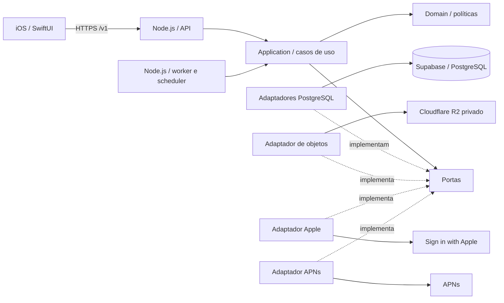
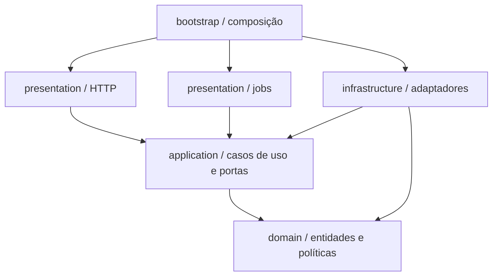
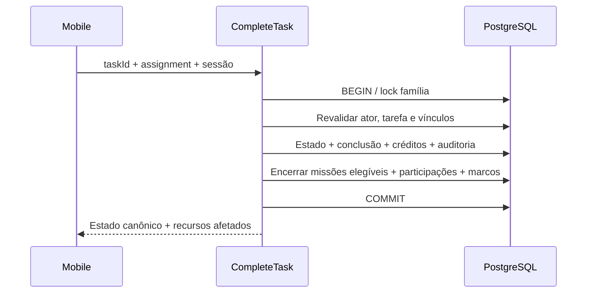
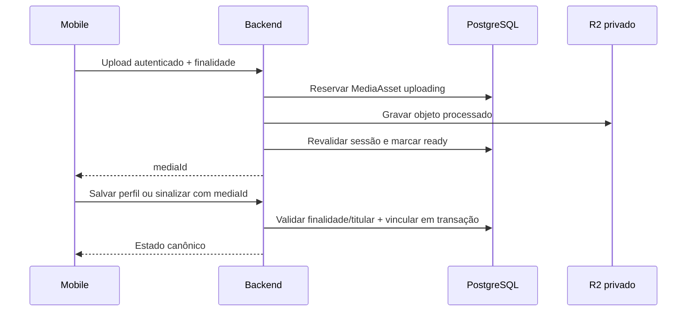

# Arquitetura backend — Node.js e Clean Architecture

**Versão:** 1.0\
**Base funcional:** 1.5 · Mobile: 1.2 · Design: 1.1 · DER: 1.2\
**Data:** 2026-10-05\
**Situação:** arquitetura para implementação futura; sem servidor, migrações ou infraestrutura implementados

[Índice](../DOCUMENTACAO.md) · [Contratos e rastreabilidade](backend-contracts.md) · [Decisões](backend-decisions.md) · [Mobile](mobile-architecture.md) · [DER](../05-modelo-de-dados.md)

## 1. Escopo e base técnica

Backend único em Node.js, com Clean Architecture, PostgreSQL hospedado no Supabase e arquivos privados no Cloudflare R2. O servidor concentra autorização, persistência, regras de negócio, materialização das rotinas, apuração semanal e envio de notificações. O aplicativo gera o PDF e realiza o sorteio/animação da roleta; o backend fornece os dados e registra o aceite.

Foram consideradas a [visão](../00-visao-do-produto.md), as [62 regras](../01-regras-de-negocio.md), os [68 RF e 27 RNF](../02-requisitos.md), os [19 UC](../03-casos-de-uso.md), o [modelo de classes](../06-diagrama-de-classes.md), o [screen map](../design/screen-map.md), os [16 fluxos](../design/user-flows.md) e as [decisões mobile](mobile-decisions.md). Esta arquitetura não cria novas funcionalidades nem altera permissões.

| Item | Definição desta arquitetura |
|---|---|
| Runtime | Node.js em linha LTS suportada; referência atual Node.js 24, patch fixado ao implementar |
| Linguagem | TypeScript com verificação estrita, compilado para JavaScript ESM |
| HTTP | Fastify como adaptador; JSON Schema de entrada/saída e contrato OpenAPI versionado |
| Persistência | SQL parametrizado com `pg` / node-postgres; migrations SQL versionadas |
| Banco | PostgreSQL do Supabase; um banco lógico por ambiente |
| Objetos | R2 privado via API compatível com S3, adaptador com AWS SDK for JavaScript v3 |
| Identidade | Sign in with Apple para Criador; convites e sessões próprios para o produto |
| Processamento assíncrono | Worker do mesmo backend; agendamento, fila e leases persistidos no PostgreSQL |
| Composição | Injeção por construtor/factory no ponto de entrada, sem service locator |
| Ambientes | Somente desenvolvimento e produção |

Node.js, Clean Architecture, Supabase e R2 foram definidos pelo usuário. TypeScript, Fastify, `pg` e a organização operacional são escolhas técnicas propostas nesta versão, explicitadas em [BA-02–BA-06](backend-decisions.md#2-decisões-técnicas). Não são apresentadas como aprovações anteriores do usuário.

A linha LTS será revalidada no começo da implementação; produção deve usar uma linha suportada. O Node.js publica o [ciclo de releases](https://nodejs.org/en/about/previous-releases). Fastify oferece [validação e serialização por schema](https://fastify.dev/docs/latest/Reference/Validation-and-Serialization/), mantendo validação de formato na borda e regras de negócio nos casos de uso.

## 2. Topologia: um monólito modular

Uma base de código, um conjunto de módulos e um artefato de release, com entradas `api` e `worker`. Eles podem executar como processos distintos do mesmo serviço. Essa separação permite reiniciar trabalhos sem bloquear HTTP; não cria microserviços, bancos por domínio nem comunicação interna por HTTP.



O mobile não recebe chave Supabase, senha PostgreSQL nem credenciais R2. Supabase é usado como banco gerenciado: Supabase Auth, Storage, Realtime e Edge Functions não são necessários para o desenho escolhido. A sessão própria permite cumprir refresh estável sem prazo, revogação em cada chamada e um aparelho por perfil sem adaptar essas regras a um fluxo de login diferente.

O backend não mantém WebSocket nem exige Redis, Kafka ou RabbitMQ no MVP. As consultas ao abrir/retomar o app e após alterações seguem MA-15. Jobs persistentes dão continuidade ao processamento mesmo com o aplicativo fechado.

## 3. Camadas e dependências



| Camada | Contém | Não deve conhecer |
|---|---|---|
| `domain` | Entidades, valores, transições, elegibilidade, fórmulas e erros de negócio | Fastify, SQL, `pg`, R2, APNs, variáveis de ambiente, DTO HTTP |
| `application` | Casos de uso, autorização por capacidade, portas, coordenação de transações e projeções | Implementações concretas dos adaptadores, objetos Request/Reply |
| `presentation` | Rotas, schemas, autenticação de transporte, presenters e handlers de jobs | SQL e regras calculadas diretamente no controller |
| `infrastructure` | Repositórios, conexão, transactions, relógio, criptografia e integrações | Navegação/telas e decisões de produto novas |
| `bootstrap` | Configuração validada e construção do grafo de dependências | Regras de crédito, missão ou destaque |

Uma entidade não chama um repositório. Um repository não decide quem merece badge. Um controller converte entrada validada em comando, chama um caso de uso e traduz a resposta. Handlers de jobs chamam os mesmos serviços de aplicação usados nas operações correspondentes.

A linguagem permanece inglesa em código, arquivos, pastas, schemas SQL, enums, logs estruturados e códigos de erro. Documentação é portuguesa; mensagens finais de UI são localizadas no mobile. Tipos usam `PascalCase`, funções/campos JSON `camelCase`, arquivos TypeScript `kebab-case.ts`, tabelas/colunas `snake_case`.

## 4. Módulos de negócio

| Módulo | Responsabilidade | Conceitos e portas principais |
|---|---|---|
| `access` | Apple, convites, ingresso, recuperação restrita, sessão e revogação | `Invite`, `Session`, `AppleIdentityVerifier`, `CredentialHasher`, `SessionRepository` |
| `family` | Família, papéis, Criador, membros, fuso e remoção | `Family`, `Member`, `FamilyRepository`, `MemberRepository` |
| `profile` | Foto/apelido do titular e leitura de badges | `OwnProfileQuery`, `UpdateOwnProfile`, contratos de mídia/missões |
| `tasks` | Ocorrências, atribuições, conclusão, correção, reabertura e exclusão | `FamilyTask`, `Completion`, `CompletionCredit`, `TaskEvent` |
| `routines` | Versões da rotina, horizonte, ocorrências e exceções | `Routine`, `OccurrenceOrigin`, `RoutineRepository` |
| `kids` | Sinalização, fila administrativa e decisão | `KidsSignal`, `KidsSignalRepository`; conclusão reutiliza `tasks` |
| `missions` | Vínculos, encerramento, participações e marcos | `Mission`, `MissionParticipation`, `BadgeAward`, `MissionRepository` |
| `rewards` | Catálogo predefinido/personalizado e aceite único | `RewardItem`, `RewardCatalog`, `RewardAcceptance` |
| `insights` | Períodos, progresso e carga consistente | `PeriodResolver`, `FamilyCalendar`, `InsightsQuery` |
| `reports` | Snapshot semanal adulto para PDF local | `WeeklyReportSnapshotQuery` |
| `recognition` | Ciclos, apuração e consulta do próprio destaque | `WeeklyCycle`, `WeeklyHighlight`, `WeeklyRecognition` |
| `media` | Upload, vínculo, leitura privada e limpeza de órfãos | `MediaAsset`, `ObjectStorage`, `ImageProcessor` |
| `notifications` | Dispositivo da sessão, outbox e APNs | `PushDevice`, `NotificationDelivery`, `PushGateway` |

Dependências entre módulos passam por contratos de Application. A conclusão de tarefa usa um serviço de aplicação de Missions para encerrar missões **na mesma transação**. O módulo Missions lê créditos por uma porta de consulta implementada na persistência, sem chamar de volta o caso de uso de conclusão. Evitar dependências cíclicas entre casos de uso.

Eventos destinados a integrações externas usam outbox após commit. Recalcular crédito e conceder participação não são eventos assíncronos: o estado devolvido deve estar consistente. Queries de Insights/Reports podem fazer joins entre tabelas por adaptadores dedicados; não precisam hidratar todos os agregados nem duplicar uma base de leitura.

## 5. Estrutura futura de arquivos

```text
backend/
  src/
    bootstrap/
      api-main.ts
      worker-main.ts
      container.ts
      configuration.ts
    modules/
      access/
      family/
      profile/
      tasks/
        domain/
          family-task.ts
          completion.ts
          completion-credit.ts
          task-policy.ts
        application/
          use-cases/
            complete-task.ts
            edit-task.ts
            reopen-task.ts
          ports/
            task-repository.ts
            completion-repository.ts
          contracts/
            task-mutation-result.ts
        presentation/http/
          task-routes.ts
          complete-task-schema.ts
          task-presenter.ts
        infrastructure/postgres/
          postgres-task-repository.ts
          task-row-mapper.ts
      routines/
      kids/
      missions/
      rewards/
      insights/
      reports/
      recognition/
      media/
      notifications/
    shared/
      domain/
        local-date.ts
        member-role.ts
        domain-error.ts
      application/
        transaction-runner.ts
        actor-context.ts
        clock.ts
      infrastructure/
        postgres/
          connection-pool.ts
          postgres-transaction-runner.ts
        security/
          credential-hasher.ts
          secret-envelope.ts
        observability/
          logger.ts
    integrations/
      apple/apple-identity-verifier.ts
      r2/r2-object-storage.ts
      apns/apns-push-gateway.ts
  database/
    migrations/
    seeds/
  contracts/
    openapi.yaml
  tests/
    unit/
    integration/
    contract/
```

A árvore é uma especificação, não arquivos já criados. Cada módulo recebe somente as pastas de que precisa. Repositórios têm operações do domínio, sem `BaseRepository<T>` que permita alterar qualquer tabela ignorando regras. A composição injeta `pg`, R2 e APNs apenas nos adaptadores; trocar Fastify não muda Domain/Application.

## 6. Supabase, SQL e isolamento de famílias

Usar PostgreSQL com conexão TLS e pool limitado por processo. Para processos persistentes, preferir conexão direta; usar Supavisor em modo sessão se a conectividade exigir IPv4. O dimensionamento soma conexões da API, worker e administração. Não pressupor que a quantidade padrão do driver cabe no plano contratado. [Conexões Supabase](https://supabase.com/docs/guides/database/connecting-to-postgres).

Tabelas do produto ficam em schema privado `app`. Desabilitar a Data API se não for usada e retirar grants dos papéis públicos `anon`/`authenticated`; não expor views ou funções de negócio por PostgREST. Papel de runtime tem apenas privilégios necessários, sem DDL; migrations usam credencial separada. Não usar superusuário nem chave `service_role` como estratégia de autorização do aplicativo. [Segurança da Data API](https://supabase.com/docs/guides/api/securing-your-api).

O isolamento adotado é autorização explícita na aplicação com escopo de família obrigatório em todos os repositories/queries, apoiado por FKs compostas. O banco não reconhece automaticamente a sessão própria como `auth.uid()`. RLS pode ser uma defesa adicional se implementada com contexto transacional, mas não é garantia implícita deste desenho. Testes de acesso cruzado cobrem também queries agregadas, mídia, jobs e relacionamentos.

| Invariante | Persistência prevista |
|---|---|
| Um Criador protegido | Identidade Apple única; índice único de Criador por família; criação família/membro atômica; proibição de remoção/rebaixamento |
| Um perfil em uma família | `members.family_id` obrigatório; referências compostas `(family_id, id)` |
| Uma sessão ativa por perfil | Índice único parcial em `sessions(member_id)` onde `revoked_at IS NULL` |
| Um convite disponível por perfil | Índice único parcial para não consumido/não revogado; hashes únicos |
| Ocorrência não duplicada | Unique `(task_template_id, origin_key)`; origem imutável, independente de `scheduled_date` |
| Uma conclusão vigente | Unique parcial `completions(task_id)` onde `undone_at IS NULL` |
| Créditos sem duplicação | PK `(completion_id, member_id)` e peso de 1 a 3 |
| Participação / marco | Unique `(mission_id, member_id)` e `(member_id, badge_code)`; contribuições do mesmo titular |
| Resgate | Campos do aceite na missão atualizados uma única vez; FK para item global ou da mesma família |
| Ciclos / apuração | Unique por família/início e por ciclo/apuração; impedir sobreposição; continuidade verificada sob lock |
| Notificação | Unique `(highlight_id, member_id)`; estado e tentativas persistidos |

Checks simples ficam no banco; regras que exigem vários registros são verificadas no caso de uso sob transação. Para famílias, missões e conclusões não basta uma FK para provar “ao menos um” ou “sempre um Criador”: a criação/edição atômica e a impossibilidade de escrita paralela fora desses caminhos sustentam a regra.

Queries sempre parametrizadas. Índices adicionais seguem os acessos: tarefas por família/data/status; responsáveis por membro/tarefa; conclusões por família/instante; vínculos de missão; fila Kids pendente; ciclos e jobs por próximo processamento. Datas civis usam `date`, instantes `timestamptz`; JSON de auditoria contém valores antes/depois, não tokens ou fotos binárias.

## 7. Transações, concorrência e resultado incerto

Edições seguem a última gravação **válida persistida**; não há `If-Match`, `expectedVersion` nem merge automático. `PATCH` altera somente os campos presentes; duas edições do mesmo campo podem se sobrescrever. Substituições de listas, como responsáveis/vínculos, enviam a lista completa. O servidor não aceita `status`, créditos, autor ou família arbitrariamente dentro de um PATCH.

Para o MVP, comandos que alteram estado de uma família adquirem primeiro `SELECT ... FOR UPDATE` na linha da família, mantendo a transação curta. Isso serializa conclusão, sinalização, missão, remoção de membro, fuso e apuração da mesma família; outras famílias continuam independentes. A autorização é revalidada depois do lock, incluindo sessão, papel e perfil ativo. Todos os caminhos de escrita, inclusive jobs, seguem essa ordem.

Locks seguem identidade de bootstrap, quando aplicável, e depois famílias por ID ordenado, membros/sessões e recursos. Operações de uma família normalmente usam apenas um lock familiar. Troca de acesso que encerre uma sessão local anterior usa ordem determinística entre as famílias envolvidas. Uma revogação efetivada antes do lock impede o comando; comando autorizado e confirmado antes da revogação permanece válido.

Usar `READ COMMITTED` com esses locks nas escritas. Reads agregados e snapshots com várias consultas usam transação curta `REPEATABLE READ READ ONLY`, após completar materialização necessária. Cada transação usa **a mesma conexão**; o `TransactionRunner` libera/descarta corretamente a conexão no fim. [Transações node-postgres](https://node-postgres.com/features/transactions), [locks PostgreSQL](https://www.postgresql.org/docs/current/explicit-locking.html) e [isolamento](https://www.postgresql.org/docs/current/transaction-iso.html).

Não executar upload, verificação remota Apple, processamento pesado de imagem nem envio APNs segurando lock. Verificar provas externas antes e revalidar dados mutáveis dentro da transação. Não fazer retry automático de um comando HTTP cujo commit ficou incerto, nem usar request ID como chave de idempotência. Erro após commit pode significar sucesso: o cliente consulta estado. Retentativas internas de jobs usam suas chaves naturais, não um replay geral de ações do usuário.

Exemplo conceitual; portas e tipos auxiliares são resumidos, sem implementação compilável:

```typescript
// complete-task.ts
export class CompleteTask {
  constructor(private readonly transactions: TransactionRunner) {}

  execute(input: CompleteTaskInput, actor: ActorContext) {
    return this.transactions.forFamily(actor.familyId, async (tx) => {
      const member = await tx.access.requireActiveAdult(actor);
      const task = await tx.tasks.getRequired(actor.familyId, input.taskId);
      const completion = task.complete({
        actorId: member.id,
        assignment: input.assignment,
        completedAt: tx.clock.now(),
      });
      await tx.tasks.save(task);
      await tx.completions.insert(completion);
      await tx.audit.recordCompletion(task, completion);
      await tx.missions.reconcileForTask(task.id);
      return tx.queries.taskMutationResult(task.id);
    });
  }
}
```

`forFamily` só resolve após commit confirmado; repositories de `tx` compartilham conexão. `reconcileForTask` é serviço de aplicação composto sobre esses repositories, não uma regra escondida no driver. Relógio usa instante obtido após adquirir lock, evitando registrar conclusão em período anterior por tempo de espera. Nunca aceitar `completedAt` retroativo enviado pelo app.

## 8. Identidade, bootstrap, convites e sessões

### Criador via Apple

Validar assinatura/chaves, emissor, audiência, validade e nonce da prova Apple; o cliente verifica também o contexto/state. Trocar authorization code conforme a integração oficial, sem confiar em email ou Apple ID isolado. Chaves públicas podem ter cache limitado e atualização; prova inválida não abre sessão. [Validação Apple](https://developer.apple.com/documentation/signinwithapple/verifying-a-user).

Identidade sem família recebe `creationGrant` opaco, restrito a UC01, de curta duração configurada (dez minutos, confirmado em [BA-21](backend-decisions.md)). Não é sessão de membro e não autoriza consultas de família. `CreateFamily` bloqueia a identidade, cria família, Criador, ciclo inicial e sessão na mesma transação. Concorrência retorna a família já vinculada, sem duplicá-la. Grant expirado exige Apple novamente. Identidade existente abre sessão do Criador e revoga a anterior. Cadastro por convite não cria/associa identidade Apple.

### Credenciais e ingresso

Convites usam token aleatório e senha aleatória independente; geração pelo backend com fonte criptográfica. Persistir hash/verificador, nunca senha legível. Senha usa função resistente a tentativas offline, por exemplo scrypt assíncrono com salt e parâmetros versionados; tokens de alta entropia admitem SHA-256/HMAC. Bibliotecas e parâmetros são fixados ao implementar, com limites de recursos. [Primitivas do Node.js](https://nodejs.org/api/crypto.html).

`IssueMemberInvite` sempre cria link/senha novos, revoga convites disponíveis e sessão do alvo no mesmo commit. Não permite convite ao Criador ou membro removido. Credenciais saem uma vez, com `Cache-Control: no-store`. Se a resposta da emissão se perder, emitir outro mediante nova ação; não existe endpoint para reconstruir senha. Inspeção/ingresso recebem token no body, com logs removidos; a página do link não carrega analytics que recebam a credencial. Limitar tentativas por origem e identificador derivado do convite, sem expirar o convite por tempo.

Ingresso valida senha antes do lock quando possível e revalida convite, perfil e estado no lock. Consome convite, cria sessão/credenciais e registra recuperação de ingresso em uma transação. Duas tentativas distintas não criam duas sessões. Para troca confirmada, receber opcionalmente credencial da sessão anterior, autenticá-la e encerrá-la somente no mesmo commit bem-sucedido; não remover seu membro. Cancelamento/erro de validação não toca o acesso anterior. Resposta perdida após commit é resultado incerto, não rollback; o app usa recuperação específica.

### Um aparelho e recuperação de ingresso

Sessão identifica perfil e instalação, com segredo aleatório da instalação protegido no Keychain e verificador no servidor. UUID da instalação sozinho não autentica. Requisições enviam prova da instalação por TLS além da credencial; não registrar esses headers. A regra é uma sessão ativa por perfil, não garantia física contra cópia de credenciais de um aparelho comprometido.

Access token é opaco, aleatório, válido por 15 minutos, armazenado por hash no servidor e apenas em memória no app. Refresh estável, sem vencimento temporal, fica no Keychain; servidor persiste seu hash. Renovação pode emitir novo access token sem invalidar os ainda dentro dos 15 minutos, todos subordinados à **mesma sessão**. Isso evita falhas em requisições concorrentes; revogar sessão invalida todos imediatamente. Papel/família/estado são lidos do servidor em cada operação, sem cache que prolongue permissão revogada.

Antes do ingresso, o app cria `attemptId` e segredo de tentativa imprevisível, associados à prova da instalação. O servidor guarda verificadores e um envelope criptografado do resultado de credenciais por **dez minutos desde o commit**. `RecoverInviteJoin` exige as mesmas provas, convite/tentativa compatíveis e sessão ainda ativa. Pode retornar as credenciais do mesmo ingresso, sem consumir convite novamente. Rotação/revogação posterior impede a recuperação. Envelope usa criptografia autenticada e chave fora do banco; validade é conferida a cada recuperação mesmo se a limpeza atrasar, e o envelope expirado é removido. Senha do convite não entra nele. Fora da janela, convidado precisa de novo convite; Criador pode refazer Apple.

Esse armazenamento operacional é limitado ao ingresso; não cria idempotência para tarefas, uploads ou resgates. Falha de refresh em rede não revoga sessão. Toda consulta, download e escrita verifica a sessão; consulta negada por recurso não equivale a revogação global.

## 9. Tarefas, Kids e missões na mesma transação



| Comando | Regras transacionais |
|---|---|
| Criar/editar tarefa | Adulto, título, peso 1–3, data civil livre, responsáveis da família; não alterar conquista protegida |
| Concluir | Pendente/aguardando; manter responsáveis ou assumir; sem responsáveis atribui ao adulto; uma conclusão com crédito integral para cada responsável final |
| Sinalizar Kids | Própria tarefa pendente; registrar sinalização e foto opcional; estado único aguardando, sem crédito |
| Confirmar/recusar sinalização | Só Admin; operar sobre `signalId` ainda corrente; confirmar conclui para todos, recusar volta a pendente; decisão antiga não atua sobre nova sinalização |
| Concluir manualmente enquanto aguarda | Adulto; encerra sinalização corrente, audita e conclui uma vez |
| Editar concluída | Permitido sem missão concluída; ajustar crédito vigente e auditoria, preservar `completedAt` e autor; lista vazia significa zero crédito individual |
| Reabrir | Só Admin; pelo menos uma missão em andamento e nenhuma concluída; invalidar conclusão vigente uma vez, manter responsáveis, atualizar progresso |
| Excluir | Somente não concluída/não protegida; impedir missão vazia; retirar vínculos/reconciliar missões; tombstone impede regeneração |
| Salvar missão | Só Admin; ao menos uma tarefa individual da mesma família; se todas concluídas, encerrar imediatamente |
| Remover membro | Revogar sessão/convites; retirar só ele das futuras não concluídas/não protegidas; preservar pendências antigas, concluídas/protegidas e histórico |

A remoção também retira o membro dos responsáveis padrão das rotinas para não voltar a atribuí-lo em novas ocorrências. “Futura” segue a data civil posterior a hoje no fuso da família; o dia atual não é incluído implicitamente. Na edição explícita de responsáveis, não adicionar perfis removidos; vínculos antigos preservados pela remoção não são apagados por leitura. Bloquear a sessão não apaga créditos históricos.

`CloseEligibleMissions` calcula tarefas distintas, congela dados/vínculos e registra uma participação para cada responsável com crédito válido em pelo menos uma tarefa da missão. Não usa quem clicou, não concede indistintamente a todos os ativos, não inclui recém-chegados sem participação. Membro removido pode ter participação histórica reconhecida pelos créditos preservados, sem recuperar acesso.

Contar participações distintas e conceder os marcos atingidos: bronze 5, silver 10, gold 25, diamond 50. Cada marco retém suas primeiras N participações em ordem determinística `(recordedAt, missionId)`; novos marcos mantêm os anteriores. Processar missões simultaneamente encerradas em ordem estável, sem depender da ordem de leitura SQL. Detalhe do badge retorna essas missões. Nem badge nem conclusão de missão dependem do aceite da recompensa.

`AcceptMissionReward` verifica Admin, missão concluída, ausência de aceite e item global/da família. Registra item, título no aceite, ator e instante uma vez. Não exige prova de sorteio, não sorteia no servidor nem grava recusas. Conflito retorna estado atual para consulta, não troca a recompensa aceita.

## 10. Rotinas, datas livres e materialização

Data prevista e início aceitam datas passadas, anteriores à família e em qualquer mês futuro; validar apenas data representável/válida no contrato civil. Não usar `createdAt`, hoje ou fim de mês como limite de cadastro. O carrossel mantém RN49. Tarefa única futura é persistida imediatamente; rotina iniciada além do horizonte permanece programada, possivelmente sem ocorrências ainda.

Gerar por soma de dias civis de 1/7/14/21/28, até fim do próximo mês no fuso da família. O worker avança diariamente; consultas que dependem de totais completos acionam complemento quando houver atraso. Início antigo é processado em lotes com cursor persistente; não fazer transação proporcional a décadas nem descartar datas antigas silenciosamente. Consulta incompleta responde `202` com estado `preparing` e orientação de polling, sem mostrar total parcial como completo. O cadastro pode confirmar a configuração com `materializationState: pending`.

Cada ocorrência tem `originKey` estável e `originDate` civil original. Para a implementação proposta, origem identifica o slot original do template e permanece igual após mover `scheduledDate`; índice não se baseia na data editável. Registros cancelados e exceções individuais continuam reservando a origem. Materializar nunca sobrescreve ocorrência existente; atualizar rotina é um comando separado.

Edição de rotina registra versão com vigência e reconcilia somente ocorrências futuras abrangidas, não concluídas/não protegidas. Preserva IDs existentes, edições individuais fora do alcance, passado e conquistas; slots novos são criados, slots retirados recebem cancelamento auditado. Slots com exceção ou conquista não são recriados para “corrigir” a frequência. Frequência nova é ancorada à data inicial da versão. Exclusão “esta e futuras” também encerra geração além do limite escolhido, preservando tombstones e protegidas. Um job antigo revalida a versão sob lock antes de avançar cursor.

A consulta do estado atual permite acompanhar a preparação por `routineId`; isso é estado do recurso, não recuperação geral de resultado de comando. Autorização e limite de trabalho por lote impedem que consulta Kids force criação fora da rotina de sua família.

## 11. Fuso, ciclos e apuração semanal

`FamilyCalendar` usa fuso IANA, padrão `America/Sao_Paulo`, e relógio injetado. Transporte distingue `LocalDate` (`YYYY-MM-DD`) e instante ISO 8601 UTC. Não interpretar data civil por `new Date(dateOnly)` nem somar 86.400 segundos para obter “amanhã”. Adaptador de calendário usa biblioteca com suporte IANA; a biblioteca fica fora das regras puras.

O servidor persiste `WeeklyCycle` com início inclusivo, fim exclusivo, fuso, referência e flag de transição. Criação inicia o primeiro ciclo no instante da família e marca período parcial. Consultas/PDF podem incluir tarefas retroativas na semana de criação conforme RN62; crédito é sempre pelo instante real da conclusão.

Admin escolhe `immediate` ou `nextCycle` em RF67. Sob lock, fechar/apurar ciclos já vencidos antes de alterar o ciclo aberto. Imediata conserva seu início e define fim na próxima segunda 00:00 no novo fuso, estritamente futura. Programada conserva fim atual, aplica fuso ao começar o seguinte e usa a primeira segunda 00:00 posterior àquele início. Primeiro instante válido da data cobre transições de calendário. Ciclos permanecem contíguos; uma alteração programada nova substitui a anterior ainda não aplicada, com auditoria, segundo última gravação válida.

Mudança de fuso não desloca datas previstas nem reabre ciclos encerrados. O servidor devolve limites civis e absolutos explícitos, inclusive transição; o mobile não reconstrói o período usando o fuso do aparelho. Em período de transição, não prometer que carga semanal é soma de sete dias normais: o intervalo efetivo está identificado no retorno/PDF.

Scheduler busca ciclos vencidos pelo relógio do banco e ordena os atrasados. Às 00:00 locais o ciclo se torna elegível; processamento não depende de app aberto nem de um cron por fuso. Proposta operacional: varredura a cada minuto e também no início do worker. Um lease permite recuperar trabalho interrompido.

Apuração sob lock soma créditos válidos com `completedAt` dentro do ciclo, considerando os perfis ativos no snapshot da apuração, inclusive Kids. Sem soma positiva: resultado final sem vencedores. Empate reconhece todos. Persistir resultado e intenções de notificação juntos e marcar finalização; nenhuma leitura publica apuração parcial. Se houve atraso do worker, usar o estado válido no momento em que finaliza, registrando `processedAt`; não fingir que foi calculado à meia-noite. Correções anteriores à finalização podem refletir no resultado; posteriores não o alteram nem notificam outra vez.

## 12. Consultas, indicadores e snapshot para PDF

| Projeção | Fonte e fórmula |
|---|---|
| Progresso | Tarefas distintas previstas no intervalo e estado atual: concluídas / total; sem responsável conta no familiar |
| Carga por membro | Soma do peso vigente de créditos de conclusões válidas cujo instante está no intervalo |
| Carga familiar | Soma das cargas individuais; tarefa peso 3 compartilhada por dois soma 6 |
| Quantidade realizada | Por membro, tarefas creditadas distintas; familiar, tarefas distintas, sem somar contagens individuais |
| Missão | Concluídas distintas / vinculadas distintas, sem prazo |
| Destaque | Resultado final persistido, não recalculado pela consulta |

`FamilyOverviewQuery` devolve carga, progresso e membros numa leitura consistente; listas extensas têm paginação, mas totais são calculados sobre o período completo. Sem denominador, percentual `null` e contagens zero; nenhum NaN ou conclusão fictícia. Joins de responsáveis/missões não podem multiplicar tarefas/creditar peso novamente.

Queries do carrossel restringem data de referência à criação–fim do mês corrente e explicitam intervalos efetivos nas bordas. Leitura por ID após criação e seleção de tarefas para missão são contratos distintos, com autorização; não impõem o limite do carrossel ao cadastro. Kids recebem projeção própria, sem campos de carga familiar ocultos apenas na UI. Missões podem mostrar resumos coletivos, sem liberar detalhe operacional/fotos de tarefas alheias.

`GetWeeklyReportSnapshot` autoriza adulto, rejeita semana futura ou sem interseção com a existência da família, completa materialização necessária e usa um snapshot de banco. Retorna família, período/fuso/transição, `generatedAt`, parcialidade, carga, progresso e linhas por membro, incluindo créditos históricos preservados e indicação de removidos quando necessária à conciliação. Não omitir silenciosamente antigos membros com crédito válido. Não inclui fotos Kids, tokens, hashes ou configuração privada de perfil.

PDFKit/renderização/paginação e compartilhamento são locais. Não há endpoint de gerar binário PDF nem bucket para PDFs. Arquivo exportado permanece como estava; nova consulta traz valores corrigidos. O destaque usa seu snapshot preservado e pode diferir do novo relatório, com natureza temporal explicitada.

## 13. Fotos no R2 e consistência com o banco

Upload passa pelo backend, conforme decisão do usuário. Receber conteúdo com limite, validar bytes/formato, converter para JPEG com lado maior até 1.600 pixels e até 5 MB após processamento, removendo metadados desnecessários. Limites de entrada/decodificação protegem o processo; não confiar em extensão/MIME informado. CPU de imagem usa concorrência limitada, sem bloquear o event loop.

O servidor gera chave sob prefixo de ambiente/família e nunca aceita URL remota arbitrária para buscar ou vincular. `ObjectStorage` encapsula `put/get/delete` compatíveis com o R2; não depender de funcionalidades AWS ausentes. [Compatibilidade S3 do R2](https://developers.cloudflare.com/r2/api/s3/api/).



R2 e PostgreSQL não compartilham transação. Reservar `MediaAsset` antes do I/O permite recuperar objeto órfão quando R2 conclui e o banco falha; falha inversa deixa reserva sem objeto. O worker reconcilia ambos. Upload só fica pronto após verificação e revalidação de acesso; remover membro durante upload impede seu vínculo. Substituir foto mantém a antiga até a transação do perfil confirmar. Falha de foto opcional deixa o usuário escolher repetir ou prosseguir sem ela.

Supabase guarda a URL estável do objeto **privado**, sem assinatura ou segredo, além dos metadados/referências necessários. O app recebe `mediaId` e `GET /v1/media/{id}/content`; backend autoriza a sessão, família, titularidade/finalidade e transmite o objeto por streaming. Não redirecionar para URL pública/assinada que continue acessível sem revalidação. Respostas privadas não devem entrar em cache compartilhado. Leitura já transferida não pode ser apagada remotamente pela revogação.

Foto de perfil segue visibilidade familiar; foto de sinalização segue titular e adultos autorizados a avaliar/concluir aquela tarefa. Resumo de missão não expõe fotos Kids a outros Kids. O servidor só vincula mídia própria compatível com o comando; conhecer um UUID não concede posse.

Uploads nunca vinculados são candidatos à limpeza após 24 horas. Sob lock, marcar `deleting` somente se ainda sem vínculo; comandos não vinculam esse estado. Apagar R2 fora da transação e finalizar registro; retentativa trata objeto já ausente como removido. Fotos já vinculadas, inclusive substituídas ou históricas, não entram automaticamente nessa política: retenção continua fora desta etapa.

## 14. Jobs, notificações e falhas externas

| Trabalho | Disparo / garantia |
|---|---|
| `MaterializeRoutineOccurrences` | Diário no fuso, complemento de consulta, cursor/versão e origem única |
| `AdvanceFamilyCalendar` | Ciclo vencido ou configuração; aplica mudança programada e cria próximo ciclo contíguo |
| `FinalizeWeeklyHighlight` | Ciclo encerrado; resultado único e imutável após finalização |
| `DeliverRecognitionNotification` | Outbox confirmada; intenção única, envio externo sujeito a falhas |
| `CleanOrphanMedia` | Reservas/uploads não vinculados com mais de 24h; revalidar antes de apagar |
| `CleanExpiredAccessArtifacts` | Access tokens expirados, grants e envelopes encerrados; nunca expirar refresh/convite por idade |

Fila em PostgreSQL possui chave natural, `status`, `availableAt`, `attemptCount`, `leaseUntil`, `lockedBy`, erro sanitizado e versão do claim. Claim em transação curta com `FOR UPDATE SKIP LOCKED`; execução fora do lock de fila, depois atualização condicional pelo claim. Lease vencido volta a ser elegível. Sempre adquirir lock familiar antes de alterar domínio; não manter lock de job enquanto espera família.

Retries dos jobs têm atraso crescente e variação, limite configurável por integração e estado de falha visível para recuperação. Isso não define volume de testes nem cria fila de comandos mobile offline. Execução pode ocorrer mais de uma vez; unicidade, cursor e estado tornam os efeitos de negócio seguros. PostgreSQL e banco indisponíveis interrompem gravações, sem fallback de autoridade para memória.

Dispositivo APNs pertence à sessão e ao ambiente; o servidor rejeita ambiente incompatível com sua configuração, sem aceitar seleção arbitrária do cliente. Atualizar token no registro do aparelho, invalidar em revogação/troca; envio consulta sessão/perfil ainda ativos. Uma notificação sem dispositivo válido não impede consulta interna. Payload mínimo contém tipo e ID do reconhecimento, sem foto/credencial/detalhes familiares; revalidar ao abrir. Job não envia WhatsApp: esse compartilhamento pertence ao usuário no app.

Fila distingue `pending`, `acceptedByProvider` e `failed`, com tentativas e abertura separada. Resposta de sucesso do APNs significa aceitação, não prova de entrega/leitura. Timeout após envio pode produzir duplicata externa; documentar e usar identificação estável para reduzir duplicidade, sem prometer entrega exatamente uma vez. Resultado do destaque não depende do push. [Respostas do APNs](https://developer.apple.com/documentation/usernotifications/handling-notification-responses-from-apns).

## 15. Operação, configuração e verificação

API e worker validam configuração ao iniciar: URLs de banco/API, ambiente, bucket/endpoint R2, audiência Apple, segredos de verificação/criptografia e credenciais APNs. Produção e desenvolvimento não compartilham dados/segredos. Um ponto de readiness verifica dependências essenciais à função do processo; liveness verifica processo. Falha R2 não precisa bloquear consultas de tarefas; falha do banco impede afirmar persistência.

Logs estruturados usam `requestId`, caso de uso, duração e erro sanitizado. Remover Authorization, refresh, senha, token de convite, prova de instalação, conteúdo de foto e prova Apple. IDs técnicos de família/membro só quando necessários e protegidos. Medir latência, falhas, espera de lock, pool, atraso de materialização/apuração, tamanho/idade da outbox e uploads incompletos. Meta já aceita: p95 de consultas comuns do servidor até um segundo, a medir posteriormente; sem promessa de benchmark nesta documentação.

Migrations SQL forward-only e seeds determinísticos para quatro badges e catálogo predefinido. Em evolução, aplicar mudanças compatíveis antes de retirar campos e manter API/worker na mesma versão de contratos. Não fazer sincronização automática de schema no boot. Não há rotina própria de backup do banco, conforme decisão anterior. Hospedagem, distribuição do app, retenção de fotos vinculadas e volume de testes continuam fora deste escopo.

Validação futura se concentra em comportamentos: acesso entre famílias, privilégios do Criador/Kids, corrida conclusão/validação, missão vazia/protegida, correção de crédito, badge único, resgate simultâneo, reemissão/consumo de convite, revogação no meio do comando, recuperação de ingresso e isolamento de segredos. Testar fusos/transições/atrasos, reinício de jobs, snapshot de relatório e falhas entre R2 e banco. Usar PostgreSQL real nos testes transacionais; mocks isolados não comprovam unicidade, locks ou isolamento. Quantidades/cobertura percentual não são impostas aqui.

## Histórico

| Versão | Data | Alteração |
|---|---|---|
| 1.0 | 2026-10-05 | Arquitetura Node.js/Clean Architecture com Supabase/R2, módulos, transações, acesso, jobs, contratos e preservação da base funcional 1.5. |
