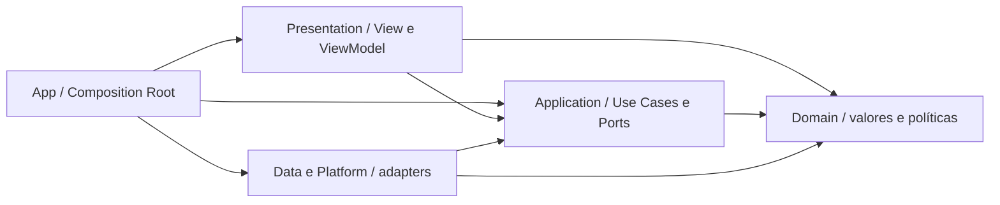
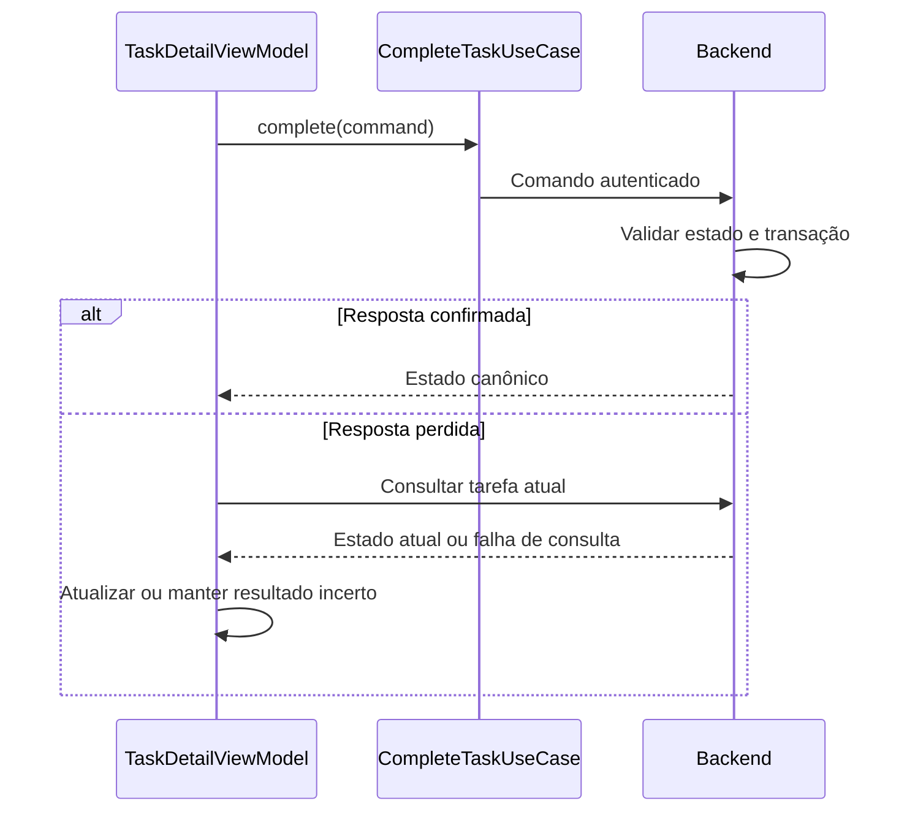

# Arquitetura mobile — Swift, SwiftUI e Clean Architecture

**Projeto:** App de Organização Familiar — MVP\
**Versão da arquitetura:** 1.4\
**Base funcional:** 1.9 · Design: 1.4 · Modelo de classes: 1.5\
**Data:** 2026-10-06\
**Situação:** decisões consolidadas antes da implementação

[Projeto](../../README.md) · [Índice](../DOCUMENTACAO.md) · [Catálogo mobile](mobile-feature-catalog.md) · [Decisões](mobile-decisions.md)

## 1. Escopo e fontes

Aplicativo nativo para iPhone e iPad, mínimo iOS/iPadOS 26, em Swift e SwiftUI. View + ViewModel organiza Presentation; Clean Architecture separa apresentação, casos de uso, domínio e integrações. Código, arquivos, tipos, membros, recursos e comentários de código usam inglês; documentação e textos da experiência permanecem em português, com strings localizáveis.

Esta arquitetura incorpora as decisões do usuário sobre datas, fuso, créditos, badges, convites, sessão única, Supabase, R2, concorrência e falhas. Árvores e exemplos abaixo são especificações futuras; nenhum projeto ou código de aplicativo foi implementado.

Fontes: [visão](../00-visao-do-produto.md), [RN](../01-regras-de-negocio.md), [RF/RNF](../02-requisitos.md), [UC01–UC19](../03-casos-de-uso.md), [diagramas UML](../04-diagramas-de-caso-de-uso.md), [DER](../05-modelo-de-dados.md), [classes](../06-diagrama-de-classes.md), [screen map](../design/screen-map.md) e [user flows](../design/user-flows.md). A base Markdown vigente é a referência; PDFs exportados anteriormente não são automaticamente atualizados.

O backend está definido em Node.js com Clean Architecture na [arquitetura backend](backend-architecture.md), com TypeScript/Fastify como propostas técnicas. Retenção de fotos vinculadas, volumes de teste e distribuição permanecem fora desta etapa. Layouts visuais finais podem evoluir sem reabrir as regras aqui consolidadas.

## 2. Estrutura escolhida

Um app organizado por funcionalidades, inicialmente em um target com fronteiras lógicas e targets de teste separados. A extração em Swift Packages é possível posteriormente; não se cria um package por tela.



Setas são dependências de código: Application chama protocolos implementados em Data, sem conhecer implementações concretas.

| Camada | Responsabilidade | Restrições |
|---|---|---|
| `Presentation` | Views, ViewModels, rascunhos, erros apresentados e navegação | Sem HTTP, DTOs, Keychain ou transações |
| `Application` | Casos de uso e portas de repositórios/integrações | Sem SwiftUI, UIKit, JSON ou SDK de armazenamento |
| `Domain` | Entidades de valor, enums, regras locais e métricas puras | Sem rede, persistência ou dependência de UI |
| `Data` / `Platform` | API, mappers, credenciais e integrações nativas | Não definem fluxos visuais nem substituem autorização remota |
| `App` | Montar implementações, factories, sessão e raiz da navegação | Não calcula créditos ou concede conquistas |

A revisão de imports deve preservar as fronteiras, pois pastas não as impõem ao compilador. Features não dependem da Presentation/Data de outras; comunicação usa casos de uso e projeções. Família compõe membros, tarefas e indicadores sem absorver seus domínios. Não haverá service locator, container externo ou `BaseViewModel` obrigatório.

## 3. Base técnica confirmada

| Item | Definição |
|---|---|
| Plataforma | iPhone e iPad, iOS/iPadOS 26 mínimo; layout adaptativo |
| Swift | Swift 6; toolchain estável fixado no começo da implementação e igual na CI |
| UI | SwiftUI, `NavigationStack`, `TabView`; bridges UIKit nas bordas necessárias |
| Observação | ViewModels `@Observable` e `@MainActor`; `@State` no proprietário e `@Bindable` para bindings |
| Concorrência local | `async/await`, cancelamento e actors para estado concorrente de infraestrutura |
| Rede | API HTTP/JSON `/v1` por `URLSession`, HTTPS, DTOs próprios e contrato OpenAPI |
| Dados | Backend único; PostgreSQL no Supabase; app acessa os dados pela API |
| Fotos | Backend grava arquivos privados no Cloudflare R2; URL estável do objeto no Supabase |
| Sessão | Keychain, access token de 15 minutos, refresh token estável e revogável sem expiração temporal; uma sessão ativa por perfil/instalação |
| Offline | Sem banco local de negócio e sem fila de gravações offline; conteúdo em memória pode ser identificado como desatualizado |
| PDF | Snapshot consistente do backend e renderização no app |
| Roleta | Catálogo remoto, sorteio/animação local e aceite remoto |
| Atualização remota | Abertura/retomada, foreground, atualização manual e invalidação após comandos; tempo real não é necessário ao MVP |
| Ambientes | Somente desenvolvimento e produção, com dados e credenciais separados |
| Backup | Sem rotina de backup do banco implementada pelo projeto; mecanismos automáticos do provedor são independentes |

## 4. Organização dos arquivos

`FamilyRoutine` é o identificador técnico do projeto, sem definir nome comercial. Estrutura futura resumida:

```text
ios/
  FamilyRoutine/
    App/
      FamilyRoutineApp.swift
      AppContainer.swift
      AppSessionStore.swift
      Navigation/
        AppRouter.swift
        AppRoute.swift
        DeepLinkParser.swift
      Factories/
        TasksFeatureFactory.swift
    Features/
      Access/
      Family/
      Profile/
      Tasks/
        Presentation/TaskDetail/
          TaskDetailView.swift
          TaskDetailViewModel.swift
          TaskDetailState.swift
        Application/UseCases/
          CompleteTaskUseCase.swift
        Application/Ports/
          TaskRepository.swift
        Application/Models/
          CompleteTaskCommand.swift
        Domain/
          FamilyTask.swift
          Completion.swift
        Data/
          RemoteTaskRepository.swift
          TaskDTO.swift
          TaskMapper.swift
      Routines/
      KidsParticipation/
      Insights/
      Missions/
      Rewards/
      Reports/
      Recognition/
    Shared/
      Domain/
        LocalDate.swift
        FamilyCalendar.swift
        MemberRole.swift
        DomainError.swift
      Application/
        ClockProviding.swift
        SessionProviding.swift
      Presentation/
        LoadState.swift
        UserFacingError.swift
        DesignSystem/
          PeriodPickerView.swift
          EmptyStateView.swift
      Infrastructure/
        APIClient.swift
        SessionRefreshCoordinator.swift
        KeychainSessionCredentialStore.swift
        ResourceChangeStore.swift
      Platform/
        AppleSignInAdapter.swift
        CameraCaptureAdapter.swift
        ProfilePhotoPickerAdapter.swift
        NativePDFRenderer.swift
        NotificationAdapter.swift
        WhatsAppShareAdapter.swift
    Resources/
      Localizable.xcstrings
      Assets.xcassets
      Info.plist
      PrivacyInfo.xcprivacy
    Configuration/
      Development.xcconfig
      Production.xcconfig
  FamilyRoutineTests/
  FamilyRoutineUITests/
```

As demais features seguem o mesmo padrão quando necessário, sem pastas vazias por simetria. `Shared` recebe conceitos transversais reais; `BadgeAward` e `MissionParticipation` pertencem a Missions, `PeriodProgress` a Insights. Nomes completos de telas e modais estão no [catálogo](mobile-feature-catalog.md).

## 5. View, ViewModel e estado

View descreve layout, acessibilidade e ações. ViewModel mantém estado da tela e aciona casos de uso; não referencia outra ViewModel. Componentes simples recebem valores/closures, sem ViewModel obrigatória.

| Estado | Dono |
|---|---|
| Foco, animação, expansão | View |
| Seleção, rascunho, conteúdo, erro, envio | ViewModel |
| Caminho, origem e modal | Router de apresentação |
| Perfil/família/papel apresentados, sem tokens | `AppSessionStore` |
| Credenciais e renovação | Infraestrutura de sessão |
| Tarefas, créditos, participações, resgates | Backend |

`LoadState` distingue `idle`, `loading`, `loaded`, `empty` e `failed`. Estado de operação é separado (`idle`, `submitting`, `succeeded`, `failed`, `outcomeUnknown`). Não mostrar falha de consulta como lista vazia. Rascunhos sobrevivem à falha de gravação. Sucesso só aparece após confirmação; animação ou toque não constitui persistência.

Consultas por `.task(id:)` incluem recurso, filtro, período e geração da sessão. Cancelar e ignorar respostas antigas ao trocar período ou identidade. Encerrar uma requisição no aparelho não garante que uma gravação enviada foi cancelada no servidor.

ViewModels/routers pertencem ao `MainActor`. Valores que cruzam isolamento são `Sendable`; não transportar ViewModels ou `UIImage` entre atores. Processamento de imagens/PDF mantém responsividade, respeitando o isolamento exigido pelo framework. Referências: [Swift: concorrência](https://docs.swift.org/swift-book/LanguageGuide/Concurrency.html) e [Apple: Observation](https://developer.apple.com/documentation/swiftui/managing-model-data-in-your-app).

## 6. Contratos e injeção de dependências

Casos de uso recebem dependências pelo inicializador. Portas ficam em Application e implementações em Data. DTOs não atravessam para as Views; mappers validam/convertem o transporte. O domínio não ganha `Codable` apenas para espelhar JSON.

Exemplo ilustrativo de UC12; tipos auxiliares e imports são omitidos, sem alegação de código compilado:

```swift
// CompleteTaskCommand.swift
struct CompleteTaskCommand: Sendable {
    let taskID: UUID
}

// TaskRepository.swift
protocol TaskRepository: Sendable {
    func complete(_ command: CompleteTaskCommand) async throws
        -> TaskMutationResult
    func task(id: UUID) async throws -> FamilyTask
}

// CompleteTaskUseCase.swift
struct CompleteTaskUseCase: Sendable {
    let repository: any TaskRepository
    func execute(_ command: CompleteTaskCommand) async throws
        -> TaskMutationResult {
        try await repository.complete(command)
    }
}
```

O comando não tem `expectedVersion` ou chave geral de idempotência. O ator é derivado da sessão, não de `performedBy` enviado como autorização. A resposta devolve estado canônico e recursos/períodos afetados. O servidor mantém responsáveis existentes e, sem responsáveis, atribui automaticamente o adulto autor, conforme UC12.

O `AppContainer` monta cliente autenticado → repositório → caso de uso → ViewModel → View. Factories por feature concentram montagem. `Environment` distribui dependências de apresentação já montadas, sem busca de repositório concreto pela View. Previews usam fixtures fictícias e doubles sem rede.

## 7. Tradução do modelo de classes para o mobile

O [modelo de classes](../06-diagrama-de-classes.md) descreve o sistema; métodos transacionais não são mutações locais que persistem por conta própria.

| Conceito | Mobile / autoridade |
|---|---|
| `FamilyTask`, `Routine`, `Member`, `Mission` | Valores/projeções com IDs; servidor aplica comandos |
| `Completion` | Crédito vigente e auditoria de correções; edição permitida altera projeções, preserva fatos históricos |
| `PersonalTasks`, `FamilyArea` | ViewModels e casos de uso separados |
| `AccessControl` | Capacidades locais orientam UI; servidor autoriza por sessão/recurso |
| `Invite`, `Session` | Mobile recebe somente projeções e credenciais transitórias necessárias; não recebe hashes ou Apple ID alheio |
| `AppleAuthenticating` | Prova de autorização enviada para validação remota, não apenas uma string de Apple ID |
| `MissionParticipation` | Participação única por membro/missão, registrada no encerramento |
| `Badge`, `BadgeAward` | Catálogo fixo bronze 5, silver 10, gold 25, diamond 50; concessão cumulativa única por membro/marco |
| `RewardWheel` | Sorteio/animação no app; servidor valida catálogo, permissão e resgate único |
| `PeriodCalculator` | Calendário explícito e políticas puras; totais completos fornecidos pelo servidor |
| `PDFRendering` | Renderização nativa de snapshot consistente |
| `WeeklyHighlightScheduling` | Job remoto, independente do app |
| `HighlightSharing` | Compartilhamento por ação explícita, sem comprovar envio externo |

`FamilyTask` é a ocorrência individual (`OCORRENCIA_TAREFA` no DER), evitando colisão com `Task` da concorrência Swift. `Routine` é configuração recorrente. Badge não pertence a uma única missão; TEL-054 apresenta as missões que contribuíram para o marco. Adulto que apenas confirma ou conclui sem receber crédito não ganha participação por esse clique. Não conceder conquistas retroativas ao ingressar em outro perfil/família.

## 8. Navegação e autorização

Raiz distingue restauração, entrada, Criador sem família, shell adulto e shell Kids. Adultos mantêm quatro abas independentes; Kids exatamente duas, com perfil no avatar. Cada aba tem seu `NavigationStack`. TEL-014/031 continuam retiradas.

Rotas tipadas transportam IDs e contexto, nunca entidades completas ou credenciais persistidas. `TaskQueryContext` inclui data de referência, escopo pessoal/família/membro e Dia/Semana somente nos escopos familiares adultos; o escopo pessoal é diário. Detalhe do membro recebe cópia do período da origem e não altera o seletor de Família ao voltar. PDF sempre recebe a semana da data selecionada.

Novos destinos: TEL-053 Configurações da família (Admin), TEL-054 Detalhe do marco (titular), MOD-012 aplicação do fuso e MOD-013 confirmação da troca de acesso. Perfil → marco → missão preserva a pilha de origem. Na variante Kids, abrir missão não concede operação sobre tarefas alheias.

Abertura de convite com sessão ativa exige MOD-013. Cancelamento ou ingresso inválido mantém o acesso corrente; sucesso troca o contexto local e limpa seus dados. Não migra histórico nem remove o perfil da família anterior, inclusive quando ele é Criador. Perfil pertence a uma família; a troca seleciona outro perfil autorizado e não transfere o anterior.

Mudanças de papel removem destinos incompatíveis. `403` de recurso não equivale automaticamente a sessão revogada. Deep links e notificações revalidam permissões e titularidade após acesso. Não reabrir reconhecimento de outro perfil em uma sessão nova.

## 9. Sessão, Apple e convites

`SessionRefreshCoordinator` é um actor com uma renovação em andamento compartilhada por chamadas concorrentes. Refresh token e prova da instalação ficam no Keychain, acessíveis no aparelho desbloqueado e sem migração para outro dispositivo. Access token permanece em memória e dura 15 minutos; refresh token é estável durante a sessão, sem expiração temporal e sempre revogável. Toda operação protegida verifica a sessão ativa, sem esperar o token vencer para revogar acesso. Falha de rede ou dispositivo bloqueado não significa credencial ausente.

Uma sessão ativa por perfil é vinculada à instalação e a uma credencial protegida; identificador de instalação sozinho não prova identidade. Novo convite revoga sessão e convites anteriores na emissão, antes de ingresso no novo aparelho. Novo acesso Apple substitui a sessão anterior do Criador. Credenciais não ficam em logs, rotas, preferências ou telemetria.

Apple usa AuthenticationServices e prova associada à tentativa (`nonce`/`state`), validada pelo backend. Universal Links usam domínio controlado e AASA; parser aceita somente hosts/paths esperados. Senha não vai na URL. Sem app, página direciona à loja e orienta reabrir o link depois de instalar. Credenciais do R2/Supabase e segredos Apple ficam no backend.

Gerar/reenviar convite sempre gera novo link e senha, com confirmação dos efeitos; não recupera senha de hash. Não existe expiração temporal do convite, mas consumo/revogação o invalidam. TEL-034 disponibiliza credenciais transitoriamente para envio conjunto explícito.

Ingresso com resposta perdida tem recuperação específica por dez minutos, comprovando a tentativa e a instalação original, sem segundo ingresso. Identificador público não permite recuperar credenciais. Após a janela, obter novo convite. Esse protocolo é exceção limitada ao acesso, não um mecanismo geral de `operationID` para todas as gravações.

Revogação limpa credenciais, navegação, imagens e dados protegidos. Respostas de gerações de sessão antigas são descartadas. Aparelho desconectado não detecta instantaneamente revogação; por isso não se promete acesso persistente offline. Ocultar conteúdo sensível no snapshot do alternador de apps.

## 10. Rede, consistência e atualização entre telas

Última gravação válida efetivada no servidor prevalece nas edições, sem `If-Match`/rejeição por versão antiga. O risco de sobrescrever edição alheia foi aceito. A ordem é a de persistência no servidor, não o relógio do aparelho. Permissões, missão protegida, estados válidos, consumo único, conclusão única, participações e resgate único continuam obrigatórios.

O backend único usa transações no PostgreSQL/Supabase para concluir tarefa, ajustar crédito, encerrar missões e registrar participações/badges. Não encadear essas gravações no app. Operações críticas podem ser serializadas por família em transações curtas; nenhuma chamada a R2/APNs permanece dentro de uma transação aberta. Erros têm código estável, campos inválidos e request ID; transporte pode seguir [Problem Details](https://www.rfc-editor.org/rfc/rfc9457.html).

Após timeout ou falha ambígua de gravação, consultar o recurso atual antes de oferecer nova tentativa. Não repetir automaticamente comandos nem prometer recuperar o resultado exato da tentativa. Se a tarefa já aparece concluída, mostrar esse estado sem afirmar quem realizou aquela tentativa. Em criação sem ID recebido, uma lista pode não esclarecer autoria/duplicação: informar resultado não confirmado e permitir conferência, sem reenviar silenciosamente. A opção de última gravação não elimina validação de comandos críticos.



`ResourceChangeStore` publica invalidações tipadas depois de confirmação: listas, fila Kids, tarefa, membros, carga/progresso, missões e perfil/badges afetados. Edição de concluída/reabertura pode atingir período passado. Arquivo PDF já exportado e destaque finalizado permanecem snapshots. Atualização em outros aparelhos ocorre ao abrir/retomar/atualizar; revalidação de cada comando protege contra estado remoto antigo.

## 11. Calendário, datas e métricas

`LocalDate` é data civil; `completedAt` é instante absoluto. Cadastro/edição de tarefa e início de rotina usam DatePicker com hoje como padrão e permitem qualquer data passada/futura, inclusive anterior à criação da família. Não usar `CarouselRange` como validador desses campos.

O carrossel de consulta continua entre criação da família e fim do mês corrente. Uma tarefa fora desse intervalo pode ser salva, mas não aparece nesse carrossel até estar no intervalo; uma anterior à criação não entra nele. Não inventar novo filtro ou ampliar consulta sem decisão funcional. Criação deve confirmar a data salva claramente.

Rotinas geram até fim do mês seguinte, com reposição diária e complemento em consulta. Início futuro além do horizonte permanece programado. Início passado exige geração completa em lotes, sem impor limite não aprovado; não apresentar totais completos enquanto faltar materialização. A identidade da ocorrência não depende só da data editável: manter identificador de origem estável para não recriar uma ocorrência quando sua data prevista for alterada.

`FamilyCalendar` recebe fuso IANA do servidor, padrão `America/Sao_Paulo`, e relógio injetado. Somar dias de calendário, não segundos fixos. Intervalos usam início inclusivo/fim exclusivo. Administradores escolhem aplicar novo fuso imediatamente ou no próximo ciclo, após informativo. Datas civis das tarefas não são deslocadas automaticamente.

O servidor mantém ciclos com limites absolutos, fuso e versão de configuração. Para mudança imediata, preservar o início do ciclo já aberto e calcular o próximo encerramento válido no novo fuso, estritamente posterior à mudança; para mudança programada, preservar o encerramento atual e iniciar o ciclo seguinte no novo fuso. O período de transição pode ter duração excepcional e deve ser identificado nas consultas/PDF. Os ciclos são contíguos e não sobrepostos. Apuração das conclusões usa esses limites, sem reapurar ciclos finalizados; referência normal é segunda-feira às 00:00 local (primeiro instante válido). Hora de elegibilidade não promete conclusão instantânea do processamento.

| Métrica | Base |
|---|---|
| Progresso pessoal/familiar | Data prevista e estado atual; tarefas distintas concluídas / total; sem responsável entra no total familiar |
| Carga | Instante da conclusão válida e crédito vigente de cada responsável |
| Missão | Tarefas vinculadas distintas concluídas / total, sem prazo |
| Participação em missão | Uma por membro/missão encerrada em que recebeu crédito em ao menos uma tarefa |
| Badge | Marco cumulativo de 5/10/25/50 participações, sem duplicação e sem retroatividade |
| Destaque | Snapshot final por ciclo; todos os primeiros com pontos positivos; preservado após correções |

Edição individual de concluída sem proteção atualiza peso/responsáveis e crédito vigente; data prevista muda progresso, não `completedAt`. Sem responsáveis, nenhum crédito individual e tarefa ainda concluída no progresso familiar. Auditoria preserva versões anteriores. Reabrir invalida o crédito vigente uma vez. Missão concluída protege tarefas e participações.

Totais semanais não são média de percentuais diários. Carga de tarefa peso 3 com dois responsáveis é 3 para cada um e 6 no total, mas a tarefa conta uma vez no progresso familiar. Não reconstruir indicadores a partir de uma página de resultados. Fuso e intervalos disponíveis devem aparecer nos rótulos; não calcular vencedor no mobile.

## 12. Câmera, fotos, relatórios e notificações

### Fotos

Sinalização Kids abre diretamente câmera, com revisão/refazer/descartar; negar, cancelar ou falhar permite seguir sem foto por escolha explícita. Perfil de todos, inclusive Kids, oferece câmera e galeria. Upload isolado não sinaliza tarefa nem substitui a foto antiga: essas mudanças dependem da gravação confirmada.

Backend salva foto em bucket privado no R2; Supabase guarda URL estável sem credenciais. O aplicativo busca conteúdo pelo backend autenticado, que confere perfil, família e finalidade em cada leitura. Não persistir URL assinada temporária como referência permanente nem tornar o bucket público apenas para ter URL. Política de revogação também vale para fotos. [R2: URLs assinadas](https://developers.cloudflare.com/r2/api/s3/presigned-urls/).

Parâmetros operacionais aceitos: JPEG processado, lado maior até 1.600 pixels e até 5 MB; remover metadados desnecessários. Upload sem vínculo é limpo após 24 horas. Retenção das fotos vinculadas não é definida nesta etapa. Imagens locais temporárias são protegidas e limpas no descarte/revogação.

### PDF

Backend entrega `WeeklyReport` consistente com família, período, fuso, geração, parcialidade, métricas e linhas. `NativePDFRenderer` monta gráficos/tabelas/paginação localmente, sem novas consultas durante renderização. PDFKit visualiza; interface nativa salva/compartilha por ação explícita. Arquivo parcial nunca é disponibilizado; falha mantém semana selecionada. Mudança posterior não altera arquivo exportado. Projeção não inclui fotos de validação, credenciais ou configurações privadas.

### Roleta

`DrawRewardUseCase` usa catálogo remoto elegível e fonte local de aleatoriedade substituível em testes. Sorteio e animação são locais; resultados recusados não são persistidos. `AcceptRewardUseCase` envia item/missão; servidor autoriza e garante resgate único. Resultado local não comprova resgate nem prova ao servidor que houve aleatoriedade; essa distribuição de responsabilidades foi aceita.

### Notificações e compartilhamento

Backend apura e registra resultado final junto com intenção de notificar por destinatário; worker envia ao APNs, recuperando falhas. Registro por instalação/sessão acompanha tokens atualizados e revogação. Distinguir `pending`, `acceptedByProvider`, `failed` e abertura reportada, sem declarar entrega/leitura por aceitação do APNs. Deduplicação lógica por reconhecimento; push externo não tem garantia de entrega exatamente uma vez. Sem push, consultar resultado em Minhas tarefas. [Apple: APNs](https://developer.apple.com/documentation/usernotifications/sending-notification-requests-to-apns).

Payload contém apenas dados mínimos para buscar reconhecimento autorizado. Mensagem WhatsApp editável é preparada para o próprio reconhecido; abrir/cancelar não confirma envio. Sem WhatsApp, copiar mediante ação. Destaque final é preservado mesmo após edição/reabertura que mude carga histórica.

## 13. Falhas, conectividade e privacidade

| Situação | Resposta |
|---|---|
| Consulta falha | Erro e retentativa; não confundir com vazio |
| Validação | Preservar rascunho e identificar campo |
| Estado/permissão mudou | Consultar atual, ajustar controles; não repetir comando proibido |
| Resposta de gravação perdida | Reconciliar estado atual; informar incerteza quando não for conclusivo |
| Revogação confirmada | Limpar contexto protegido e voltar ao acesso |
| Rede indisponível na renovação | Preservar credenciais e permitir retentativa |
| Foto opcional falha | Repetir upload ou continuar sem foto explicitamente |

Nova abertura offline não libera acervo protegido persistente. Conteúdo já carregado em memória pode mostrar desatualização durante falha transitória; antes de reapresentar áreas sensíveis após retomada, revalidar acesso. Logs usam códigos sanitizados, duração e request ID, sem senha, tokens, link de convite completo, fotos ou dados pessoais. Telemetria de negócio não é adicionada implicitamente.

## 14. Design system e qualidade

Tokens e componentes compartilhados usam nomes em inglês; valores visuais finais seguem design. Texto/ícones acompanham cores. Usar Dynamic Type, VoiceOver, contraste, ordem de foco e Reduce Motion; roleta comunica resultado sem depender de animação. Gráficos têm rótulos e alternativa textual. iPad adapta layout mantendo permissões e jornadas; variante Kids não ganha áreas adultas pelo tamanho da tela.

## 15. Estratégia de verificação futura

Esta revisão executa verificação documental, não testes do aplicativo inexistente. Na implementação:

- Domain: datas livres de cadastro versus consulta limitada, frequências, períodos/fusos/transições, métricas e elegibilidade dos badges.
- Application/Data: última gravação em edições, unicidade das operações críticas, ausência de retentativa automática após resposta perdida, recuperação específica de ingresso e revogação por convite.
- ViewModel/UI: rascunho preservado, respostas antigas ignoradas, quatro abas adultas/duas Kids, câmera direta na sinalização e câmera/galeria no perfil, fuso imediato/programado, troca de acesso cancelada/falha/sucesso.
- Integração: dois resgates, decisões Kids concorrentes, correção de concluída, uma sessão ativa, mídia privada e snapshot conciliado de PDF.
- Artefatos: PDF paginado com nomes longos, rótulos de transição/parcialidade; previews e testes com dados fictícios.

Doubles de repositório, relógio e aleatoriedade tornam testes determinísticos. Não há volume de teste obrigatório definido nesta etapa. Meta inicial aceita de resposta: 95% das consultas comuns no servidor em até um segundo, a aferir sob carga definida posteriormente, sem alegação de desempenho já medido.

## 16. Integração com os contratos do backend

A API `/v1` é descrita em [backend-contracts.md](backend-contracts.md). Cada repository mobile adapta esses DTOs e erros, sem importar detalhes de PostgreSQL/R2. `creationGrant` representa Criador validado ainda sem família; não abre o shell de um membro. Access tokens são opacos e subordinados à sessão única. A prova secreta da instalação acompanha chamadas protegidas; credenciais anteriores são descartadas somente após ingresso confirmado/recuperado.

`202 preparing` em consultas identifica materialização incompleta: apresentar carregamento/preparação e repetir a consulta, sem percentuais falsos. Rotina criada com `materializationState: pending` já teve sua configuração salva, mas não promete todas as ocorrências imediatamente. IDs de sinalização identificam a decisão Kids; preview de fuso não reserva configuração. `TaskMutationResult` conduz invalidações sem substituir autorização de cada consulta.

## 17. Ambientes e continuidade

Somente desenvolvimento e produção, separados por URL de API, identificadores/configuração do app, banco, bucket e credenciais. Segredos de servidor, chaves R2/Supabase/Apple/APNs não entram no app ou em `.xcconfig` versionado. Capabilities previstos: Apple, Associated Domains e Push Notifications; câmera/galeria conforme integrações nativas escolhidas.

O projeto não implementará rotina de backup do banco. Backups automáticos eventualmente fornecidos pelo plano Supabase são independentes dessa decisão. Hospedagem do backend, distribuição, retenção de fotos vinculadas e volumes de teste ficam fora desta etapa, sem bloquear a documentação mobile.

A sequência futura permanece: composição/acesso → família/membros → tarefas/rotinas/indicadores → Kids/mídia → missões/participações/badges/resgate → PDF/reconhecimento. As decisões confirmadas e substituições da versão anterior estão no [registro](mobile-decisions.md).

## Histórico

| Versão | Data | Alteração |
|---|---|---|
| 1.4 | 2026-10-07 | `CompleteTaskCommand` não transporta escolha de responsáveis; conclusão é direta e o servidor resolve a atribuição automática. |
| 1.3 | 2026-10-06 | `TaskQueryContext` distingue escopo pessoal diário dos períodos Dia/Semana familiares adultos. Para SPEC-009. |
| 1.2 | 2026-10-05 | Integração com arquitetura backend 1.0 em Node.js, contratos `/v1`, bootstrap, preparação de rotinas e referências; base funcional 1.5 preservada. |
| 1.1 | 2026-10-05 | Consolidação das decisões: mínimo 26/iPad, fuso configurável, datas livres, badges por participação, sessão única, reemissão de convites, Supabase/R2, última gravação e consulta após falha, PDF/sorteio locais, dois ambientes e sem rotina própria de backup. |
| 1.0 | 2026-10-05 | Primeira proposta mobile, anterior às decisões consolidadas na versão 1.1. |
