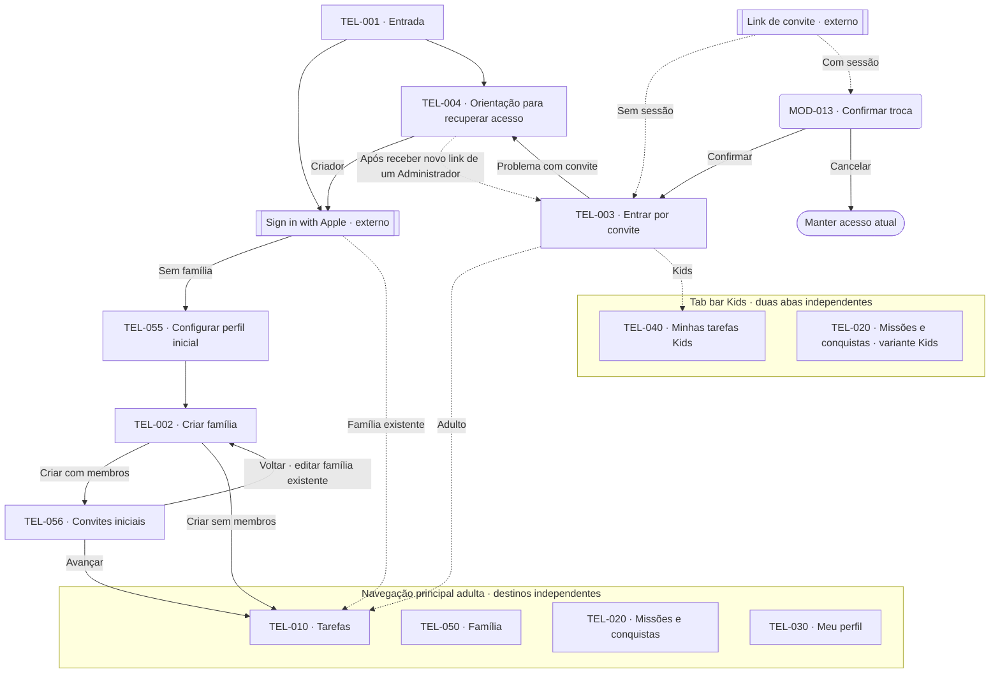
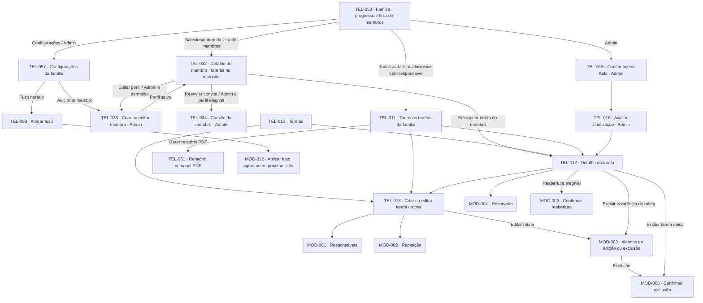
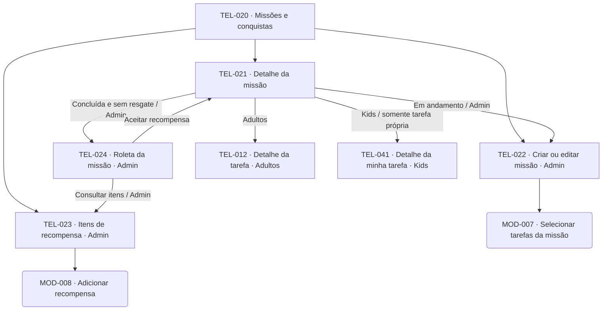
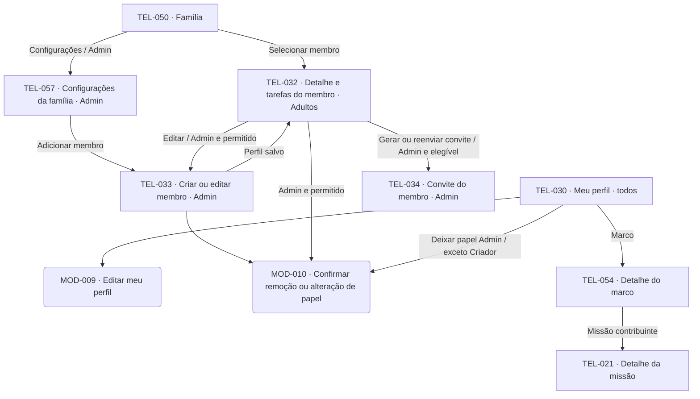
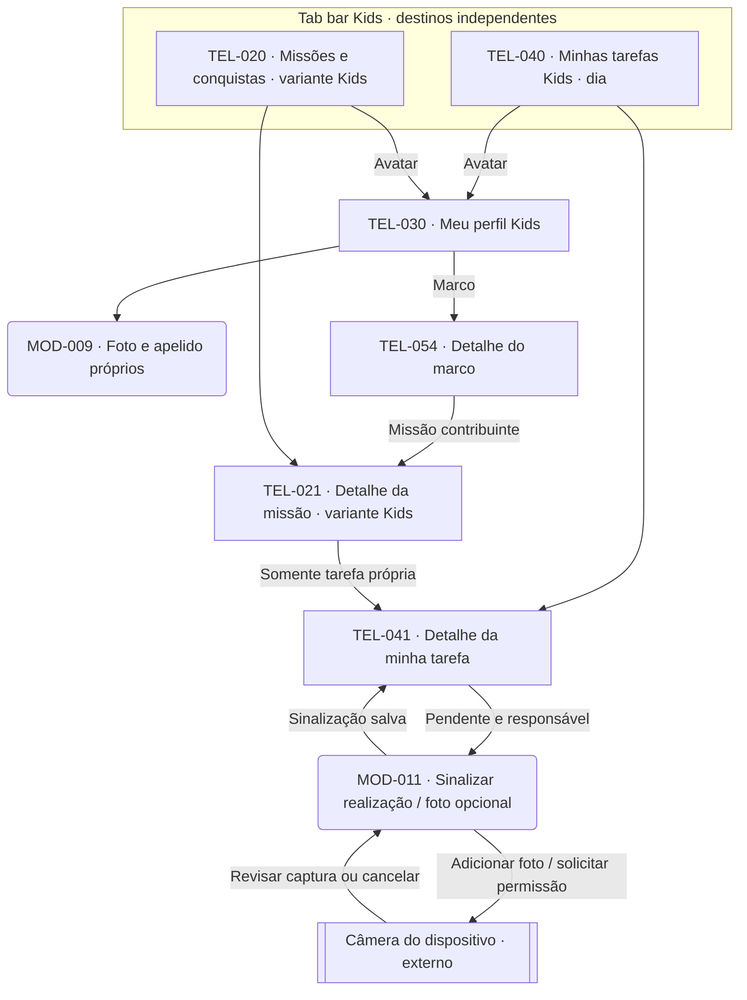
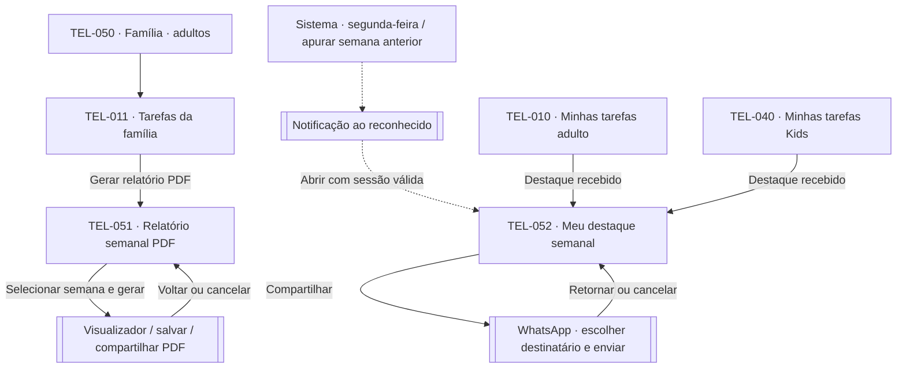

# Screen map — versão 1.17

**Projeto:** App de Organização Familiar — MVP  
**Versão do mapa:** 1.17\
**Base funcional:** RN 1.22 / RF 1.21 / UC 1.21\
**Data:** 2026-10-27\
**Situação:** referência inicial para design; organização de navegação proposta

[Projeto](../../README.md) · [Índice e versões](../DOCUMENTACAO.md) · [Visão](../00-visao-do-produto.md) · [Regras](../01-regras-de-negocio.md) · [Requisitos](../02-requisitos.md) · [Casos de uso](../03-casos-de-uso.md) · [Diagrama de classes](../06-diagrama-de-classes.md)

## Escopo e leitura

O [catálogo mobile](../architecture/mobile-feature-catalog.md#2-telas-e-arquivos-de-apresentação) mapeia estes IDs para Views, ViewModels e arquivos futuros em inglês, conforme a [arquitetura mobile](../architecture/mobile-architecture.md). Esse mapeamento técnico não modifica os destinos e as permissões definidos neste mapa.

Este mapa organiza o MVP em telas e superfícies de interação. As permissões e comportamentos derivam da base funcional; os agrupamentos, nomes de telas e escolha entre tela e modal são decisões de design desta versão. As quatro telas principais adultas são destinos independentes: Tarefas, Perfil, Missões e Família. Tarefas é o destino inicial. Cada uma é acessada diretamente pela navegação principal, sem passar por Tarefas. Kids usam duas abas independentes, Minhas tarefas e Missões e conquistas. O mapa usa os nomes das telas; o layout, os campos ainda não especificados seguem para detalhamento visual; os user flows estão consolidados em documento próprio.

- `TEL-xxx`: tela com identidade estável; criar e editar podem ser modos da mesma tela.
- `MOD-xxx`: modal ou painel sobre a tela de origem, com retorno ao fechá-lo.
- Retângulos: telas; formas arredondadas: modais; contorno duplo: interface externa. Agrupamentos representam áreas, não telas adicionais.
- Setas contínuas: destinos acessíveis a partir da origem, sujeitos ao perfil e estado indicados. Setas tracejadas: transições do sistema ou entrada por link externo.
- Retornos comuns não são repetidos: voltar retorna à origem; cancelar não salva; salvar fecha o formulário ou modal e atualiza a origem. A navegação principal permite alternar entre os destinos permitidos.
- Estados como vazio, erro e carregamento pertencem à tela, sem receber um ID de tela próprio.

Administrador e Membro compartilham a experiência adulta. O Criador é Administrador com restrições adicionais. Kids têm telas de tarefas próprias e variantes simplificadas das missões compartilhadas.

## 1. Visão geral e acesso

As duas abas Kids têm o mesmo nível: “Minhas tarefas” e “Missões e conquistas”. Missões é acessível diretamente no tab bar. Meu perfil fica no avatar/cabeçalho de ambas, sem terceira aba. As quatro telas dentro do agrupamento adulto têm o mesmo nível de navegação. As setas de acesso para TEL-010 indicam apenas a tela inicial após autenticação ou ingresso; não tornam as outras telas dependentes dela. Nos recortes seguintes, cada tela principal inicia seu próprio conjunto de subtelas.

Com sessão válida, a entrada é dispensada e o sistema abre TEL-010 ou TEL-040 conforme o perfil atual. Para uma identidade Apple sem família, TEL-055 envia a foto opcional antes da criação, sem persistir perfil; a falha permite repetir ou seguir sem foto. TEL-002 reúne nome, fuso e zero ou mais membros preparados em rascunho. A confirmação cria família, Criador e membros iniciais em uma operação e abre a sessão. Havendo membros, TEL-056 oferece os convites explícitos, sem gerar nenhum automaticamente; sem membros, a criação segue diretamente a TEL-010. Voltar de TEL-056 a TEL-002 abre a família existente para edição: prosseguir sem mudanças não grava, e mudanças autorizadas são salvas sem nova criação. Novo membro após a criação usa a gestão normal; mudança posterior de fuso segue TEL-053/MOD-012. A renovação da sessão é transparente. TEL-004 orienta a contatar um Administrador fora do aplicativo; não envia pedidos nem cria um canal de comunicação. O novo link abre TEL-003 para o mesmo perfil. O Criador usa Apple para retornar à família existente.

## 2. Família, tarefas e navegação adulta

**TEL-050 — Família:** apresenta progresso das tarefas da família e dos membros no intervalo livre entre Início e Fim, limitado pela criação da família e pelo fim do mês corrente. Cada membro ativo abre TEL-032 com o intervalo exato selecionado. A tela abre TEL-011 para todas as tarefas e, somente para Administradores, TEL-015 para Confirmações Kids e TEL-057 para Configurações. A carga familiar de SPEC-018 fica para entrega posterior e não integra esta tela.

**TEL-032 — Detalhe do membro:** Administradores e Membros consultam as tarefas da pessoa selecionada no intervalo herdado exatamente de TEL-050 e podem alterá-lo sem mudar o período da origem. A tela identifica o membro e permite abrir a tarefa em TEL-012. As ações Editar perfil, Remover membro e Gerar/Reenviar convite ficam aqui, somente para Administradores e quando permitidas; visualizar tarefas não concede gestão. A configuração de apelido permanece exclusiva do titular em Meu perfil. O Criador retorna por Apple, sem convite de recuperação.

TEL-010 e TEL-040 abrem no dia atual e consultam somente o dia selecionado. TEL-050 inicia na semana corrente, limitada ao intervalo disponível. TEL-032 e TEL-011 herdam exatamente Início e Fim de TEL-050; mudanças locais não alteram a origem e voltar restaura o contexto anterior. TEL-011 inclui tarefas sem responsável e oferece Gerar relatório PDF. Se o intervalo tocar mais de uma semana, TEL-051 solicita a semana antes da geração.

Progresso é concluídas/total de tarefas previstas no período, sem ponderar peso nem multiplicar responsáveis. Sem tarefas, apresentar “Sem tarefas”. Para Membro, Aguardando confirmação aparece e é contado como Pendente, sem mudar o estado canônico; Administrador vê o estado separado. A carga usa a data de conclusão válida (RN61) quando consultada no relatório. O relatório continua sempre semanal. TEL-015 e TEL-016 são exclusivos do Administrador; fotos de validação mantêm suas permissões.

## 3. Missões e recompensas

Missões em andamento e concluídas são grupos da mesma lista. Participações, progresso e recompensa aceita aparecem no detalhe. Kids consultam o progresso coletivo e as tarefas vinculadas, mas só abrem o detalhe operacional de tarefas das quais são responsáveis. A roleta apresenta o resultado na própria tela e permite aceitar, sortear novamente ou sair sem aceitar. Não existe tela de recompensa resgatável antes da conclusão da missão.

## 4. Família, perfil, membros e convites

TEL-034 disponibiliza link e senha juntos para compartilhamento, a partir do detalhe do membro ou de TEL-056. A primeira emissão por ação explícita abre diretamente a folha nativa, sem confirmação intermediária. A reemissão informa e exige confirmação dos efeitos antes de gerar novas credenciais; revoga convites e sessão anteriores do mesmo perfil. Não reutilizar credenciais consumidas. Na recuperação, parte do perfil existente, sem novo cadastro de membro. A troca de acesso ocorre por convite confirmado e validado, sem migração de histórico ou remoção automática do perfil anterior. Não há seletor livre de identidades nem modo Kids ativado pela criança. Um Administrador altera o perfil Kids em TEL-033, respeitando as restrições de promoção. A proteção do Criador vale também no próprio perfil; não é adicionada uma operação de saída de família sem caso de uso definido.

## 5. Experiência Kids

A sinalização muda a tarefa inteira para Aguardando confirmação. O progresso só avança após conclusão válida por adulto. Kids podem editar o próprio perfil, foto opcional e etiqueta/apelido, mas não acessam carga, relatório familiar, administração, criação de tarefas ou sorteio. Adicionar foto para validação abre diretamente a câmera, sem seletor câmera/galeria. Negativa de permissão, câmera indisponível ou cancelamento permitem continuar sem foto.

## 5.1. Relatório e reconhecimento semanal

TEL-051 mantém a semana selecionada em geração, falha ou retorno; quando TEL-011 cobre várias semanas, solicita uma semana antes de gerar. Se cobre uma só, usa essa semana. TEL-052 pertence à pessoa reconhecida, inclui semana, pontos, tarefas realizadas e convite para fazer algo em família. Não é terceira aba Kids. Notificação sem sessão válida passa pelo acesso e só depois abre o resultado se a pessoa continuar autorizada. Há entrada interna mesmo sem notificação externa. Apuração ocorre às 00:00 de segunda-feira no fuso da família e preserva resultados já finalizados (RN28/RN65).

## 5.2. Configuração, marcos e datas

Família oferece TEL-057 Configurações da família somente a Administradores. A opção de fuso abre TEL-053 e MOD-012 com efeitos e alternativas imediata/próximo ciclo. Exibir fuso vigente e mudança programada; cancelar/falhar mantém estado confirmado. Criação (TEL-002) já permite escolher fuso, padrão `America/Sao_Paulo`.

Meu perfil lista total de missões com participação e badges cumulativos. Marco conquistado abre TEL-054, cuja lista contém as missões que contribuíram para a concessão; selecionar uma abre TEL-021. Sem badge, informar total/próximo marco. Não existe selo configurável em TEL-022.

Os DatePickers de tarefa e início de rotina começam hoje e aceitam datas passadas/futuras sem limites de produto, inclusive antes da criação da família. O carrossel continua com RN49; confirmar a data salva mesmo quando ela não aparece nessa consulta. Edição individual de concluída não protegida explica ajuste de crédito/progresso e preservação do destaque finalizado.

Sem app instalado, link direciona à loja e orienta reabrir após instalar. Com outra sessão ativa, MOD-013 confirma troca de acesso. Não transfere histórico ou remove perfil antigo. A substituição local acontece somente após ingresso validado.

## 6. Catálogo de telas

A = Administrador (inclui Criador); M = Membro; K = Kids. Códigos RF e RNF são consultáveis em [Requisitos](../02-requisitos.md); UC aponta para a especificação completa, incluindo todas as regras relacionadas.

| ID | Tela e objetivo | Acesso | Conteúdo e ações principais | Rastreabilidade |
|---|---|---|---|---|
| TEL-001 | Entrada | Sem sessão | Entrada Apple para Criador; orientação para quem recebeu convite ou perdeu acesso | [UC04](../03-casos-de-uso.md#uc04), [UC09](../03-casos-de-uso.md#uc09); RF37, RF46 |
| TEL-002 | Criar/editar família no onboarding | Futuro Criador; no retorno de TEL-056, Criador Administrador | Informar nome e fuso inicial (padrão America/Sao_Paulo); preparar, alterar ou retirar membros antes da criação atômica. No retorno, editar família existente e membros conforme permissão, sem nova criação ou gravação sem mudanças; fuso posterior segue TEL-053/MOD-012 | [UC01](../03-casos-de-uso.md#uc01), [UC02](../03-casos-de-uso.md#uc02); RF01–03, RF38, RF40, RF67 |
| TEL-003 | Entrar por convite | Pessoa com link | Validar convite, informar senha e acessar perfil novo ou recuperado | [UC09](../03-casos-de-uso.md#uc09); RF42–46, RF54 |
| TEL-004 | Recuperar acesso | Sem sessão | Orientar novo convite com Administrador; retorno Apple do Criador | [UC02](../03-casos-de-uso.md#uc02), [UC09](../03-casos-de-uso.md#uc09); RF41, RF46 |
| TEL-010 | Tarefas | A, M | Tela principal e inicial; somente tarefas em que o adulto é responsável ou corresponsável, com estado e progresso próprios diários. Carrossel pessoal visual de domingo a sábado, cartões individuais com responsáveis e P1/P2/P3, incentivo e cabeçalho datado; o status permanece no ícone e no VoiceOver, fora do subtítulo visual. O círculo conclui/reabre quando permitido; o restante do cartão abre TEL-012. Tarefa compartilhada sinalizada por Kids é apresentada como Pendente aqui, sem alterar seu estado efetivo nem as ações permitidas | [UC11](../03-casos-de-uso.md#uc11), [UC12](../03-casos-de-uso.md#uc12), [UC17](../03-casos-de-uso.md#uc17); RF11, RF12, RF17, RF49, RF57 |
| TEL-011 | Tarefas da família | A, M | Consultar tarefas de todos, inclusive sem responsável, por Início/Fim livres herdados de TEL-050; filtrar membro e estado, abrir/criar tarefa e gerar PDF semanal | [UC07](../03-casos-de-uso.md#uc07), [UC12](../03-casos-de-uso.md#uc12), [UC11](../03-casos-de-uso.md#uc11), [UC18](../03-casos-de-uso.md#uc18); RF07–12, RF60–61 |
| TEL-012 | Detalhe da tarefa | A, M | Título, peso, responsáveis, estado, origem em rotina; concluir, editar, excluir ou reabrir conforme regra | [UC07](../03-casos-de-uso.md#uc07), [UC12](../03-casos-de-uso.md#uc12), [UC17](../03-casos-de-uso.md#uc17); RF08–12, RF47, RF56–59 |
| TEL-013 | Criar/editar tarefa ou rotina | A, M | Título (1–60 car.), peso 1–3, data livre (padrão hoje), responsáveis, observação opcional (até 250 car.) e repetição com DatePicker inicial livre; identificar alcance e efeitos em concluídas; editar tarefa Aguardando confirmação abre MOD-014 | [UC07](../03-casos-de-uso.md#uc07), [UC08](../03-casos-de-uso.md#uc08); RF07–10, RF13–16, RF69, RF70 |
| TEL-014 | Reservada — carga familiar | — | Carga visual adiada para entrega posterior de SPEC-018; ID preservado, sem destino nesta entrega | [UC13](../03-casos-de-uso.md#uc13); RF18–21, RF56–57 |
| TEL-015 | Confirmações Kids | A | Fila de tarefas aguardando avaliação | [UC03](../03-casos-de-uso.md#uc03); RF25–26 |
| TEL-016 | Avaliar sinalização | A | Responsáveis, criança que sinalizou, foto opcional; confirmar ou recusar | [UC03](../03-casos-de-uso.md#uc03); RF25–26, RF55–56 |
| TEL-020 | Missões e conquistas | A, M, K | Aba independente para adultos e Kids; listas em andamento/concluídas; abrir detalhe; criar e gerenciar itens somente A | [UC05](../03-casos-de-uso.md#uc05), [UC14](../03-casos-de-uso.md#uc14); RF28–32, RF36 |
| TEL-021 | Detalhe da missão | A, M, K | Título, observação, tarefas, status e recompensa aceita visíveis a todos (Kids em versão simplificada); progresso e participações ficam para UC14, e o resgate é ação exclusiva de Administrador; edição somente A e conforme estado | [UC05](../03-casos-de-uso.md#uc05), [UC14](../03-casos-de-uso.md#uc14); RF29–32, RF36, RF50, RF58, RF71 |
| TEL-022 | Criar/editar missão | A | Título, observação opcional (≤250 car.) e tarefas individuais, com atalho para criar tarefa nova; sem prazo | [UC05](../03-casos-de-uso.md#uc05); RF28–29, RF31–32, RF50, RF58, RF71 |
| TEL-023 | Itens de recompensa | A | Consultar predefinidos e personalizados; adicionar item com título e descrição opcional | [UC06](../03-casos-de-uso.md#uc06); RF33–34 |
| TEL-024 | Roleta da missão | A | Sortear, ver resultado, aceitar ou sortear novamente; sair sem consumir resgate | [UC16](../03-casos-de-uso.md#uc16); RF35, RF51–53 |
| TEL-030 | Meu perfil | A, M, K | Principal adulta; avatar/cabeçalho para Kids; foto por câmera/galeria, apelido só do titular, badges cumulativos e detalhe dos marcos; deixar papel Admin quando permitido | [UC10](../03-casos-de-uso.md#uc10), [UC02](../03-casos-de-uso.md#uc02); RF48, RF62, RF65, RF03, RF05 |
| TEL-031 | Reservada — lista de membros | — | Lista e botão Adicionar membro ficam em TEL-057; ID preservado, sem destino navegável | [UC02](../03-casos-de-uso.md#uc02); RF02–06, RF40 |
| TEL-032 | Detalhe e tarefas do membro | A, M; gestão somente A | Identificação e tarefas no intervalo exato herdado de TEL-050, alterável localmente; abrir tarefa; editar perfil, remover e gerar/reenviar convite quando permitido, sem acesso ao apelido de terceiros | [UC11](../03-casos-de-uso.md#uc11), [UC02](../03-casos-de-uso.md#uc02); RF60, RF66, RF03–06, RF41 |
| TEL-033 | Criar/editar membro | A, após criação da família | Dados permitidos e configuração Kids/papel, respeitando restrições; membro preparado antes da criação permanece em TEL-002 | [UC02](../03-casos-de-uso.md#uc02); RF02–06, RF40 |
| TEL-034 | Convite do membro | A | Primeira emissão explícita abre diretamente a folha nativa; reemissão exige confirmação dos efeitos. Link e senha são compartilhados juntos para o mesmo perfil | [UC01](../03-casos-de-uso.md#uc01), [UC02](../03-casos-de-uso.md#uc02); RF41, RF54 |
| TEL-040 | Minhas tarefas Kids | K | Aba inicial; próprias tarefas e progresso diários. O círculo reabre tarefa própria concluída; o restante da linha abre o detalhe. Tarefa sinalizada aparece Aguardando confirmação até decisão válida | [UC11](../03-casos-de-uso.md#uc11), [UC17](../03-casos-de-uso.md#uc17); RF17, RF22, RF49, RF57 |
| TEL-041 | Detalhe da minha tarefa | K responsável | Informações da tarefa e estado; sinalizar se pendente | [UC15](../03-casos-de-uso.md#uc15); RF23–24, RF55–56 |
| TEL-050 | Família | A, M | Tela principal; progresso familiar e por membro com Início/Fim livres, lista de membros e entrada em Tarefas da família; Configurações e Confirmações Kids somente A; carga fica para entrega posterior | [UC02](../03-casos-de-uso.md#uc02), [UC03](../03-casos-de-uso.md#uc03), [UC11](../03-casos-de-uso.md#uc11); RF60, RF66, RN60–61 |
| TEL-051 | Relatório semanal PDF | A, M | A partir de TEL-011, selecionar semana quando o intervalo tocar mais de uma, gerar gráficos e tabela, visualizar/salvar/compartilhar; semana atual parcial | [UC18](../03-casos-de-uso.md#uc18); RF61, RN62 |
| TEL-057 | Configurações da família | A | Concentrar nome da família, fuso e gestão de membros; abrir TEL-032/TEL-033/TEL-053 | [UC01](../03-casos-de-uso.md#uc01), [UC02](../03-casos-de-uso.md#uc02); RF01–06, RF48 |
| TEL-052 | Meu destaque semanal | A, M, K reconhecido | Semana encerrada, pontos, tarefas realizadas, convite editável e compartilhar no WhatsApp ou copiar mensagem; variante Kids sem carga/PDF | [UC19](../03-casos-de-uso.md#uc19); RF63–64, RN65 |
| TEL-053 | Alterar fuso da família | A | Fuso vigente/programado; selecionar novo fuso e confirmar aplicação imediata ou próximo ciclo em MOD-012 | [UC01](../03-casos-de-uso.md#uc01); RF67, RN28 |
| TEL-054 | Detalhe do marco de participação | A, M, K titular | Bronze 5, prata 10, ouro 25, diamante 50; missões contribuintes do marco conquistado com acesso a TEL-021 | [UC10](../03-casos-de-uso.md#uc10); RF62, RN64 |
| TEL-055 | Configurar perfil inicial | Futuro Criador autenticado sem família | Nome administrativo obrigatório; foto e etiqueta/apelido opcionais. A foto escolhida é enviada antes da criação, com repetição ou continuação sem foto em falha; avançar para TEL-002 ou cancelar sem criar perfil | [UC01](../03-casos-de-uso.md#uc01); RF01, RF38, RF48 |
| TEL-056 | Convites iniciais | Criador Administrador de família já criada, com membros iniciais | Lista dos membros criados junto com a família; convite explícito por pessoa, primeira emissão direta pela folha nativa, opção de adiar e avançar para TEL-010. Voltar abre TEL-002 para editar a família existente | [UC01](../03-casos-de-uso.md#uc01), [UC02](../03-casos-de-uso.md#uc02); RF02, RF38, RF41 |

## 7. Modais e painéis

| ID | Superfície | Origem | Ações e condições |
|---|---|---|---|
| MOD-001 | Selecionar responsáveis | TEL-013 | Nenhum, um ou vários; mudança sujeita às proteções de histórico (UC07) |
| MOD-002 | Configurar repetição | TEL-013 | Sem repetição, diária, 7, 14, 21 ou 28 dias; sem mensal (UC08) |
| MOD-003 | Definir alcance | TEL-012/013 | Edição individual ou rotina futura; exclusão somente selecionada ou ela e futuras; mostrar registros preservados (UC07/08) |
| MOD-004 | Reservado | — | Conclusão não abre modal: mantém responsáveis existentes ou atribui o adulto apenas quando não houver responsável (UC12). |
| MOD-005 | Confirmar exclusão | TEL-012 ou MOD-003 | Confirmar alcance e impactos; bloquear concluída, conquista protegida ou última tarefa de missão (UC07) |
| MOD-006 | Reabrir tarefa | TEL-010/TEL-012/TEL-040 | Exibir somente se houver missão concluída e/ou recompensa aceita; avisar que a missão será reaberta e que recompensa, participações e badges derivados serão removidos (UC17). |
| MOD-007 | Selecionar tarefas da missão | TEL-022 | Seleção individual, ao menos uma; não selecionar rotina inteira implicitamente; ação "+ Nova tarefa" abre o fluxo padrão de criação (MOD-001/TEL-013) e retorna com a tarefa pré-selecionada (UC05) |
| MOD-008 | Adicionar recompensa | TEL-023 | Informar e salvar item; não vincula automaticamente a missão (UC06) |
| MOD-009 | Editar meu perfil | TEL-030 | Foto opcional e etiqueta/apelido do titular; nenhum terceiro acessa a configuração; não muda permissões (UC10) |
| MOD-010 | Confirmar alteração de membro | TEL-030/032/033 | Remoção, promoção/rebaixamento ou alteração de modo; impedir operações protegidas do Criador e Admin em Kids (UC02) |
| MOD-011 | Sinalizar realização | TEL-041 | Adicionar foto abre câmera; revisar/refazer/descartar; enviar ou cancelar; falha ou permissão negada permite seguir sem foto (UC15) |
| MOD-012 | Confirmar aplicação do fuso | TEL-053 | Informativo de efeitos; aplicar imediatamente ou próximo ciclo, confirmar/cancelar; só Admin |
| MOD-013 | Confirmar troca de acesso | Link de convite com sessão ativa | Confirmar segue ingresso; cancelar mantém acesso. Só substituir sessão local após ingresso válido, sem remover membro anterior |
| MOD-014 | Resolver sinalização pendente | TEL-013, ao salvar edição | Obrigatório sobre tarefa Aguardando confirmação: retornar a Pendente (descarta sinalização) ou manter Aguardando confirmação com os dados editados (UC07) |

## 8. Estados que o design deve contemplar

| Telas | Estados e respostas |
|---|---|
| Todas com rede/gravação | Carregando/processando, sucesso confirmado e falha com possibilidade de tentar novamente. Não apresentar operação como salva em falha. Manter a interface responsiva. |
| Listas paginadas | Carregar a próxima página por rolagem infinita antes do fim dos itens confirmados; cada página tem até 20 itens. Falha de página preserva a lista e permite nova tentativa, sem interpretar como fim da lista. |
| Áreas protegidas | Sessão recuperável renova silenciosamente; sessão perdida encaminha à entrada. Perfil removido tem acesso bloqueado, inclusive na renovação; novo convite não reativa perfil removido. |
| TEL-001/002/055/056 | Apple cancelado ou com falha; dados obrigatórios inválidos; família já existente redireciona; rascunhos de perfil e membros não são persistidos antes da criação; foto opcional enviada antes da criação pode ser repetida ou omitida após falha. Membros iniciais e Criador são persistidos atomicamente; sem membros, não abrir TEL-056. No retorno de TEL-056, não criar de novo nem gravar sem mudanças; convites podem ser adiados. |
| TEL-003/034 | Senha incorreta, link inválido/consumido, perfil removido, geração com falha e ingresso concluído; não reutilizar convite consumido. |
| TEL-010/040/050 | Sem tarefas no período; Pendente, Aguardando confirmação e Concluída; progresso apenas de conclusões válidas. Em tarefa compartilhada sinalizada por Kids, TEL-010 do adulto corresponsável mostra Pendente e TEL-040 Kids mostra Aguardando confirmação; estado efetivo e permissões não mudam. Carrossel da criação da família até último dia do mês atual. |
| TEL-011/012/013/032 | Lista vazia, inclusive membro sem tarefas no período; preservar filtro do membro e período no retorno; dados inválidos; sem responsáveis; compartilhada; origem em rotina; operação bloqueada por conquista ou vínculo com missão; editar tarefa Aguardando confirmação exige resolver a sinalização pendente (MOD-014). |
| TEL-015/016 | Fila vazia, sinalização sem foto, foto indisponível e tarefa já decidida por outro adulto; atualizar estado e impedir decisão duplicada. |
| TEL-050 | Intervalo sem tarefas: informar “Sem tarefas”, sem simular 100%; Membro vê Aguardando confirmação como Pendente. |
| TEL-020/021/022 | Sem missões; em andamento; concluída sem resgate; concluída com recompensa visível a todos os perfis; seleção sem tarefas impede salvar. Conquista concluída não editável. |
| TEL-023/024 | Itens carregando; cadastro inválido; pronta para sortear; resultado aguardando aceitação; recompensa aceita; resgate já realizado por outro Admin; falha ao salvar mantém informação verdadeira. |
| TEL-030/032–034 | Campos inválidos, acesso de gestão negado, Criador protegido, membro removido enquanto tela aberta; somente perfis ativos recebem recuperação. |
| TEL-041/MOD-011 | Foto ausente; permissão da câmera negada, câmera indisponível, captura cancelada, revisão/refazer; envio em andamento/com falha; Aguardando confirmação; recusa retorna a Pendente; conclusão por adulto. Não sinalizar novamente enquanto aguarda ou após concluir. |
| TEL-030/MOD-009 | Foto ausente/padrão, substituição/remoção, falha de upload sem perda da anterior; apelido editável só pelo titular; badges vazios ou conquistados. |
| TEL-051 | Seleção de semana, atual parcial, sem dados, gerando, PDF disponível, falha com nova tentativa; cancelar compartilhamento preserva relatório. |
| TEL-053/MOD-012 | Fuso vigente, mudança programada, aplicação imediata, falha sem alteração, cancelamento e período de transição identificado. |
| TEL-054 | Marco e missões contribuintes; sem acesso a configurações alheias; retorno ao perfil preservado. |
| TEL-003/MOD-013 | Confirmação da troca, cancelamento, convite inválido e resposta perdida; não limpar a sessão anterior antes de novo ingresso válido. |
| TEL-052 | Resultado disponível ou acesso negado; notificação externa indisponível; WhatsApp ausente permite copiar; cancelamento retorna ao resultado. Não afirmar envio ao abrir app externo. |

Estados e permissões precisam de texto ou ícone além de cores. Aplicam-se RNF01–07, RNF11–13, RNF22–25 conforme a operação. Mensagens ao usuário explicam a ação possível; detalhes como refresh token ficam na especificação técnica.

## 9. Cobertura e continuidade

Os 19 casos de uso estão cobertos no catálogo: UC01 em TEL-055/002/056/053; UC02 em TEL-056 e TEL-050 e TEL-030/032–034; UC03 em TEL-015/016; UC04 em TEL-001; UC05 em TEL-020–022; UC06 em TEL-023; UC07/08 em TEL-011–013; UC09 em TEL-003/004 e MOD-013; UC10 em TEL-030/054; UC11 em TEL-010/040/050, tarefas por membro em TEL-032 e consulta familiar em TEL-011; UC12 em TEL-010/012; UC13 em TEL-050; UC14 em TEL-020/021; UC15 em TEL-041; UC16 em TEL-024; UC17 em TEL-010/012/040/MOD-006; UC18 em TEL-051; UC19 em TEL-052.

Os user flows UF-01–UF-16 referenciam estes IDs, incluindo configuração do fuso e troca confirmada de acesso. Prioridades: criar família; convidar e recuperar acesso; criar tarefa/rotina; concluir mantendo ou assumindo responsáveis; sinalizar e validar Kids; criar missão e resgatar recompensa; reabrir tarefa elegível.

Campos funcionais de data/fuso e seleção de foto estão definidos; o layout visual final segue o trabalho de design. A notificação do destaque semanal e o compartilhamento WhatsApp estão previstos. Não há chat interno, login por senha permanente ou ranking completo. Troca de acesso por convite segue confirmação e preserva o perfil anterior.

## Histórico

| Versão do mapa | Base funcional | Data | Alteração |
|---|---|---|---|
| 1.17 | RN 1.22 / RF 1.21 / UC 1.21 | 2026-10-27 | TEL-050 e TEL-011 usam intervalo livre Início/Fim; TEL-032 herda o intervalo exato; PDF parte de TEL-011 e pede semana quando necessário; gestão entra por TEL-057; carga visual de TEL-050 adiada. |
| 1.16 | RN 1.18 / RF 1.17 / UC 1.18 | 2026-10-26 | TEL-010 adota a apresentação adulta do Figma: aba “Tarefas”, semana visual domingo–sábado, cartões com responsáveis/P1–P3, progresso por extenso, incentivo e status apenas no ícone/VoiceOver; regras e período semanal familiar preservados. |
| 1.15 | UC 1.18 | 2026-10-26 | TEL-010 e TEL-040 usam o círculo para concluir/reabrir quando permitido; a linha abre detalhe. MOD-006 pode partir da lista. |
| 1.14 | RN 1.18 / RF 1.17 / UC 1.16 | 2026-10-19 | TEL-002 prepara membros para criação atômica e edita família existente no retorno; TEL-056 fica como convite após criação. Foto inicial enviada antes da criação; convite inicial direto e reemissão confirmada; estados pessoais distintos para adulto/Kids. |
| 1.13 | 1.17 | 2026-10-10 | Consolida TEL-021/023/050/052 com listas paginadas de até 20 itens e rolagem infinita que preserva itens confirmados em falha. Para SPEC-003, SPEC-015, SPEC-016, SPEC-018 e SPEC-020. |
| 1.12 | 1.17 | 2026-10-10 | TEL-052 detalha variante Kids e compartilhamento opcional/cancelável do destaque. Para SPEC-020. |
| 1.11 | 1.16 | 2026-10-10 | TEL-050 integra carga Dia/Semana sem ranking e preserva crédito histórico como “Membro removido”. Para SPEC-018. |
| 1.10 | 1.15 | 2026-10-10 | TEL-021 alinha Kids a RF36: recompensa aceita é consultável, mas participações e resgate continuam restritos. Para SPEC-016. |
| 1.9 | 1.15 | 2026-10-10 | TEL-023 passa a explicitar cadastro de título e descrição opcional para item personalizado. Para SPEC-015. |
| 1.7 | 1.12 | 2026-10-07 | TEL-022 ganha observação opcional; MOD-007 ganha atalho "+ Nova tarefa"; TEL-021 explicita consulta básica por todos os perfis, inclusive Kids. Para SPEC-014. |
| 1.6 | 1.11 | 2026-10-07 | Conclusão direta sem MOD-004; MOD-006 confirma reabertura de missão concluída e reversão de recompensa, participações e badges. |
| 1.5 | 1.10 | 2026-10-06 | MOD-004 oculta conclusão de tarefa com responsável Kids para Membro; evidência Kids permanece administrativa. Para SPEC-010. |
| 1.4 | 1.9 | 2026-10-06 | TEL-010 e TEL-040 ficam diárias; consultas familiares adultas usam Dia/Semana, e a carga é adiada para SPEC-018. Para SPEC-009. |
| 1.8 | 1.14 | 2026-10-07 | TEL-055 e TEL-056 (novas): perfil inicial do Criador, criação da família e membros opcionais com convite explícito antes da área principal. |
| 1.3 | 1.8 | 2026-10-06 | MOD-002 mantém rotina sem data final obrigatória; MOD-003 define que “selecionada e futuras” inclui a ocorrência de origem. Para SPEC-008. |
| 1.2 | 1.7 | 2026-10-06 | TEL-013 ganha observação opcional e limite de título; MOD-014 (novo) resolve sinalização Kids pendente ao editar. Para SPEC-007. |
| 1.1 | 1.5 | 2026-10-05 | TEL-053/054 e MOD-012/013; 26 telas ativas, 13 modais, fuso, badges, datas livres e acesso único. |
| 1.0 | 1.4 | 2026-10-02 | Família concentra carga/progresso, lista e inclusão de membros e PDF; detalhe do membro com tarefas e ações permitidas. TEL-014/031 retiradas da navegação; 24 telas ativas, 2 IDs reservados e 11 modais. |
| 1.0 | 1.3 | 2026-10-02 | Revisão durante elaboração: duas abas Kids, câmera direta, perfil para todos, períodos Dia/Semana, TEL-051/052; 26 telas e 11 modais. |
| 1.0 | 1.2 | 2026-10-01 | Primeiro mapa: 24 telas, 11 modais/painéis, cinco diagramas Mermaid, permissões e estados; inclui a tela Família com progresso coletivo diário e recuperação de acesso por novo convite do mesmo perfil. |
