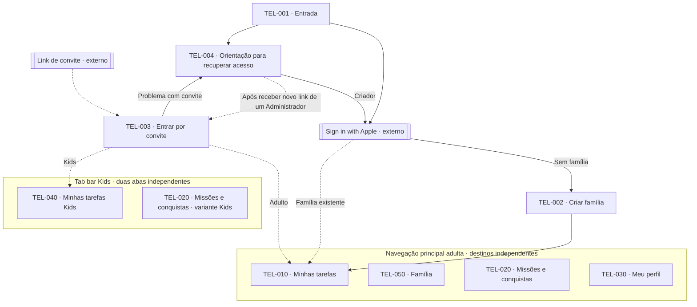
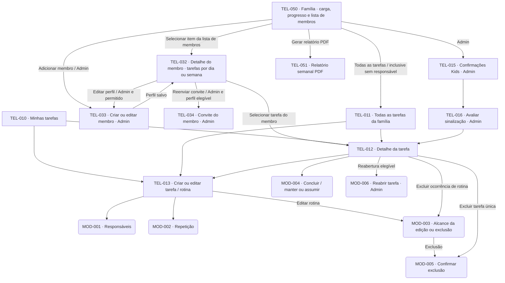
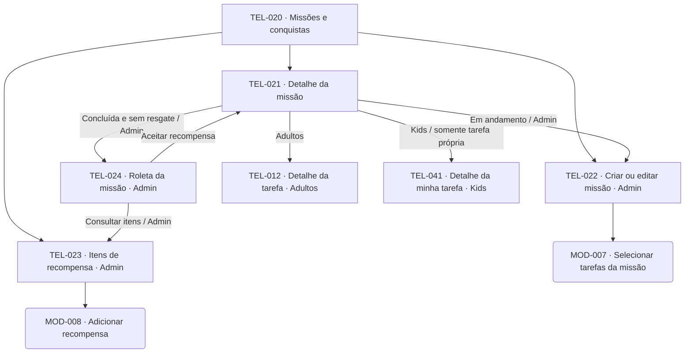
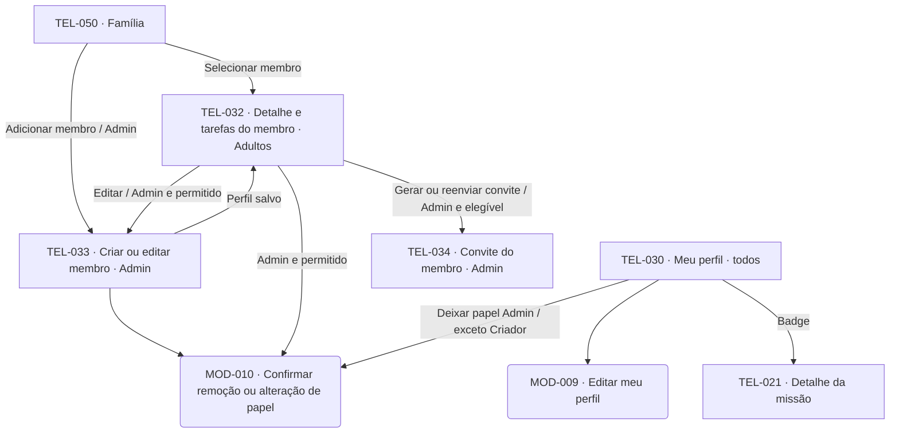
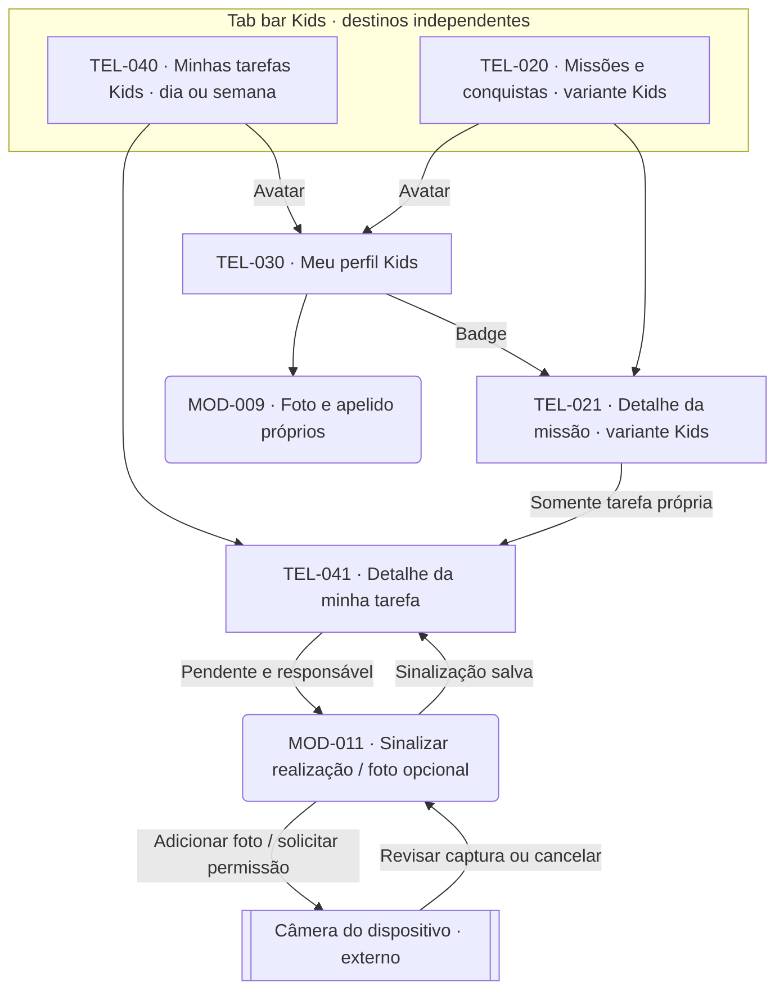
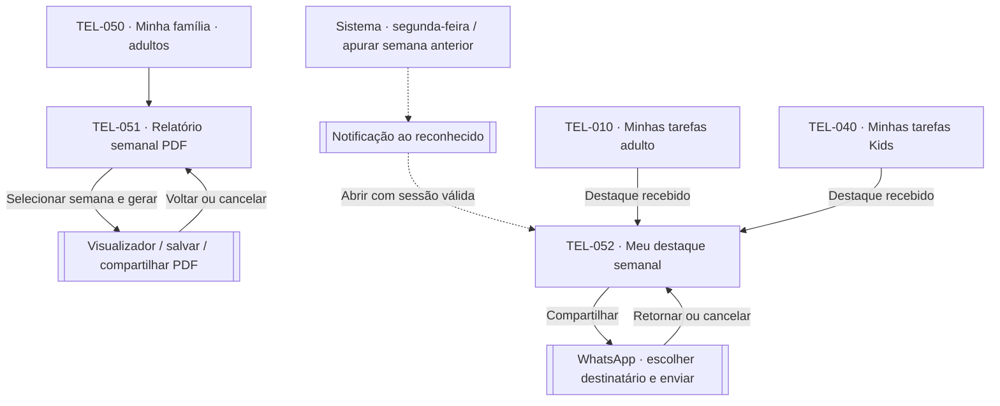

# Screen map — versão 1.0

**Projeto:** App de Organização Familiar — MVP  
**Versão do mapa:** 1.0  
**Base funcional:** 1.4  
**Data:** 2026-10-02  
**Situação:** referência inicial para design; organização de navegação proposta

[Projeto](../../README.md) · [Índice e versões](../DOCUMENTACAO.md) · [Visão](../00-visao-do-produto.md) · [Regras](../01-regras-de-negocio.md) · [Requisitos](../02-requisitos.md) · [Casos de uso](../03-casos-de-uso.md) · [Diagrama de classes](../06-diagrama-de-classes.md)

## Escopo e leitura

Este mapa organiza o MVP em telas e superfícies de interação. As permissões e comportamentos derivam da base funcional; os agrupamentos, nomes de telas e escolha entre tela e modal são decisões de design desta v1. As quatro telas principais adultas são destinos independentes: Minhas tarefas, Meu perfil, Missões e conquistas e Família. Minhas tarefas é o destino inicial. Cada uma é acessada diretamente pela navegação principal, sem passar por Minhas tarefas. Kids usam duas abas independentes, Minhas tarefas e Missões e conquistas. O mapa usa os nomes das telas; o layout, os campos ainda não especificados e a sequência completa dos user flows permanecem para detalhamento.

- `TEL-xxx`: tela com identidade estável; criar e editar podem ser modos da mesma tela.
- `MOD-xxx`: modal ou painel sobre a tela de origem, com retorno ao fechá-lo.
- Retângulos: telas; formas arredondadas: modais; contorno duplo: interface externa. Agrupamentos representam áreas, não telas adicionais.
- Setas contínuas: destinos acessíveis a partir da origem, sujeitos ao perfil e estado indicados. Setas tracejadas: transições do sistema ou entrada por link externo.
- Retornos comuns não são repetidos: voltar retorna à origem; cancelar não salva; salvar fecha o formulário ou modal e atualiza a origem. A navegação principal permite alternar entre os destinos permitidos.
- Estados como vazio, erro e carregamento pertencem à tela, sem receber um ID de tela próprio.

Administrador e Membro compartilham a experiência adulta. O Criador é Administrador com restrições adicionais. Kids têm telas de tarefas próprias e variantes simplificadas das missões compartilhadas.

## 1. Visão geral e acesso

As duas abas Kids têm o mesmo nível: “Minhas tarefas” e “Missões e conquistas”. Missões é acessível diretamente no tab bar. Meu perfil fica no avatar/cabeçalho de ambas, sem terceira aba. As quatro telas dentro do agrupamento adulto têm o mesmo nível de navegação. As setas de acesso para TEL-010 indicam apenas a tela inicial após autenticação ou ingresso; não tornam as outras telas dependentes dela. Nos recortes seguintes, cada tela principal inicia seu próprio conjunto de subtelas.

Com sessão válida, a entrada é dispensada e o sistema abre TEL-010 ou TEL-040 conforme o perfil atual. A renovação da sessão é transparente. TEL-004 orienta a contatar um Administrador fora do aplicativo; não envia pedidos nem cria um canal de comunicação. O novo link abre TEL-003 para o mesmo perfil. O Criador usa Apple para retornar à família existente.

## 2. Família, tarefas e navegação adulta

**TEL-050 — Família:** apresenta diretamente a carga/sobrecarga e o progresso total da família, com seletor Dia/Semana, além da lista de membros. Cada item abre TEL-032 para aquele membro. O botão Adicionar membro fica nesta tela e é exclusivo do Administrador; Gerar relatório PDF fica nesta tela para Administradores e Membros e abre TEL-051. Confirmações Kids continuam exclusivas do Administrador. Carga e lista de membros são conteúdo de TEL-050, sem passagem por TEL-014 ou TEL-031.

**TEL-032 — Detalhe do membro:** Administradores e Membros consultam as tarefas da pessoa selecionada por dia ou semana. A tela identifica o membro, preserva o filtro por pessoa ao alternar período e permite abrir a tarefa em TEL-012. As ações Editar perfil e Reenviar convite ficam aqui, somente para Administradores e quando permitidas pelas regras do perfil; visualizar tarefas não concede gestão de membros. A configuração de apelido permanece exclusiva do titular em Meu perfil. O Criador retorna por Apple, sem convite de recuperação.

TEL-010 e TEL-050 abrem no dia atual. Ao selecionar um membro, TEL-032 herda o dia/semana de TEL-050; mudanças de período no detalhe não alteram os indicadores familiares da origem. Voltar restaura o contexto anterior. TEL-011 permanece como consulta complementar de todas as tarefas, inclusive sem responsável, preservando o período de TEL-050. No modo Dia, o carrossel segue RN49; no modo Semana, mostra segunda–domingo, com limites disponíveis explicitados nas semanas de borda.

Progresso é concluídas/total de tarefas previstas no período, sem ponderar peso nem multiplicar responsáveis. Sem tarefas, apresentar “Sem tarefas”. A carga usa a data de conclusão válida (RN61). O relatório continua sempre semanal. TEL-015 e TEL-016 são exclusivos do Administrador; fotos de validação mantêm suas permissões.

## 3. Missões e recompensas

Missões em andamento e concluídas são grupos da mesma lista. Selo opcional, progresso e recompensa aceita aparecem no detalhe. Kids consultam o progresso coletivo e as tarefas vinculadas, mas só abrem o detalhe operacional de tarefas das quais são responsáveis. A roleta apresenta o resultado na própria tela e permite aceitar, sortear novamente ou sair sem aceitar. Não existe tela de recompensa resgatável antes da conclusão da missão.

## 4. Família, perfil, membros e convites

TEL-034 disponibiliza link e senha juntos para compartilhamento, a partir do detalhe do membro. Reenviar permite compartilhar convite ainda disponível; se já consumido ou em recuperação de acesso, gerar novo convite de uso único para o mesmo perfil ativo. Não reutilizar credenciais consumidas. Na recuperação, parte do perfil existente, sem novo cadastro de membro. Não há seletor de família, troca livre de identidade ou modo Kids ativado pela criança. Um Administrador altera o perfil Kids em TEL-033, respeitando as restrições de promoção. A proteção do Criador vale também no próprio perfil; não é adicionada uma operação de saída de família sem caso de uso definido.

## 5. Experiência Kids

A sinalização muda a tarefa inteira para Aguardando confirmação. O progresso só avança após conclusão válida por adulto. Kids podem editar o próprio perfil, foto opcional e etiqueta/apelido, mas não acessam carga, relatório familiar, administração, criação de tarefas ou sorteio. Adicionar foto para validação abre diretamente a câmera, sem seletor câmera/galeria. Negativa de permissão, câmera indisponível ou cancelamento permitem continuar sem foto.

## 5.1. Relatório e reconhecimento semanal

TEL-051 mantém a semana selecionada em geração, falha ou retorno; vindo de Dia, propõe a semana que contém a data e explicita o intervalo. TEL-052 pertence à pessoa reconhecida, inclui semana, pontos, tarefas realizadas e convite para fazer algo em família. Não é terceira aba Kids. Notificação sem sessão válida passa pelo acesso e só depois abre o resultado se a pessoa continuar autorizada. Há entrada interna mesmo sem notificação externa. Detalhes pendentes da apuração estão em RN65.

## 6. Catálogo de telas

A = Administrador (inclui Criador); M = Membro; K = Kids. Códigos RF e RNF são consultáveis em [Requisitos](../02-requisitos.md); UC aponta para a especificação completa, incluindo todas as regras relacionadas.

| ID | Tela e objetivo | Acesso | Conteúdo e ações principais | Rastreabilidade |
|---|---|---|---|---|
| TEL-001 | Entrada | Sem sessão | Entrada Apple para Criador; orientação para quem recebeu convite ou perdeu acesso | [UC04](../03-casos-de-uso.md#uc04), [UC09](../03-casos-de-uso.md#uc09); RF37, RF46 |
| TEL-002 | Criar família | Criador autenticado sem família | Informar dados solicitados e criar família; vínculo existente redireciona | [UC01](../03-casos-de-uso.md#uc01); RF01, RF38–39 |
| TEL-003 | Entrar por convite | Pessoa com link | Validar convite, informar senha e acessar perfil novo ou recuperado | [UC09](../03-casos-de-uso.md#uc09); RF42–46, RF54 |
| TEL-004 | Recuperar acesso | Sem sessão | Orientar novo convite com Administrador; retorno Apple do Criador | [UC02](../03-casos-de-uso.md#uc02), [UC09](../03-casos-de-uso.md#uc09); RF41, RF46 |
| TEL-010 | Minhas tarefas | A, M | Tela principal e inicial; checklist por data, estado e progresso diário ou semanal; abrir tarefa e criar | [UC11](../03-casos-de-uso.md#uc11); RF11, RF17, RF22, RF49 |
| TEL-011 | Tarefas da família | A, M | Consultar tarefas de outros e sem responsável por data, com o mesmo carrossel de dias; abrir e criar | [UC07](../03-casos-de-uso.md#uc07), [UC12](../03-casos-de-uso.md#uc12); RF07–12 |
| TEL-012 | Detalhe da tarefa | A, M | Título, peso, responsáveis, estado, origem em rotina; concluir, editar, excluir ou reabrir conforme regra | [UC07](../03-casos-de-uso.md#uc07), [UC12](../03-casos-de-uso.md#uc12), [UC17](../03-casos-de-uso.md#uc17); RF08–12, RF47, RF56–59 |
| TEL-013 | Criar/editar tarefa ou rotina | A, M | Título, peso 1–3, responsáveis opcionais e repetição; identificar alcance da edição | [UC07](../03-casos-de-uso.md#uc07), [UC08](../03-casos-de-uso.md#uc08); RF07–10, RF13–16 |
| TEL-014 | Retirada — carga incorporada à Família | — | Conteúdo incorporado à TEL-050; ID preservado, sem destino navegável | [UC13](../03-casos-de-uso.md#uc13); RF18–21, RF56–57 |
| TEL-015 | Confirmações Kids | A | Fila de tarefas aguardando avaliação | [UC03](../03-casos-de-uso.md#uc03); RF25–26 |
| TEL-016 | Avaliar sinalização | A | Responsáveis, criança que sinalizou, foto opcional; confirmar ou recusar | [UC03](../03-casos-de-uso.md#uc03); RF25–26, RF55–56 |
| TEL-020 | Missões e conquistas | A, M, K | Aba independente para adultos e Kids; listas em andamento/concluídas; abrir detalhe; criar e gerenciar itens somente A | [UC05](../03-casos-de-uso.md#uc05), [UC14](../03-casos-de-uso.md#uc14); RF28–32, RF36 |
| TEL-021 | Detalhe da missão | A, M, K | Tarefas, progresso, selo e recompensa; edição/resgate somente A e conforme estado | [UC05](../03-casos-de-uso.md#uc05), [UC14](../03-casos-de-uso.md#uc14); RF29–32, RF36, RF50, RF58 |
| TEL-022 | Criar/editar missão | A | Dados da missão, tarefas individuais e selo opcional; sem prazo | [UC05](../03-casos-de-uso.md#uc05); RF28–29, RF31–32, RF50, RF58 |
| TEL-023 | Itens de recompensa | A | Consultar predefinidos e personalizados; adicionar item | [UC06](../03-casos-de-uso.md#uc06); RF33–34 |
| TEL-024 | Roleta da missão | A | Sortear, ver resultado, aceitar ou sortear novamente; sair sem consumir resgate | [UC16](../03-casos-de-uso.md#uc16); RF35, RF51–53 |
| TEL-030 | Meu perfil | A, M, K | Principal adulta; avatar/cabeçalho para Kids; foto opcional, apelido editável só pelo titular, badges e detalhe da missão; deixar papel Admin quando permitido | [UC10](../03-casos-de-uso.md#uc10), [UC02](../03-casos-de-uso.md#uc02); RF48, RF62, RF65, RF03, RF05 |
| TEL-031 | Retirada — lista incorporada à Família | — | Lista e botão Adicionar membro incorporados à TEL-050; ID preservado, sem destino navegável | [UC02](../03-casos-de-uso.md#uc02); RF02–06, RF40 |
| TEL-032 | Detalhe e tarefas do membro | A, M; gestão somente A | Identificação e tarefas do membro por dia/semana; abrir tarefa; editar perfil, remover e gerar/reenviar convite quando permitido, sem acesso ao apelido de terceiros | [UC11](../03-casos-de-uso.md#uc11), [UC02](../03-casos-de-uso.md#uc02); RF60, RF66, RF03–06, RF41 |
| TEL-033 | Criar/editar membro | A | Dados permitidos e configuração Kids/papel, respeitando restrições | [UC02](../03-casos-de-uso.md#uc02); RF02–06, RF40 |
| TEL-034 | Convite do membro | A | Disponibilizar link e senha gerados, inclusive recuperação do mesmo perfil | [UC02](../03-casos-de-uso.md#uc02); RF41, RF54 |
| TEL-040 | Minhas tarefas Kids | K | Aba inicial; próprias tarefas e progresso por dia/semana; abrir tarefa, perfil ou destaque recebido | [UC11](../03-casos-de-uso.md#uc11); RF11, RF17, RF22, RF49 |
| TEL-041 | Detalhe da minha tarefa | K responsável | Informações da tarefa e estado; sinalizar se pendente | [UC15](../03-casos-de-uso.md#uc15); RF23–24, RF55–56 |
| TEL-050 | Família | A, M | Tela principal; carga e progresso total por dia/semana, lista de membros com acesso ao detalhe, Gerar relatório PDF e Todas as tarefas; Adicionar membro e confirmações Kids somente A | [UC02](../03-casos-de-uso.md#uc02), [UC03](../03-casos-de-uso.md#uc03), [UC13](../03-casos-de-uso.md#uc13); [UC11](../03-casos-de-uso.md#uc11); RF60, RN60 |
| TEL-051 | Relatório semanal PDF | A, M | Selecionar semana, gerar gráficos e tabela, visualizar/salvar/compartilhar; semana atual parcial | [UC18](../03-casos-de-uso.md#uc18); RF61, RN62 |
| TEL-052 | Meu destaque semanal | A, M, K reconhecido | Semana encerrada, pontos, tarefas realizadas, convite e compartilhar no WhatsApp ou copiar mensagem | [UC19](../03-casos-de-uso.md#uc19); RF63–64, RN65 |

## 7. Modais e painéis

| ID | Superfície | Origem | Ações e condições |
|---|---|---|---|
| MOD-001 | Selecionar responsáveis | TEL-013 | Nenhum, um ou vários; mudança sujeita às proteções de histórico (UC07) |
| MOD-002 | Configurar repetição | TEL-013 | Sem repetição, diária, 7, 14, 21 ou 28 dias; sem mensal (UC08) |
| MOD-003 | Definir alcance | TEL-012/013 | Edição individual ou rotina futura; exclusão somente selecionada ou ela e futuras; mostrar registros preservados (UC07/08) |
| MOD-004 | Concluir tarefa | TEL-012 | Mostrar responsáveis; se adulto não é responsável, manter ou assumir com aviso do crédito; sem responsável, atribuir ao autor (UC12) |
| MOD-005 | Confirmar exclusão | TEL-012 ou MOD-003 | Confirmar alcance e impactos; bloquear concluída, conquista protegida ou última tarefa de missão (UC07) |
| MOD-006 | Reabrir tarefa | TEL-012, somente A | Explicar retirada de carga e progresso de todos; exigir missão em andamento e nenhum vínculo com missão concluída (UC17) |
| MOD-007 | Selecionar tarefas da missão | TEL-022 | Seleção individual, ao menos uma; não selecionar rotina inteira implicitamente (UC05) |
| MOD-008 | Adicionar recompensa | TEL-023 | Informar e salvar item; não vincula automaticamente a missão (UC06) |
| MOD-009 | Editar meu perfil | TEL-030 | Foto opcional e etiqueta/apelido do titular; nenhum terceiro acessa a configuração; não muda permissões (UC10) |
| MOD-010 | Confirmar alteração de membro | TEL-030/032/033 | Remoção, promoção/rebaixamento ou alteração de modo; impedir operações protegidas do Criador e Admin em Kids (UC02) |
| MOD-011 | Sinalizar realização | TEL-041 | Adicionar foto abre câmera; revisar/refazer/descartar; enviar ou cancelar; falha ou permissão negada permite seguir sem foto (UC15) |

## 8. Estados que o design deve contemplar

| Telas | Estados e respostas |
|---|---|
| Todas com rede/gravação | Carregando/processando, sucesso confirmado e falha com possibilidade de tentar novamente. Não apresentar operação como salva em falha. Manter a interface responsiva. |
| Áreas protegidas | Sessão recuperável renova silenciosamente; sessão perdida encaminha à entrada. Perfil removido tem acesso bloqueado, inclusive na renovação; novo convite não reativa perfil removido. |
| TEL-001/002 | Apple cancelado ou com falha; dados obrigatórios inválidos; família já existente redireciona. |
| TEL-003/034 | Senha incorreta, link inválido/consumido, perfil removido, geração com falha e ingresso concluído; não reutilizar convite consumido. |
| TEL-010/040/050 | Sem tarefas no período; Pendente, Aguardando confirmação e Concluída; progresso apenas de conclusões válidas. Carrossel da criação da família até último dia do mês atual. |
| TEL-011/012/013/032 | Lista vazia, inclusive membro sem tarefas no período; preservar filtro do membro e período no retorno; dados inválidos; sem responsáveis; compartilhada; origem em rotina; operação bloqueada por conquista ou vínculo com missão. |
| TEL-015/016 | Fila vazia, sinalização sem foto, foto indisponível e tarefa já decidida por outro adulto; atualizar estado e impedir decisão duplicada. |
| TEL-050 | Dia/semana sem conclusões: informar ausência de carga, sem divisão por zero; distribuição sem ranking. |
| TEL-020/021/022 | Sem missões; em andamento; concluída sem resgate; concluída com recompensa; selo ausente; seleção sem tarefas impede salvar. Conquista concluída não editável. |
| TEL-023/024 | Itens carregando; cadastro inválido; pronta para sortear; resultado aguardando aceitação; recompensa aceita; resgate já realizado por outro Admin; falha ao salvar mantém informação verdadeira. |
| TEL-030/032–034 | Campos inválidos, acesso de gestão negado, Criador protegido, membro removido enquanto tela aberta; somente perfis ativos recebem recuperação. |
| TEL-041/MOD-011 | Foto ausente; permissão da câmera negada, câmera indisponível, captura cancelada, revisão/refazer; envio em andamento/com falha; Aguardando confirmação; recusa retorna a Pendente; conclusão por adulto. Não sinalizar novamente enquanto aguarda ou após concluir. |
| TEL-030/MOD-009 | Foto ausente/padrão, substituição/remoção, falha de upload sem perda da anterior; apelido editável só pelo titular; badges vazios ou conquistados. |
| TEL-051 | Seleção de semana, atual parcial, sem dados, gerando, PDF disponível, falha com nova tentativa; cancelar compartilhamento preserva relatório. |
| TEL-052 | Resultado disponível ou acesso negado; notificação externa indisponível; WhatsApp ausente permite copiar; cancelamento retorna ao resultado. Não afirmar envio ao abrir app externo. |

Estados e permissões precisam de texto ou ícone além de cores. Aplicam-se RNF01–07, RNF11–13, RNF22–25 conforme a operação. Mensagens ao usuário explicam a ação possível; detalhes como refresh token ficam na especificação técnica.

## 9. Cobertura e continuidade

Os 19 casos de uso estão cobertos no catálogo: UC01 em TEL-002; UC02 em TEL-050 e TEL-030/032–034; UC03 em TEL-015/016; UC04 em TEL-001; UC05 em TEL-020–022; UC06 em TEL-023; UC07/08 em TEL-011–013; UC09 em TEL-003/004; UC10 em TEL-030; UC11 em TEL-010/040/050, tarefas por membro em TEL-032 e consulta familiar em TEL-011; UC12 em TEL-012; UC13 em TEL-050; UC14 em TEL-020/021; UC15 em TEL-041; UC16 em TEL-024; UC17 em TEL-012/MOD-006; UC18 em TEL-051; UC19 em TEL-052.

Os próximos user flows devem referenciar estes IDs e detalhar decisões, cancelamentos, falhas e retornos por tarefa. Prioridades: criar família; convidar e recuperar acesso; criar tarefa/rotina; concluir mantendo ou assumindo responsáveis; sinalizar e validar Kids; criar missão e resgatar recompensa; reabrir tarefa elegível.

A apresentação dos formulários e os campos descritos genericamente nas docs continuam decisões para o design. A notificação do destaque semanal e o compartilhamento WhatsApp estão previstos. Não há chat interno, login por senha permanente, ranking completo ou troca de família.

## Histórico

| Versão do mapa | Base funcional | Data | Alteração |
|---|---|---|---|
| 1.0 | 1.4 | 2026-10-02 | Família concentra carga/progresso, lista e inclusão de membros e PDF; detalhe do membro com tarefas e ações permitidas. TEL-014/031 retiradas da navegação; 24 telas ativas, 2 IDs reservados e 11 modais. |
| 1.0 | 1.3 | 2026-10-02 | Revisão durante elaboração: duas abas Kids, câmera direta, perfil para todos, períodos Dia/Semana, TEL-051/052; 26 telas e 11 modais. |
| 1.0 | 1.2 | 2026-10-01 | Primeiro mapa: 24 telas, 11 modais/painéis, cinco diagramas Mermaid, permissões e estados; inclui a tela Família com progresso coletivo diário e recuperação de acesso por novo convite do mesmo perfil. |
