# User flows — versão 1.10

**Projeto:** App de Organização Familiar — MVP  
**Versão dos fluxos:** 1.10\
**Base funcional:** 1.15\
**Screen map:** 1.10 — revisão de 2026-10-10\
**Data:** 2026-10-10\
**Situação:** primeira versão para revisão de design

[Projeto](../../README.md) · [Índice documental](../DOCUMENTACAO.md) · [Screen map](screen-map.md) · [Regras](../01-regras-de-negocio.md) · [Requisitos](../02-requisitos.md) · [Casos de uso](../03-casos-de-uso.md) · [Diagrama de classes](../06-diagrama-de-classes.md)

## Como ler

A implementação futura destes percursos é detalhada na [arquitetura mobile](../architecture/mobile-architecture.md), com [rastreabilidade UC–TEL/MOD–UF](../architecture/mobile-feature-catalog.md#4-casos-de-uso-mobile-e-rastreabilidade-funcional), contratos e tratamento de falhas. Os fluxos abaixo continuam como referência da experiência.

Cada fluxo representa um objetivo do usuário e usa as telas `TEL` e os modais `MOD` do screen map. `UF` identifica o fluxo e deve ser preservado nas próximas revisões. Os códigos RN e RF citados remetem à base funcional; os links de UC levam à especificação completa.

Nos diagramas, retângulos representam telas ou ações, losangos representam decisões e formas arredondadas representam resultados ou pontos de entrada/saída. Um nó de ação ou resultado não cria uma tela adicional. As setas mostram a sequência dentro daquele objetivo. A condição escrita na seta determina o caminho.

**Minhas tarefas, Meu perfil, Missões e conquistas e Família são destinos independentes da navegação principal adulta.** Minhas tarefas é o destino inicial após acesso. Os fluxos iniciados em Família, Meu perfil ou Missões não passam por Minhas tarefas. Kids possuem duas abas independentes: Minhas tarefas e Missões e conquistas; Meu perfil é acessado pelo avatar/cabeçalho.

O detalhamento traduz a base 1.5 em caminhos para design; as decisões de 2026-10-05 estão consolidadas nas regras e no registro de arquitetura. Falhas e retornos comuns são definidos abaixo e se aplicam a todos os diagramas, mesmo quando não repetidos em cada desenho.

## Condições comuns

| Situação | Resposta e continuação |
|---|---|
| Operação em andamento | Exibir processamento sem bloquear toda a interface e sem indicar sucesso antes da confirmação. |
| Falha de consulta | Informar que os dados não puderam ser carregados e oferecer nova tentativa na mesma tela; não confundir falha com lista vazia. |
| Falha de gravação | Consultar estado após resposta perdida, sem repetição automática ou chave geral de operação; informar quando não for possível determinar se uma criação foi salva; permanecer na tela de origem da operação e permitir nova tentativa. Não atualizar progresso como se houvesse sucesso. |
| Cancelar formulário ou modal | Retornar à origem sem gravar a alteração cancelada. Fechar um seletor interno retorna ao formulário que o abriu. |
| Voltar após consulta | Retornar à tela que abriu o detalhe, mantendo o contexto de data quando aplicável. |
| Sessão renovável | Renovação transparente; refresh token sem expiração temporal continua sujeito à revogação. |
| Sessão perdida | Entrada TEL-001 e recuperação UF-03; o Criador usa Apple. Perfil removido não recupera acesso por convite nem renovação. |
| Permissão ou estado mudou | Revalidar antes da operação, informar a indisponibilidade e apresentar o estado atual sem concluir a ação proibida. |
| Ações simultâneas | Última edição válida persistida prevalece, com risco de sobrescrita aceito; não duplicar conclusão, crédito, ingresso ou resgate. |

Referências transversais: RNF01, RNF05–13 e RNF17–25, conforme a operação. Textos e ícones complementam as cores. Controles não visíveis não substituem verificação de permissão.

## Índice e cobertura

| Fluxo | Objetivo | Perfis | Casos de uso |
|---|---|---|---|
| [UF-01](#uf-01) | Criar família ou retornar como Criador | Criador | UC01, UC04 |
| [UF-02](#uf-02) | Convidar e ingressar | Administrador e pessoa convidada | UC02, UC09 |
| [UF-03](#uf-03) | Recuperar acesso ao perfil | Usuário sem sessão e Administrador | UC02, UC04, UC09 |
| [UF-04](#uf-04) | Consultar tarefas e progresso pessoal diário ou familiar Dia/Semana | Todos; área Família somente adultos | UC11 |
| [UF-05](#uf-05) | Criar ou editar tarefa e rotina | Administrador, Membro | UC07, UC08 |
| [UF-06](#uf-06) | Concluir tarefa mantendo ou assumindo responsáveis | Administrador, Membro | UC12 |
| [UF-07](#uf-07) | Sinalizar e validar tarefa Kids | Kids e Administrador | UC15, UC03 |
| [UF-08](#uf-08) | Reabrir e excluir tarefa | Administrador; exclusão também Membro | UC17, UC07 |
| [UF-09](#uf-09) | Consultar carga diária ou semanal | Administrador, Membro | UC13 |
| [UF-10](#uf-10) | Criar, editar e acompanhar missão | Gestão: Administrador; consulta: todos | UC05, UC14 |
| [UF-11](#uf-11) | Cadastrar item e resgatar recompensa | Administrador | UC06, UC16 |
| [UF-12](#uf-12) | Gerenciar membros e permissões | Administrador | UC02 |
| [UF-13](#uf-13) | Editar o próprio perfil e consultar badges | Todos | UC10 |
| [UF-14](#uf-14) | Gerar relatório semanal PDF | Administrador, Membro | UC18 |
| [UF-15](#uf-15) | Receber e compartilhar destaque semanal | Sistema e reconhecido, inclusive Kids | UC19 |
| [UF-16](#uf-16) | Configurar fuso da família | Administrador | UC01 |

## UF-01 — Criar família ou retornar como Criador

**Objetivo:** acessar a família do Criador, criando-a somente quando ainda não existir.  
**Entrada:** TEL-001, sem sessão válida.  
**Referências:** [UC01](../03-casos-de-uso.md#uc01), [UC04](../03-casos-de-uso.md#uc04); RN28, RN44; RF01, RF37–39, RF67.

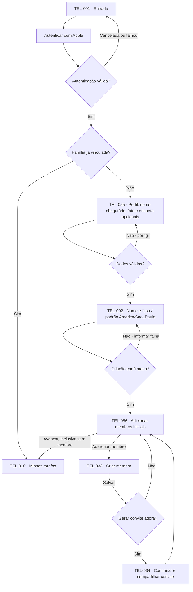

**Resultado:** família acessível ao Criador, com perfil Administrador e identificação protegida. O rascunho de perfil não existe antes da criação; a foto é opcional e pode ser enviada depois que a sessão for aberta, sem impedir a entrada. Retorno a uma família existente não cria outra. Cancelar antes da criação encerra o onboarding sem salvar; depois da criação, a pessoa pode avançar de TEL-056 sem adicionar membro.

## UF-02 — Convidar e ingressar

**Objetivo:** criar o perfil e permitir um único ingresso pelo convite correspondente.  
**Entrada:** Administrador acessa Família diretamente pela navegação principal.  
**Referências:** [UC02](../03-casos-de-uso.md#uc02), [UC09](../03-casos-de-uso.md#uc09); RN09, RN45–47; RF40–46, RF54, RF68.

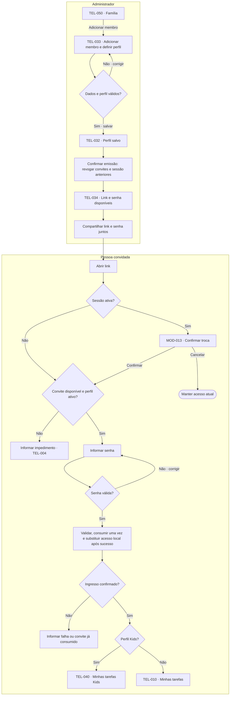

**Exceções e retornos:** falha ao salvar perfil permanece em TEL-033; falha ao gerar convite retorna à ação em TEL-032 sem exibir credenciais fictícias. Perfil já salvo não é recriado para tentar gerar o convite novamente. Cancelar o compartilhamento mantém o perfil criado. Senha incorreta não consome o convite; controles de tentativas abusivas continuam aplicáveis. Convite consumido não permite outro ingresso; recuperação segue UF-03. Falha de rede no ingresso exige conferir o estado corrente antes de repetir.

**Resultado:** acesso ao perfil correto em sessão única e convite consumido uma vez. Troca não remove o perfil da família anterior nem migra histórico. Sem app, direcionar à loja e reabrir convite depois de instalar. Resposta perdida no ingresso tem recuperação específica comprovada por dez minutos; depois exige novo convite. Compartilhar o convite, sozinho, não significa que o convidado ingressou.

## UF-03 — Recuperar acesso ao mesmo perfil

**Objetivo:** retornar sem duplicar membro, tarefas ou histórico.  
**Entrada:** perda real da sessão; uma sessão renovável permanece no aplicativo.  
**Referências:** [UC02](../03-casos-de-uso.md#uc02), [UC04](../03-casos-de-uso.md#uc04), [UC09](../03-casos-de-uso.md#uc09); RN47; RF41, RF46, RF54; RNF22.

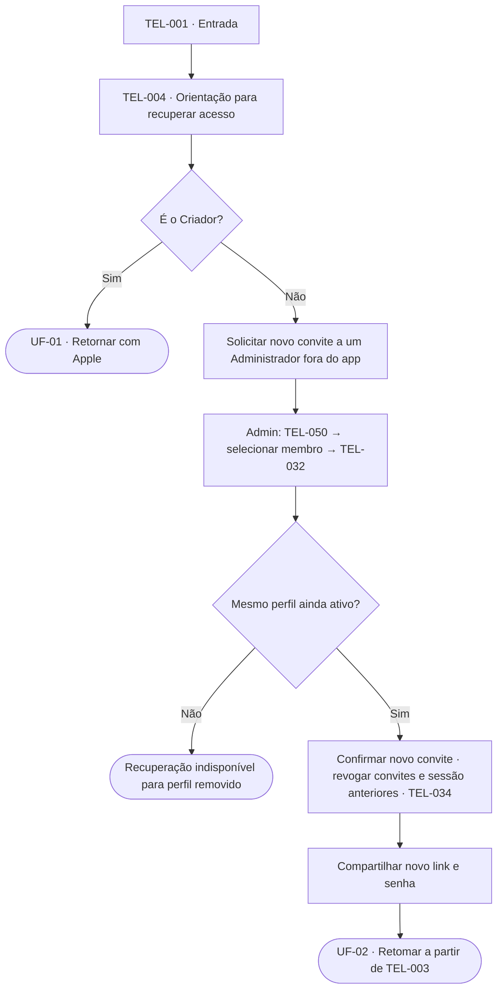

**Resultado:** ingresso com um novo convite de uso único recupera o perfil existente e seus vínculos. Não há mensagem automática ao Administrador, formulário de pedido de recuperação ou senha permanente. Sem novo convite, o usuário permanece fora da área protegida; não se cria um perfil substituto como parte da recuperação.

## UF-04 — Consultar tarefas e progresso pessoal diário ou familiar Dia/Semana

**Objetivo:** consultar o período pessoal ou o período da família e abrir uma tarefa permitida.  
**Entrada:** Minhas tarefas ou Família, escolhidas independentemente.  
**Referências:** [UC11](../03-casos-de-uso.md#uc11); RN26, RN49, RN60–61; RF11, RF17, RF22, RF49, RF60, RF66.

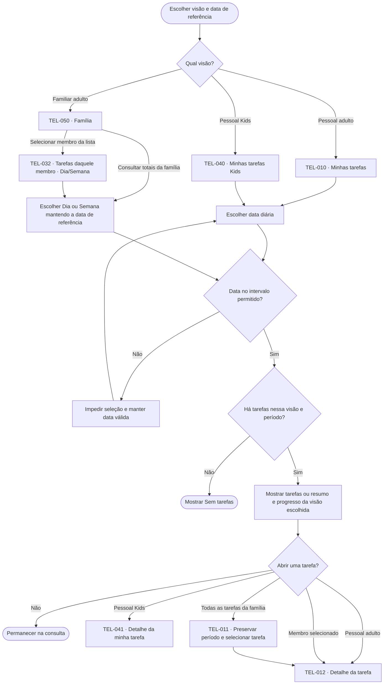

Em Minhas tarefas, todos os perfis consultam somente o dia de referência e seu progresso diário. Dia/Semana mantém a data de referência nas superfícies familiares adultas. A semana vai de segunda a domingo; semanas de borda indicam os dias disponíveis. Progresso semanal familiar usa concluídas/total da semana, não a média dos percentuais diários. O intervalo vai da criação da família ao último dia do mês corrente, incluindo dias futuros desse mês. Na visão familiar, cada tarefa prevista no período conta uma vez no total e, se concluída, uma vez no numerador; peso e quantidade de responsáveis não multiplicam o progresso. Tarefas sem responsável entram no total. Aguardando confirmação não conta como concluída.

TEL-032 mantém o membro selecionado ao alternar Dia/Semana e abre TEL-012 para uma tarefa. Herdar o período da Família não liga os seletores: voltar restaura a seleção anterior de TEL-050. Membro sem tarefas mostra estado vazio; falha de consulta não é apresentada como ausência de tarefas. A carga não integra TEL-050 nesta entrega e fica para SPEC-018. Ações administrativas no detalhe seguem UF-12.

**Continuação:** adultos podem seguir UF-05, UF-06 ou UF-08 a partir das telas permitidas; Kids seguem UF-07 somente para tarefa própria pendente. Voltar do detalhe restaura a origem, que pode ser uma lista pessoal, familiar ou missão. Consultar outra data não altera tarefas. Ao abrir o checklist em um novo dia, o padrão volta a ser o dia atual.

## UF-05 — Criar ou editar tarefa e rotina

**Objetivo:** salvar tarefa única ou rotina com esforço e responsáveis opcionais.  
**Entrada:** TEL-010/TEL-011 para criar; TEL-012 para editar. Adultos apenas.  
**Referências:** [UC07](../03-casos-de-uso.md#uc07), [UC08](../03-casos-de-uso.md#uc08); RF07–10, RF13–16, RF58, RF69, RF70.

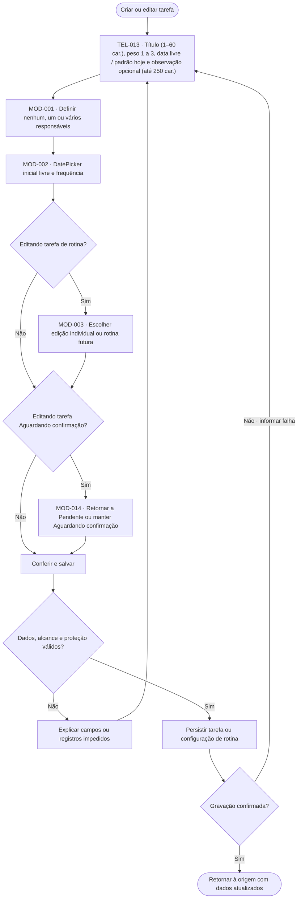

Responsáveis e repetição são escolhas do formulário; não é obrigatório abrir os seletores quando a configuração desejada já estiver definida. Repetição oferece sem repetição, diária ou a cada 7, 14, 21 ou 28 dias. Não há mensal nem data final obrigatória. Datas de cadastro/início são livres, inclusive antes da criação da família e em meses futuros. Backend mantém geração até fim do mês seguinte, com reposição diária e complemento em consulta. Cada ocorrência possui estado próprio; escolher uma tarefa não altera automaticamente outras ocorrências.

**Proteções:** edição individual afeta somente a selecionada; alteração de rotina no alcance “selecionada e futuras” inclui a ocorrência aberta e alcança somente futuras elegíveis, preservando passado e conquistas concluídas. O limite de consulta do carrossel não interrompe a geração futura. Concluída não protegida pode ser editada individualmente: peso/responsáveis ajustam crédito, data prevista ajusta progresso, sem mudar instante de conclusão ou destaque já finalizado; manter auditoria. Sem responsáveis, não há crédito individual. Última edição válida persistida vence. Cancelar antes de salvar não grava as mudanças e retorna à lista ou ao detalhe de origem. Editar tarefa Aguardando confirmação exige MOD-014 antes de salvar, mesmo que só a observação tenha mudado: retornar a Pendente descarta a sinalização corrente da criança, e manter Aguardando confirmação preserva a sinalização para decisão com os dados atualizados (RN66, RF69).

## UF-06 — Concluir tarefa mantendo ou assumindo responsáveis

**Objetivo:** concluir a tarefa inteira diretamente, com crédito previsível.
**Entrada:** TEL-012, tarefa Pendente ou Aguardando confirmação; Administrador ou Membro apenas quando não houver responsável Kids.
**Referências:** [UC12](../03-casos-de-uso.md#uc12); RN48, RN55–56; RF12, RF47, RF56.

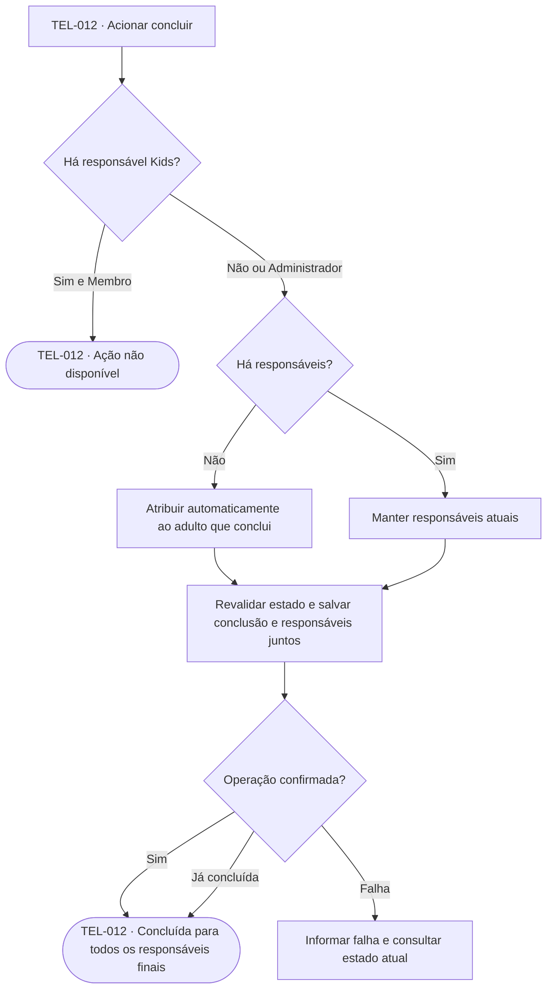

Concluir não exibe alerta. Cada responsável final recebe o peso integral; quem apenas executou a ação não recebe crédito se não for responsável. A tarefa conta uma vez no progresso de cada missão e no progresso coletivo diário ou semanal. Tarefa com responsável Kids só é concluída manualmente por Administrador; a pendência e foto são preservadas para auditoria administrativa. Se outra conclusão já foi confirmada, a interface atualiza silenciosamente para Concluída. Outras ocorrências da rotina não mudam.

## UF-07 — Sinalizar e validar tarefa Kids

**Objetivo:** a criança informa a realização e um Administrador decide sobre a tarefa.  
**Entrada:** Kids em TEL-040; Administrador acessa Família independentemente.  
**Referências:** [UC15](../03-casos-de-uso.md#uc15), [UC03](../03-casos-de-uso.md#uc03); RN22–26, RN54–55; RF23–26, RF55–56.

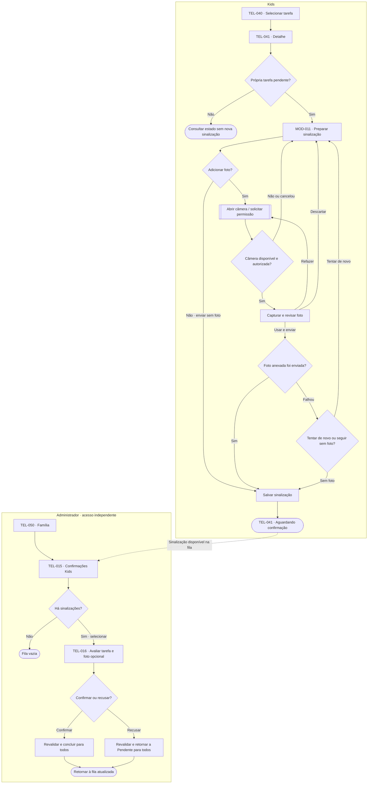

Permissão negada ou câmera indisponível exibe orientação e permite continuar sem foto; não abre galeria automaticamente. Revisar captura não envia a sinalização por si só.

A seta tracejada liga os registros entre os dois usuários; não representa navegação da criança para a área administrativa. Sinalização e decisão só mudam a tela após gravação confirmada. Cancelar MOD-011 mantém a tarefa como estava. Voltar de TEL-016 sem decidir mantém a sinalização na fila.

**Resultados:** sinalizar não credita peso nem progresso parcial. A ausência de foto não impede sinalizar ou confirmar. Recusar volta a Pendente; a criança pode sinalizar novamente. Confirmar conclui para todos. Se outro adulto já concluiu manualmente por UF-06, atualizar o estado e impedir nova decisão. Não há conclusão parcial por responsável nem nova sinalização enquanto aguarda confirmação.

## UF-08 — Reabrir e excluir tarefa

**Objetivo:** aplicar a alteração permitida sem corromper conquistas ou descontar carga duas vezes.  
**Entrada:** TEL-012. Reabertura por Administrador/Membro em tarefa acessível e por Kids em tarefa própria; exclusão por Administrador ou Membro.
**Referências:** [UC17](../03-casos-de-uso.md#uc17), [UC07](../03-casos-de-uso.md#uc07); RN50, RN57–59, RN66; RF09, RF57–59, RF69.

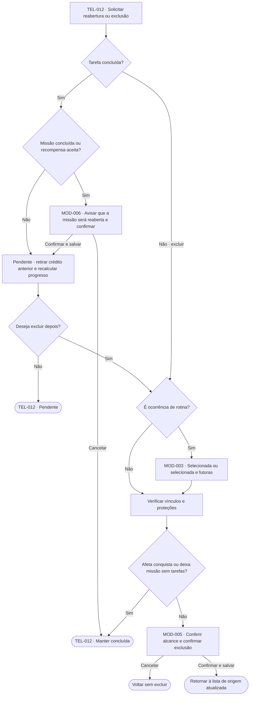

Não existe exclusão direta de tarefa concluída. Reabrir uma tarefa vinculada a missão concluída e/ou com recompensa aceita exige MOD-006: confirmar retorna a missão para Em andamento e remove recompensa, participações e badges derivados, sem histórico. Em exclusão de rotina, preservar ocorrências concluídas e informar os registros que não podem ser excluídos. A última tarefa de uma missão exige vincular outra antes de tentar excluí-la. Não se contorna a proteção de missão concluída pela mudança de alcance. Excluir uma tarefa Aguardando confirmação remove a sinalização corrente da criança junto com a tarefa, sem pedir confirmação adicional sobre a sinalização (RN66).

A reabertura é uma operação independente: retira o crédito do dia e da semana da conclusão anterior para todos os responsáveis, mantém responsáveis e atualiza progresso. Se a exclusão posterior falhar ou for cancelada, a reabertura já salva permanece. A exclusão não desconta o peso novamente. Cada gravação segue as condições comuns de falha e concorrência.

## UF-09 — Consultar carga diária ou semanal

**Objetivo:** entender a distribuição da participação creditada no período.  
**Entrada:** Família, por Administrador ou Membro.  
**Referências:** [UC13](../03-casos-de-uso.md#uc13); RN28, RN30–34, RN61; RF18–21, RF56–57, RF66.

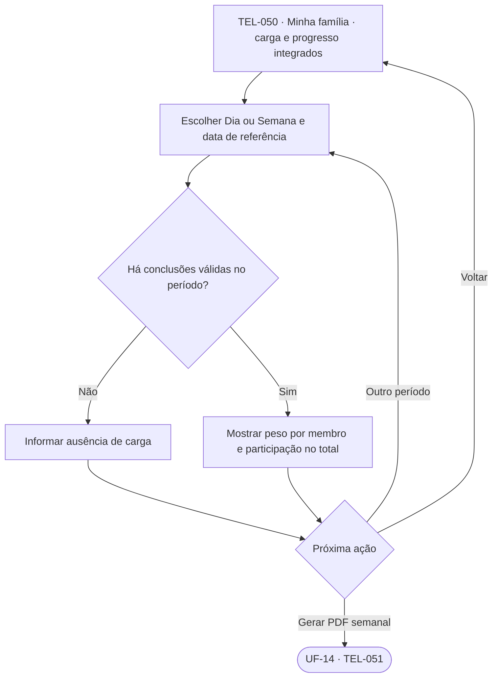

Cada responsável recebe o peso integral; o total soma cargas individuais. Pendentes e Aguardando confirmação não entram. Reaberturas ajustam o dia e a semana originais. Crédito histórico de perfil removido aparece como “Membro removido”, sem dado pessoal. Sem carga, não dividir por zero. A semana vai de segunda a domingo; a consulta ocorre na própria TEL-050 e mantém a referência selecionada. Kids não acessam esta tela. O destaque semanal é consultado separadamente em UF-15.

## UF-10 — Criar, editar e acompanhar missão

**Objetivo:** organizar uma conquista coletiva sem prazo e acompanhar seu progresso.  
**Entrada:** Missões e conquistas, diretamente na navegação adulta; Kids diretamente na aba Missões e conquistas.  
**Referências:** [UC05](../03-casos-de-uso.md#uc05), [UC14](../03-casos-de-uso.md#uc14); RN35–40, RN50–51, RN58; RF28–32, RF36, RF50, RF58.

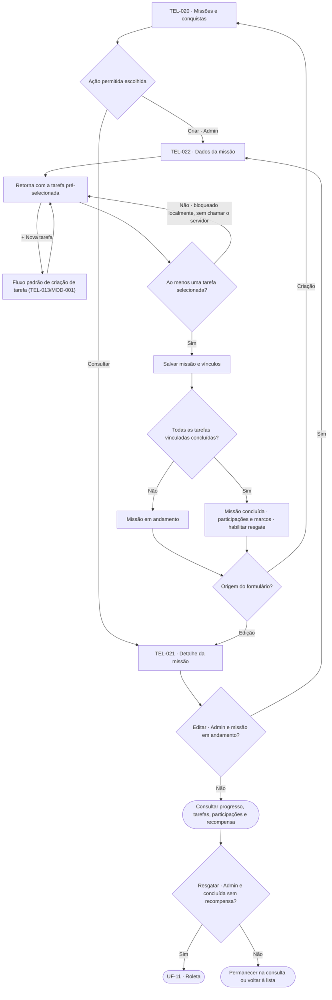

Salvar retorna à origem que abriu o formulário: à lista em criação e ao detalhe em edição. Missão encerrada conta uma vez para cada responsável creditado em uma ou mais tarefas vinculadas; marcos 5/10/25/50 concedem badges cumulativos. Sem missões, TEL-020 mostra o estado vazio; somente Administradores têm ação de criação. Sem tarefas disponíveis, o Administrador cria uma tarefa diretamente em MOD-007 (atalho para UF-05) ou navega a UF-05 antes de salvar uma missão; o botão Salvar permanece desabilitado enquanto não houver ao menos uma tarefa selecionada, sem chamar o servidor nesse estado.

Cada tarefa vinculada conta uma vez, sem incluir a rotina inteira implicitamente. Remover vínculos de missão em andamento pode concluí-la se todas as restantes estiverem concluídas; desmarcar a última tarefa restante sem substituição é bloqueado no próprio MOD-007, com mensagem explicando que uma missão precisa de ao menos uma tarefa. Progresso também é recalculado por conclusões e reaberturas autorizadas fora deste fluxo. Missão concluída não aceita edição; a única exceção é a reabertura confirmada de tarefa vinculada, que remove os dados derivados do encerramento. Não existe expiração por tempo.

**Consulta de tarefas:** adultos podem abrir TEL-012 a partir do detalhe da missão. Kids podem abrir TEL-041 somente para tarefas próprias; acompanhar as demais tarefas da missão não concede ações operacionais. Kids consultam título, observação, tarefas vinculadas, status e recompensa aceita em TEL-020/021 numa apresentação simplificada, sem ações de gestão, participações ou resgate. Voltar retorna a TEL-021.

## UF-11 — Cadastrar item e resgatar recompensa

**Objetivo:** manter opções coletivas e aceitar uma única recompensa por missão.  
**Entrada:** TEL-020 para itens; TEL-021 para resgatar. Administrador apenas.  
**Referências:** [UC06](../03-casos-de-uso.md#uc06), [UC16](../03-casos-de-uso.md#uc16); RN41–43, RN52–53; RF33–35, RF51–53.

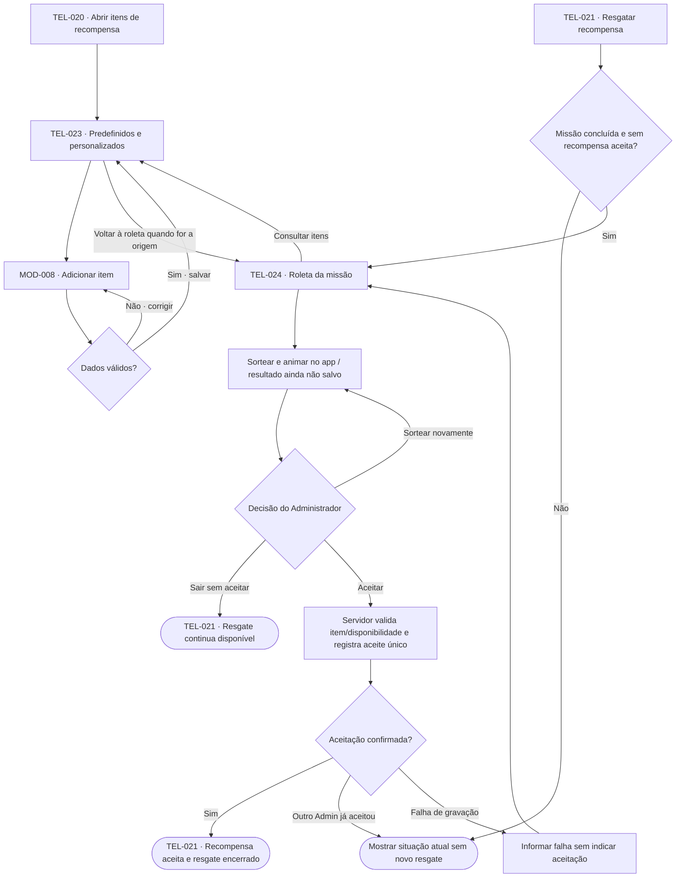

Cadastrar um item é opcional e independente: a roleta já dispõe dos itens predefinidos. No MOD-008, o título é obrigatório, sem caracteres de controle, tem até 60 caracteres não-espaço após `trim` e deve ser único na família sem distinguir maiúsculas/minúsculas; a descrição é opcional e tem até 255 caracteres contando espaços. Salvar um item o inclui em próximos sorteios, sem vinculá-lo a missão. Cancelar MOD-008 volta a TEL-023 sem adicionar. A origem de TEL-023 determina o retorno: lista de missões ou roleta.

**Resultado:** aceitação salva encerra o resgate para toda a família e acrescenta a recompensa à conquista sem alterar suas tarefas, progresso ou participações. Consultar itens, sortear ou sair sem aceitar não consome o resgate. Após falha ou concorrência, consultar a situação corrente antes de tentar aceitar novamente.

## UF-12 — Gerenciar membros e permissões

**Objetivo:** ajustar perfil, modo Kids e papel, ou remover membro com efeitos claros.  
**Entrada:** selecionar um item da lista de membros na própria Família → Detalhe do membro; Administrador para gestão.  
**Referências:** [UC02](../03-casos-de-uso.md#uc02); RN01–10; RF02–06, RF40–41.

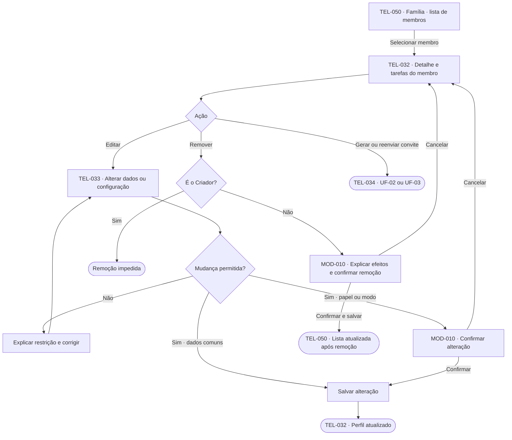

Administradores e Membros podem consultar as tarefas em TEL-032; somente Administradores acessam ações de gestão quando permitidas. Reenviar abre TEL-034 para confirmar emissão de novo link e senha, invalidando convites anteriores e revogando a sessão anterior do mesmo perfil. Cancelar volta ao detalhe preservando membro/período; falha não cria membro duplicado. O Criador recupera acesso por Apple.

**Restrições:** o Criador não pode ser removido, rebaixado nem sair. Um Administrador não pode permanecer em modo Kids; Kids devem sair desse modo antes da promoção. Alterações obedecem à permissão corrente de quem executa.

A remoção revoga também sessões e renovação de acesso, retira somente o removido das tarefas futuras não concluídas/não protegidas e preserva histórico concluído. Falha não deve apresentar o membro como removido. Um Administrador que não é Criador também pode deixar seu próprio papel por TEL-030 → MOD-010; após salvar, seus acessos passam a seguir o papel atual. Não é um fluxo de saída da família.

## UF-13 — Editar o próprio perfil

**Objetivo:** alterar os dados pessoais permitidos, sem modificar permissões.  
**Entrada:** Meu perfil na navegação adulta ou pelo avatar/cabeçalho Kids; todos os perfis.  
**Referências:** [UC10](../03-casos-de-uso.md#uc10); RF48, RF62, RF65; RN63–64.

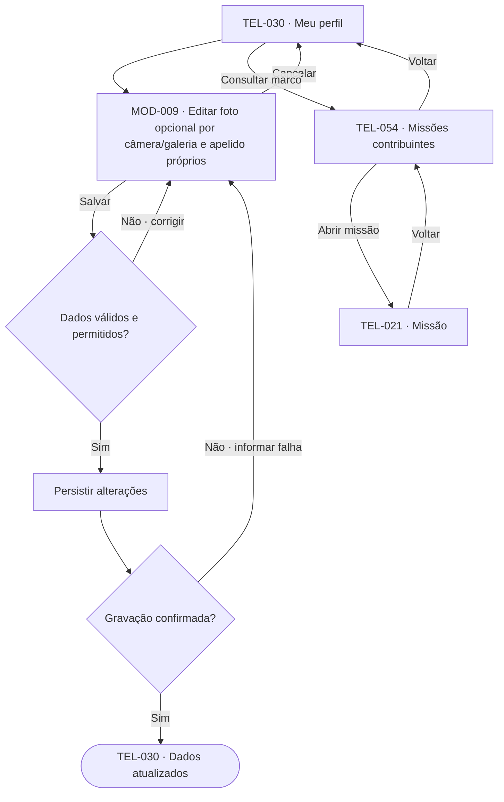

O formulário permite adicionar/substituir/remover foto opcional e configurar etiqueta/apelido. Só o titular acessa a configuração de apelido, inclusive para Kids; a gestão administrativa de UF-12 não concede esse acesso. Cancelar ou falhar mantém os dados salvos anteriores. Foto ausente usa identificação padrão. Meu perfil também lista badges por participação e abre TEL-054 com as missões contribuintes, de onde se acessa TEL-021; sem badges, mostra total de participações e próximo marco. Não altera papel, família ou modo Kids. O apelido é visível à família; badges seguem os marcos cumulativos de RN64, sem concessão retroativa.

## UF-14 — Gerar relatório semanal em PDF

**Objetivo:** obter a visão semanal da família em arquivo.  
**Entrada:** botão Gerar relatório PDF na própria Minha família (TEL-050), por adulto.  
**Referências:** [UC18](../03-casos-de-uso.md#uc18); RN62; RF61; RNF26–27.

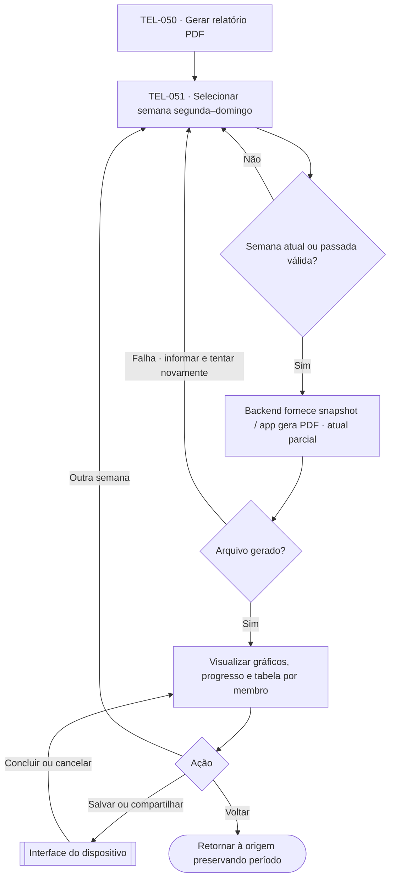

O PDF contém gráficos de carga semanal e progresso total da família e, por membro, peso creditado e número de tarefas realizadas. Identifica período, geração e métricas de RN62; compartilhadas não duplicam o total familiar de tarefas. Ausência de dados permite PDF com indicação apropriada. Falha de geração não disponibiliza arquivo incompleto. Abrir compartilhamento não comprova envio. Kids não têm acesso.

## UF-15 — Receber e compartilhar destaque semanal

**Objetivo:** reconhecer o primeiro lugar em pontos e incentivar uma atividade em família.  
**Entrada:** apuração automática na segunda-feira; consulta pela notificação ou destaque em Minhas tarefas.  
**Referências:** [UC19](../03-casos-de-uso.md#uc19); RN65; RF63–64; RNF26–27.

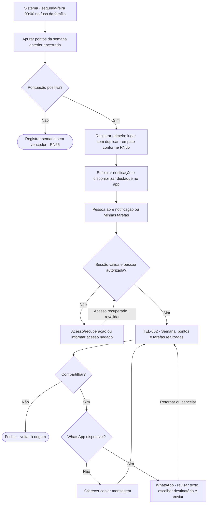

Texto do convite: “Mande para sua família e sugira algo para vocês fazerem juntos.” Sugestão editável: “Fiquei em primeiro em pontos nas tarefas desta semana! Que tal fazermos algo juntos para celebrar? Minha sugestão é: ____.” Em empate, adaptar para “Fiquei entre os primeiros…”. Nada é enviado automaticamente. Sem notificação externa, o resultado continua disponível no app. Kids reconhecidos usam a mesma tela em variante adequada, sem acesso à carga familiar. Falha de apuração exige retentativa idempotente, sem publicar resultado parcial. Empate reconhece todos os primeiros colocados; todos os perfis ativos são elegíveis e sem pontos positivos não há vencedor; a apuração ocorre às 00:00 de segunda-feira no fuso vigente; resultados finalizados permanecem preservados após correções.

## UF-16 — Configurar fuso da família

**Objetivo:** alterar o calendário comum com efeito imediato ou no próximo ciclo.\
**Entrada:** Família → Configurações da família (TEL-053), somente Administrador.\
**Referências:** [UC01](../03-casos-de-uso.md#uc01); RF67; RN28/RN65.

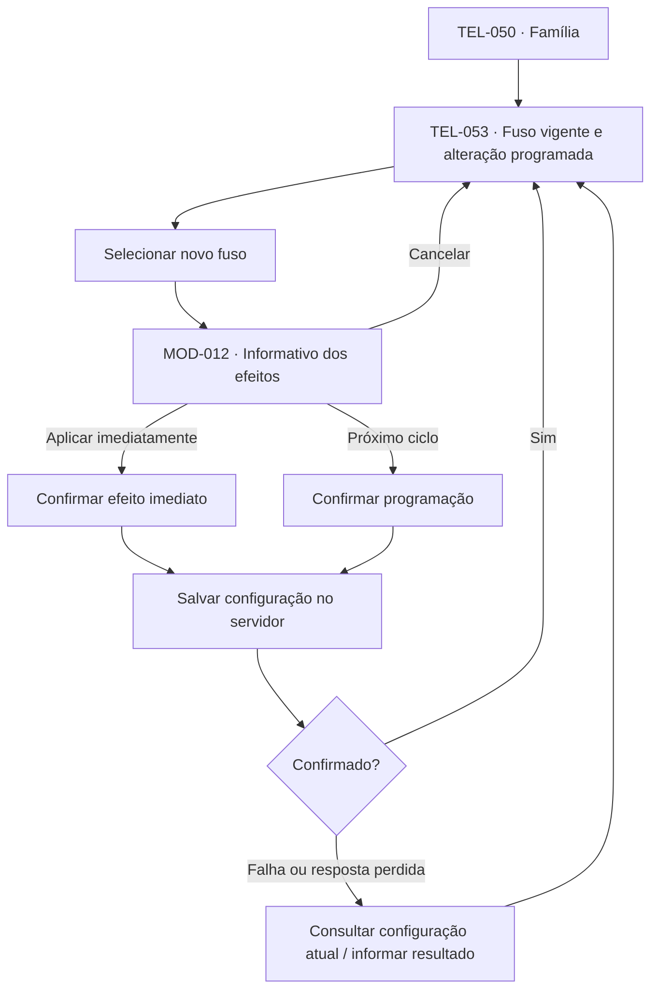

Padrão inicial é `America/Sao_Paulo`, selecionável em TEL-002. Mudança imediata afeta limites do ciclo aberto; programada mantém o atual até encerrar. Mostrar data de vigência, fuso e identificação de período de transição, sem deslocar datas civis das tarefas. Apurações finalizadas não mudam; ciclos não podem sobrepor-se ou deixar lacunas. Falha não é mostrada como alteração salva.

## Critérios de revisão

- Cada fluxo pode ser percorrido desde sua entrada até resultado, cancelamento ou impedimento explicado.
- Operações administrativas respeitam perfil, estado atual e proteção do Criador e das conquistas.
- As quatro telas principais adultas são entradas independentes; Minhas tarefas continua como inicial.
- Fluxos Kids não concedem carga, relatório familiar, gestão ou conclusão direta. Perfil próprio e reconhecimento recebido são permitidos.
- Toda alteração só é apresentada como concluída após confirmação da gravação.
- TEL/MOD preservam o screen map 1.10; UF-01–UF-16 cobrem UC01–UC19, incluindo TEL-051/052/053/054/055/056 e MOD-012/013.

## Histórico

| Versão dos fluxos | Base funcional | Screen map | Data | Alteração |
|---|---|---|---|---|
| 1.11 | 1.16 | 1.11 | 2026-10-10 | UF-09 integra carga Dia/Semana e preserva crédito histórico de removido sem ranking. Para SPEC-018. |
| 1.10 | 1.15 | 1.10 | 2026-10-10 | UF-10 alinha Kids a RF36: recompensa aceita é consultável; participações e resgate seguem indisponíveis. Para SPEC-016. |
| 1.9 | 1.15 | 1.9 | 2026-10-10 | UF-11 detalha título, descrição, limites e unicidade do item personalizado. Para SPEC-015. |
| 1.8 | 1.14 | 1.8 | 2026-10-07 | UF-01 passa a configurar o perfil do Criador, criar a família e permitir zero ou mais membros com convite explícito antes da área principal. |
| 1.7 | 1.12 | 1.7 | 2026-10-07 | UF-10 ganha atalho "+ Nova tarefa" em MOD-007, bloqueio local de salvar sem tarefas e consulta explícita por todos os perfis, inclusive Kids. Para SPEC-014. |
| 1.6 | 1.11 | 1.6 | 2026-10-07 | UF-06 conclui diretamente sem modal; UF-08 permite reabrir missão concluída com confirmação e reversão de recompensa, participações e badges. |
| 1.5 | 1.10 | 1.5 | 2026-10-06 | UF-06 restringe conclusão manual de tarefa com responsável Kids ao Administrador e reconcilia silenciosamente conclusão concorrente. Para SPEC-010. |
| 1.4 | 1.9 | 1.4 | 2026-10-06 | UF-04 distingue consulta própria diária da familiar adulta por Dia/Semana e adia carga para SPEC-018. Para SPEC-009. |
| 1.3 | 1.8 | 1.3 | 2026-10-06 | UF-05 explicita que rotina não exige data final e que o alcance “selecionada e futuras” inclui a ocorrência aberta. Para SPEC-008. |
| 1.2 | 1.7 | 1.2 | 2026-10-06 | UF-05 ganha o ramo MOD-014 (resolver sinalização pendente ao editar) e o campo de observação; UF-08 registra a remoção da sinalização ao excluir. Para SPEC-007. |
| 1.1 | 1.5 | 1.1 | 2026-10-05 | 16 fluxos; UF-16 configura fuso; demais fluxos incorporam decisões de acesso, datas, badges, PDF e sorteio local. |
| 1.0 | 1.4 | 1.0 | 2026-10-02 | UF-02/03/04/09/12/14 alinhados à lista integrada em Família e ao detalhe com tarefas do membro; mantido Dia/Semana. |
| 1.0 | 1.3 | 1.0 | 2026-10-02 | Revisão dos fluxos Kids, câmera, perfil, períodos e badges; novos UF-14/15 para PDF e destaque semanal. |
| 1.0 | 1.2 | 1.0 | 2026-10-01 | Primeira elaboração: 13 fluxos com Mermaid, decisões, alternativas, retornos e cobertura dos 17 casos de uso. |
