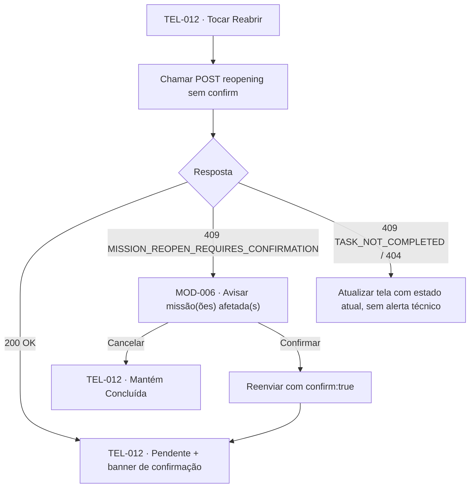

# UX Spec 011: Reabrir tarefa

**Status:** aprovada
**Autor:** Claude | **Criada em:** 2026-10-07 | **Aprovada por:** Pessoa usuária | **Em:** 2026-10-07
**Spec funcional vinculada:** [SPEC-011-reabrir-tarefa.md](SPEC-011-reabrir-tarefa.md)
**Base funcional:** 1.13
**Superfícies:** TEL-012, MOD-006, UF-08

## 1. Jornada

A pessoa abre o detalhe de uma tarefa concluída (TEL-012) e toca em "Reabrir". Se a tarefa não tiver conquista em jogo, o app aplica direto e mostra o resultado. Se reabrir desfizer uma missão concluída (e, no futuro, uma recompensa aceita), o app avisa antes de agir — porque essa reversão não guarda histórico.

| Origem | Ação | Destino | Retorno |
|---|---|---|---|
| TEL-012 (tarefa concluída) | Admin/Membro/Kids (próprio) toca Reabrir | TEL-012 pendente | Banner confirmando a reabertura e a retirada do crédito |
| TEL-012 (impacto de missão) | Toca Reabrir | MOD-006 | Confirmar reabre e aplica; Cancelar mantém concluída |

## 2. Superfícies e estados

### TEL-012 — ação Reabrir
- Visível somente quando a tarefa está `completed` e o perfil tem acesso: Admin/Membro sempre; Kids somente quando é um dos responsáveis. Ação oculta nos demais casos (não apenas desabilitada).
- **Enviando:** desabilita o botão Reabrir e impede toque duplicado.
- **Sucesso sem impacto:** fecha qualquer modal, atualiza para "Pendente" e mostra banner não bloqueante: "Tarefa voltou para Pendente. O crédito de hoje foi retirado."
- **Conflito (`TASK_NOT_COMPLETED`/`RESOURCE_NOT_FOUND`):** atualiza a tela para o estado atual, sem mensagem de erro técnico — mesmo padrão de reconciliação silenciosa do UX-010.
- **Falha não reconciliada:** mantém a tarefa como estava e oferece "Tentar novamente" após consultar o estado.

### MOD-006 — Confirmar reabertura com impacto de missão
- Exibida somente quando a resposta do servidor for `409 MISSION_REOPEN_REQUIRES_CONFIRMATION`.
- Lista a(s) missão(ões) afetadas pelo título e avisa que participações e badges derivados dela(s) serão removidos sem histórico; menciona recompensa apenas quando `hasAcceptedReward` vier `true`.
- Para Kids, usa linguagem simplificada e não cita "recompensa" quando não houver (RNF04) — ex.: "Essa tarefa faz parte da missão 'Arrumar o quintal', que já tinha terminado. Se você continuar, a missão volta a ficar em andamento."
- **Confirmar e salvar:** desabilita os botões, reenvia com `confirm: true`, fecha ao receber `200 OK`.
- **Cancelar:** fecha sem chamar o servidor; TEL-012 permanece "Concluída".

## 3. Microcopy e i18n

| Chave | Texto-base (adulto) | Cenário |
|---|---|---|
| `task.reopen.button` | "Reabrir" | Ação em TEL-012, tarefa concluída |
| `task.reopen.pending` | "Reabrindo tarefa…" | Enviando |
| `task.reopen.success_banner` | "Tarefa voltou para Pendente. O crédito de hoje foi retirado." | Sucesso sem impacto de missão |
| `task.reopen.mission_warning_title` | "Reabrir vai afetar uma missão concluída" | Título do MOD-006 |
| `task.reopen.mission_warning_body` | "A missão \"{{missionTitle}}\" volta a ficar em andamento. Participações e badges conquistados por ela serão removidos e não podem ser recuperados." | Corpo do MOD-006, uma linha por missão |
| `task.reopen.mission_warning_reward` | "A recompensa aceita por essa missão também será removida." | Acrescentada quando `hasAcceptedReward` é `true` |
| `task.reopen.confirm_button` | "Reabrir mesmo assim" | Confirmar em MOD-006 |
| `task.reopen.cancel_button` | "Manter concluída" | Cancelar em MOD-006 |
| `task.reopen.mission_warning_title_kids` | "Essa tarefa faz parte de uma missão que já terminou" | Título do MOD-006 para Kids |
| `task.reopen.mission_warning_body_kids` | "Se você continuar, a missão \"{{missionTitle}}\" volta a ficar em andamento." | Corpo do MOD-006 para Kids |

*Regra de ouro:* nenhuma mensagem culpa a criança ou o adulto pela reabertura; o foco é explicar o efeito, não quem errou.

## 4. Acessibilidade

- Botão "Reabrir": rótulo "Reabrir tarefa, botão"; dica "Dê dois toques para devolver esta tarefa a Pendente".
- MOD-006: título lido como `.header`; foco inicial no texto de aviso, depois nos botões; botão de confirmação com traço `.destructive` (mesmo padrão de MOD-005, exclusão).
- Toda informação de impacto (missão afetada, recompensa) é texto, nunca cor isolada (RNF05).
- Área de toque mínima de 44×44pt; 56×56pt nos botões do MOD-006 quando acessado pelo perfil Kids.
- iPad: MOD-006 como Form Sheet centralizado (máx. 540pt), mesma convenção de MOD-005.

## 5. Critérios UX

- Reabertura sem impacto de missão nunca abre modal — aplica direto, com retorno em banner (espelha UX-010/UC12).
- MOD-006 só aparece quando o servidor responde `409 MISSION_REOPEN_REQUIRES_CONFIRMATION`; o mobile não pré-calcula esse impacto (E-01 da SPEC-011).
- Kids não veem a ação Reabrir em tarefa que não é sua, mesmo quando compartilhada com um adulto.
- `TASK_NOT_COMPLETED`/`RESOURCE_NOT_FOUND` nunca aparecem como erro técnico — a tela apenas reflete o estado atual.
- Recompensa só é mencionada no aviso quando `hasAcceptedReward` for `true` (hoje sempre `false`, até SPEC-017 existir).

## 6. Checklist

- [x] Jornada, estados, microcopy e acessibilidade definidos.
- [x] Visibilidade por perfil (Admin/Membro/Kids próprio) refletida na ação Reabrir.
- [x] MOD-006 cobre missão concluída e recompensa aceita, com variante Kids.
- [x] Status `aprovada` autorizado pela pessoa usuária em 2026-10-07.
